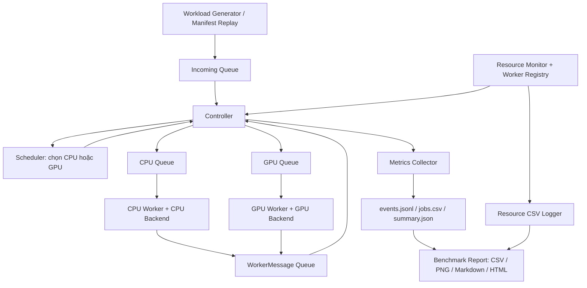
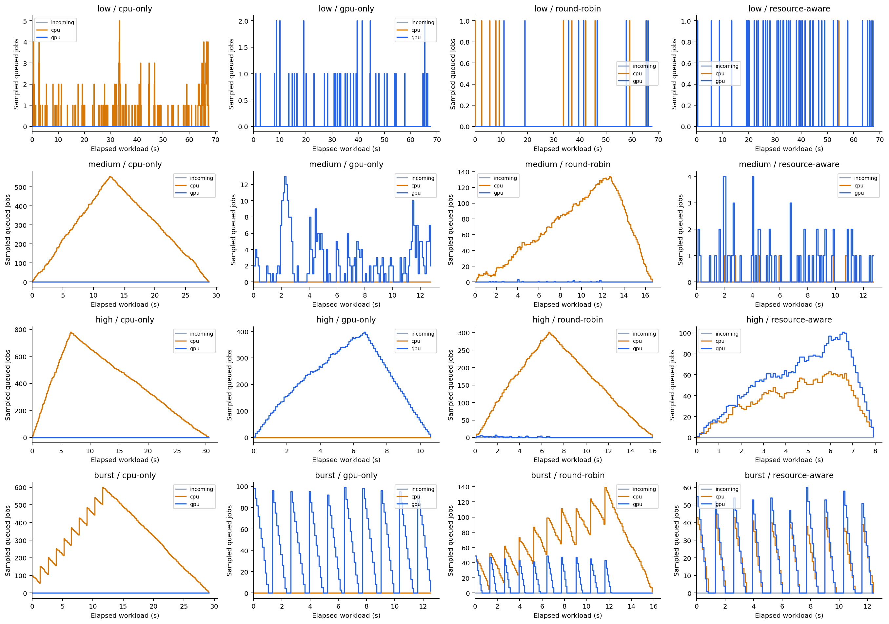

# BÁO CÁO GIỮA KỲ

## Thiết kế và xây dựng hệ thống điều phối tác vụ suy luận AI giữa CPU và GPU cho Edge AI

**Ngày báo cáo:** 01/11/2026

**Lĩnh vực:** Hệ điều hành — lập lịch và quản lý tài nguyên tính toán không đồng nhất.

**Phạm vi đánh giá:** mã nguồn, kiểm thử, báo cáo bàn giao và kết quả thực nghiệm có trong project đến ngày báo cáo.

## 1. Tóm tắt tình hình thực hiện

Dự án xây dựng một hệ thống tiếp nhận các yêu cầu suy luận AI, xếp hàng và lựa chọn CPU hoặc GPU để thực thi. Mục tiêu là đánh giá ảnh hưởng của chính sách điều phối đến thời gian phản hồi, thông lượng và mức sử dụng tài nguyên. Hai mô hình MobileNetV2 và ResNet-50 đóng vai trò tác vụ có chi phí khác nhau; phần nghiên cứu chính nằm ở bộ điều phối và cơ chế vận hành, thay vì huấn luyện mô hình.

Đến ngày 01/11/2026, hệ thống đã có pipeline chạy ONNX thực tế, bốn chính sách CPU-only, GPU-only, Round Robin và Resource-aware; có bộ tạo/phát lại workload, giám sát tài nguyên, thu thập sự kiện, profiling và sinh báo cáo. Đợt benchmark mới nhất thực hiện đủ **48 lượt = 4 chính sách × 4 mức tải × 3 lần lặp**, mỗi lượt 1.000 job. Tổng cộng **48.000 job được tiếp nhận và hoàn tất; không có job thất bại hoặc chưa kết thúc**.

Trong điều kiện thử nghiệm, Resource-aware đem lại lợi ích rõ nhất ở tải cao: thông lượng trung bình đạt **125,79 job/giây**, so với **94,68 job/giây** của GPU-only; P95 latency giảm từ **3.759,50 ms** xuống **1.226,30 ms**. Phân tích ghép từng lần lặp cho mức tăng thông lượng trung bình **32,91%** và mức giảm P95 **67,41%**. Ở tải thấp, thông lượng hai chính sách gần như bằng nhau do bị giới hạn bởi tốc độ job đến.

Phần cần tiếp tục hoàn thiện là ràng buộc RAM/VRAM của Resource-aware, cách xử lý độ mới của snapshot, vận hành tải dài hạn và kiểm chứng với nhiều đầu vào, seed, tỷ lệ model hơn. Kết quả hiện tại xác nhận hiệu quả của **điều phối theo thời gian hoàn thành ước lượng trên cấu hình đã đo**, chưa đủ để kết luận đã có một bộ lập lịch thích nghi đầy đủ theo mọi tài nguyên hoặc hiệu quả trên mọi thiết bị Edge AI.

**Căn cứ cập nhật:** mã nền hiện tại ở commit `82ebc0c`, cùng các thay đổi đang có trong workspace, bao gồm phần T15/T16 chưa được commit tại thời điểm rà soát. Các báo cáo ngày 18–30/10 được dùng theo phạm vi lịch sử; tiến độ hiện tại được đối chiếu với mã và artifact ngày 01/11. Khi lập báo cáo này, đã đọc lại dữ liệu của 48 lượt và tính lại metrics từ CSV bằng hàm phân tích hiện có; kết quả khớp summary, không có lỗi validation. Không chạy lại inference hoặc toàn bộ suite trong lượt viết báo cáo.

## 2. Mô tả đề tài

### 2.1. Bài toán và lý do lựa chọn

Trong một hệ thống AI có cả CPU và GPU, mỗi yêu cầu suy luận có thể thực thi trên một trong hai thiết bị. GPU thường có lợi thế về khả năng tính toán, nhưng việc dồn tất cả yêu cầu lên GPU có thể tạo hàng đợi dài trong khi CPU chưa được tận dụng. Ngược lại, chia đều số job cho hai thiết bị cũng có thể gây nghẽn vì tốc độ CPU/GPU và chi phí của từng model khác nhau.

Thời gian người dùng chờ một kết quả bao gồm cả thời gian xếp hàng và thời gian thực thi. Vì vậy, thiết bị chạy một job nhanh nhất khi đứng riêng chưa chắc là lựa chọn giúp job đó hoặc toàn workload hoàn thành sớm nhất khi hệ thống đang có nhiều việc.

Đề tài đặt ra câu hỏi: **với một CPU worker và một GPU worker, nên đưa mỗi job vào thiết bị nào để giảm thời gian chờ và tăng khả năng xử lý toàn hệ thống?** Để trả lời, dự án triển khai nhiều chính sách, giữ cùng lịch job và đo kết quả trong các điều kiện tải khác nhau.

Edge AI là bối cảnh ứng dụng hướng tới vì tài nguyên tính toán và bộ nhớ có giới hạn. Thử nghiệm hiện được thực hiện trên PC/laptop chạy WSL2 với GPU NVIDIA; chưa triển khai và đo trên Jetson hoặc thiết bị edge chuyên dụng.

### 2.2. Mục tiêu thực hiện

1. Xây dựng luồng xử lý từ tạo job, tiếp nhận, điều phối, suy luận đến ghi kết quả.
2. Chạy hai pretrained ONNX models trên cả CPU và GPU với cùng tiền xử lý.
3. Quản lý job bằng ID duy nhất, trạng thái và các mốc thời gian nhất quán.
4. So sánh bốn chính sách điều phối trên cùng workload đã lưu.
5. Theo dõi latency, throughput, thời gian chờ, phân bố job, tài nguyên và chi phí điều phối.
6. Kiểm tra xử lý lỗi, đồng bộ và dừng hệ thống khi còn job chờ hoặc đang chạy.
7. Phân tích cả điều kiện phối hợp CPU/GPU có lợi và điều kiện lợi ích không đáng kể.

### 2.3. Phạm vi hiện tại

Hệ thống dùng giao diện terminal, batch size 1, hai model và tối thiểu một worker cho mỗi thiết bị. Các lượt chạy là workload hữu hạn, có log và đối soát sau khi kết thúc. Dự án không huấn luyện model mới, không tự viết CUDA kernel hay GPU driver. Priority/deadline-aware scheduling, dynamic batching, TensorRT và tối ưu năng lượng là hướng mở rộng; trường `priority` hiện chưa tham gia quyết định điều phối.

Nguồn xác định yêu cầu: [README.md](README.md), [PLAN.md](PLAN.md).

## 3. Thiết kế và cách tổ chức hệ thống

### 3.1. Kiến trúc tổng thể



Controller quản lý luồng công việc và trạng thái job. Scheduler chỉ trả về thiết bị; worker gọi backend tương ứng và gửi thông điệp bắt đầu/hoàn tất/thất bại về Controller. Monitor cung cấp thông tin quan sát; collector ghi sự kiện và tổng hợp chỉ số. Cách phân chia này giúp thay chính sách điều phối mà vẫn giữ cùng backend, workload và quy ước đo.

### 3.2. Các nhóm mã nguồn chính

| Nhóm | File/thư mục | Vai trò |
|---|---|---|
| Dữ liệu và hợp đồng | `src/edge_scheduler/core/` | Job, thiết bị, trạng thái, sự kiện và các protocol chung |
| Điều phối | `runtime/controller.py`, `queues.py`, `schedulers.py` | Tiếp nhận, xếp hàng, chọn thiết bị, chạy worker và đối soát |
| Tích hợp backend | `runtime/backend_adapter.py` | Công bố ready/running/unavailable vào WorkerRegistry |
| Suy luận | `inference/` | Registry model, tiền xử lý, CPU/CUDA backend, xác nhận trace và profiling |
| Giám sát | `monitoring/` | psutil/NVML probes, snapshot cache và ghi tài nguyên nền |
| Workload | `workload/` | Manifest có phiên bản/hash, tạo tải theo seed và phát lại theo lịch |
| Thống kê | `runtime/metrics_collector.py`, `run_results.py`, `live_display.py` | Sự kiện, công thức metrics, bảng terminal và summary |
| Chạy chương trình | `main.py`, `Makefile` | Ghép thành phần, xử lý tham số và quản lý vòng đời lượt chạy |
| Thực nghiệm | `benchmark.py`, `benchmark_report.py` | Calibration, ma trận benchmark, kiểm tra dữ liệu và báo cáo so sánh |
| Kiểm chứng | `tests/`, `scripts/`, `logs/` | Unit/integration tests, harness và bằng chứng từng lượt |

Các đường dẫn ở bảng được tính từ `src/edge_scheduler/`, trừ những đường dẫn đã ghi đầy đủ hoặc nằm tại root.

### 3.3. Job và vòng đời xử lý

Mỗi job lưu `job_id`, `model_id`, đường dẫn input, lịch đến dự kiến, thiết bị được gán, kết quả/lỗi và các timestamp. Luồng bình thường:

```text
CREATED → WAITING → SCHEDULED → RUNNING → COMPLETED
                     lỗi ở bước phù hợp → FAILED
```

Các điều kiện quan trọng gồm:

- ID không được tiếp nhận hai lần trong một lượt chạy.
- Một job không được dispatch hai lần hoặc ghi nhận hai kết quả cuối.
- Controller sở hữu việc cập nhật trạng thái sau dispatch; worker gửi `WorkerMessage`.
- Sau drain bình thường: `accepted = completed + failed`, số job chưa kết thúc bằng 0.
- Với job thành công: `arrival ≤ dispatch ≤ start ≤ finish`.

Các ràng buộc được kiểm soát qua Controller, JobQueues và collector; bản thân các hàm `Job.mark_*` không phải toàn bộ cơ chế bảo vệ. Đây là bảo đảm trong phạm vi process đang chạy và các kịch bản đã kiểm thử, chưa phải cơ chế phục hồi sau mất điện hoặc kill process.

### 3.4. Kiến thức Hệ điều hành được vận dụng

| Nội dung | Cách áp dụng trong project |
|---|---|
| Thread và thực thi đồng thời | CPU/GPU worker, sampler và writer hoạt động bằng các thread riêng |
| Producer–consumer | Bộ phát tải → Incoming Queue → device queue → worker; worker → message queue → Controller |
| Đồng bộ và vùng tới hạn | `Lock`, `RLock`, `Event`, queue an toàn luồng và một đầu mối cập nhật trạng thái |
| Lập lịch tài nguyên không đồng nhất | Phân phối tác vụ theo thiết bị và chi phí model–device |
| Quản lý bộ nhớ/tài nguyên | Tái sử dụng session, quan sát RSS/VRAM, đóng backend sau khi worker hoàn tất |
| I/O nền | Writer nhận dữ liệu qua queue để hạn chế ghi đĩa trực tiếp trên đường điều phối |
| Dừng có kiểm soát | Ngừng nhận job, drain việc đã nhận, join worker, đóng session và flush log |

Pipeline dùng **thread trong một process Python**, giao tiếp qua queue trong bộ nhớ. Benchmark và profiling tạo process mới cho từng lượt/trial để tách điều kiện chạy; điều này khác với việc pipeline đã triển khai các worker inference bằng nhiều process và IPC. ONNX Runtime còn có thread nội bộ, nên cấu hình ORT được giữ cố định khi so sánh.

## 4. Các mô hình và thuật toán sử dụng

### 4.1. Suy luận với MobileNetV2 và ResNet-50

Hai model ONNX là [MobileNetV2](models/mobilenetv2-12.onnx) và [ResNet-50](models/resnet50-v1-12.onnx), đều phục vụ phân loại ảnh với output `(1, 1000)`. Chúng tạo hai loại công việc có thời gian xử lý khác nhau để đánh giá scheduler khi workload trộn nhiều model.

Tiền xử lý dùng chung cho CPU/GPU:

```text
Đọc ảnh → RGB → resize giữ tỉ lệ, cạnh ngắn 256
        → center crop 224 × 224 → float32, chia 255
        → chuẩn hóa ImageNet → CHW → thêm batch
        → tensor (1, 3, 224, 224)
```

Backend CPU dùng `CPUExecutionProvider`; backend GPU dùng `CUDAExecutionProvider`. Session được nạp và warm-up trong `prepare()`, sau đó tái sử dụng. `infer()` gồm đọc ảnh, tiền xử lý, truyền dữ liệu khi cần, chạy ONNX đồng bộ và kiểm tra output. Output phải đúng shape/dtype và hữu hạn.

GPU được kiểm chứng bằng trace có toán tử tính toán Conv/Gemm/MatMul chạy trên CUDA, kết hợp kiểm tra output CPU/GPU. Việc chỉ thấy provider trong danh sách chưa đủ chứng minh GPU đã thực hiện phép tính. Một số node phụ có thể chạy trên CPU theo phân hoạch graph của ONNX Runtime; backend không âm thầm chuyển toàn bộ job sang CPU khi GPU lỗi.

### 4.2. CPU-only và GPU-only

- **CPU-only:** mọi job được gán vào CPU Queue.
- **GPU-only:** mọi job được gán vào GPU Queue.

Hai chính sách tạo mốc so sánh để đánh giá lợi ích khi phối hợp thiết bị. Logic chọn thiết bị là hằng số. Trong pipeline hiện tại, cả hai backend và cả hai model vẫn được prepare ở mọi policy; vì vậy CPU-only mô tả nơi thực thi job, chưa phải cấu hình triển khai chỉ có CPU hoặc không chiếm VRAM.

### 4.3. Round Robin

Round Robin luân phiên gán job vào CPU và GPU, mặc định bắt đầu ở CPU:

```text
Job 1 → CPU; Job 2 → GPU; Job 3 → CPU; Job 4 → GPU; ...
```

Mỗi quyết định đổi con trỏ thiết bị kế tiếp. Ưu điểm là đơn giản, dễ kiểm tra và chia đều số job nếu tổng số chẵn. Hạn chế là không xét model, lượng việc đang chờ hoặc chênh lệch tốc độ thiết bị. CPU có thể nhận một nửa số job nhưng cần nhiều thời gian hơn để xử lý phần việc đó.

Round Robin trong đề tài là **luân phiên phân tuyến job giữa thiết bị ở tầng ứng dụng**. Job đã chạy không bị ngắt theo time quantum; mỗi device queue được worker tiêu thụ theo FIFO. Do đó không đồng nhất chính sách này với Round Robin có ngắt của bộ lập lịch CPU trong kernel.

### 4.4. Resource-aware theo thời gian hoàn thành ước lượng

Đây là thuật toán trọng tâm, triển khai trong [schedulers.py](src/edge_scheduler/runtime/schedulers.py). Với job mới `j` và thiết bị `d`, scheduler tính thời gian dự kiến từ lúc ra quyết định đến khi job hoàn tất:

```text
ETA(d, j) = R(d) + Σ S(model(q), d) + S(model(j), d)
                   q ∈ Q(d)
```

Trong đó:

- `S(m, d)`: service time trung bình của model `m` trên thiết bị `d`, lấy từ profiling thực tế.
- `Q(d)`: các job còn nằm trong device queue; loại job đã được worker lấy ra.
- `R(d)`: thời gian còn lại ước lượng của job đang chạy.

Scheduler chọn thiết bị có ETA thấp hơn. Khi ETA bằng nhau, mặc định chọn CPU. Nếu snapshot còn hiệu lực cho biết worker unavailable, ETA thiết bị đó là vô hạn; nếu cả hai phía đều không có ETA hữu hạn, scheduler phát lỗi để Controller ghi nhận job thất bại có nguyên nhân.

Ước lượng phần việc đang chạy tuân theo ba trường hợp:

1. Nếu `estimated_remaining_known=True`, dùng `max(0, estimated_remaining_s)`.
2. Nếu chưa có remaining đã biết nhưng có thời điểm bắt đầu, dùng `max(0, S(model_đang_chạy, d) − elapsed)`.
3. Nếu biết model đang chạy nhưng không có thời điểm bắt đầu, dùng một service time đầy đủ của model đó.

Nếu thiết bị không có job đang chạy thì `R(d)=0`. Đây là ước lượng từ profile tĩnh; vượt thời gian trung bình có thể khiến remaining về 0 dù job chưa thực sự hoàn tất. Mã hiện chưa cập nhật service time bằng trung bình trượt trong lúc chạy.

Mã giả mô tả quyết định hiện tại:

```text
snapshot ← dữ liệu monitor
nếu timestamp không hữu hạn hoặc snapshot quá cũ:
    bỏ snapshot khỏi phép tính ETA

với d trong {CPU, GPU}:
    nếu snapshot còn được dùng và worker d unavailable:
        ETA[d] ← vô hạn
    ngược lại:
        ETA[d] ← remaining ước lượng + tổng service time queued + service time job mới

nếu cả hai ETA không hữu hạn: báo lỗi không có thiết bị phù hợp
chọn ETA nhỏ hơn; hòa thì chọn CPU
lưu job_id, model_id, hai ETA và thiết bị đã chọn
```

`ServiceTimeProfile` từ chối lượt profiling failed, profile rỗng, entry trùng hoặc chưa passed, giá trị không hữu hạn/không dương và timings có trace. Khi một cặp model–device cần dùng không tồn tại, phép tra cứu báo lỗi. CLI yêu cầu file profile khi chọn Resource-aware. Quyết định từng job được lưu trong `scheduler_decisions.jsonl` để đối chiếu với thiết bị thực thi.

**Độ phức tạp:** phần tính ETA hiện cộng service time của từng job trong hai queue, nên mỗi quyết định có chi phí `O(|Q_CPU| + |Q_GPU|)`. Logic chọn của ba baseline là `O(1)`, nhưng Controller vẫn sao chép queue snapshot cho mọi policy; tổng đường dispatch của baseline vì vậy cũng có chi phí phụ thuộc queue. Có thể tối ưu bằng tổng service time tích lũy, song phải giữ đúng cập nhật khi enqueue/dequeue.

**Mức hoàn thiện:** thuật toán hiện dùng profile, queue và worker state khi snapshot đủ mới; chưa có admission theo nhu cầu RAM/VRAM và chưa điều chỉnh trực tiếp theo CPU load. Snapshot cũ bị bỏ toàn bộ trong phép tính ETA, khiến thông tin running/availability của scheduler cũng không được dùng ở bước đó; Controller còn kiểm tra worker từ snapshot nhận được. Queue snapshot và worker state không được chụp nguyên tử cùng nhau. Đây là các điểm cần hoàn thiện khi đánh giá T13, dù benchmark hiện tại đã chạy thành công.

### 4.5. Sinh và phát lại workload

Workload được lưu thành manifest gồm ID, model, input và arrival offset; có schema version, kiểm tra ID duy nhất, offset hữu hạn không âm và thứ tự thời gian không giảm. JSON canonical có SHA-256 giúp xác nhận cùng nội dung được sử dụng giữa các lượt.

- **Low/medium/high:** khoảng cách giữa hai job được lấy theo phân phối mũ với rate đã chọn, tạo lịch đến kiểu Poisson. RNG cục bộ theo seed giúp tái tạo lịch.
- **Burst:** một nhóm job có cùng arrival offset; giữa các nhóm có khoảng nghỉ cố định.
- **Batch:** các job cùng offset 0, phục vụ demo/kiểm tra; không thuộc bốn workload chính của benchmark T15.

Replayer dùng `time.monotonic()` và mốc tuyệt đối `begin + arrival_offset`. Trong lúc chờ, nó tiếp tục gọi pump để dispatch và xử lý thông điệp. Lịch phát không chờ job trước hoàn thành, nên quan sát được queue tích tụ khi tải vượt khả năng xử lý.

Generator cơ bản chọn model luân phiên. Runner benchmark xáo trộn lại thứ tự model bằng RNG riêng, giữ số lượng cân bằng và không đổi lịch arrival. Bước này tránh việc hai model luân phiên trùng nhịp CPU/GPU của Round Robin. Chênh lệch giữa thời điểm phát thực tế và dự kiến được ghi thành replay jitter.

### 4.6. Profiling, giám sát và thu thập số liệu

Profiling chạy process mới cho mỗi cặp model–device–repeat, chỉ nạp model được chọn, warm-up rồi đo nhiều lần. Ngoài service time, hệ thống quan sát bộ nhớ trước nạp, sau warm-up và trong inference. Trace dùng để xác nhận CUDA được tách khỏi calibration thời gian để tránh đưa overhead trace vào profile điều phối.

Resource Monitor lấy mẫu nền rồi cung cấp snapshot qua cache; các probe phần cứng không chạy trực tiếp trong `snapshot()`. WorkerRegistry cung cấp trạng thái thực thi qua adapter. Collector nhận `JobEvent`, kiểm tra thứ tự lifecycle và chuyển dữ liệu cho writer nền. Queue ghi log có giới hạn và công khai số mẫu/sự kiện mất hoặc lỗi writer; lỗi log khiến lượt chạy không được coi là thành công dù job đã drain xong.

## 5. Quy ước đo và phương pháp thực nghiệm

### 5.1. Các chỉ số đánh giá

Ký hiệu `a`, `d`, `s`, `f` là thời điểm tiếp nhận, dispatch, worker bắt đầu và kết quả/lỗi sẵn sàng. Khoảng thời gian dùng đồng hồ monotonic.

| Chỉ số | Công thức hoặc phạm vi |
|---|---|
| Dispatch waiting | `d − a` |
| Device queue waiting | `s − d` |
| Total waiting | `s − a` |
| Execution | `f − s`; bao gồm tiền xử lý và suy luận theo phạm vi backend |
| End-to-end latency | `f − a` |
| P50/P95/P99 | Phân vị latency trên các job thành công |
| Throughput | `completed / (terminal cuối − arrival đầu)`, gồm thời gian drain |
| Failure rate | `failed / accepted`; unfinished báo riêng |
| Scheduler overhead | Đo quanh snapshot, queue snapshot, chọn thiết bị và enqueue; loại ghi sự kiện |
| Replay jitter | Độ lệch thời điểm phát so với arrival offset dự kiến |
| Tài nguyên | CPU load, RAM, RSS process, VRAM, GPU utilization khi khả dụng và queue state |

Với job thành công, `latency = dispatch wait + device wait + execution`. Scheduler overhead là phép đo riêng, không cộng thêm một lần nữa vào đẳng thức này. Latency bắt đầu ở lúc Controller tiếp nhận thực tế; jitter được báo riêng để tránh xem lịch dự kiến và lịch thực tế là giống tuyệt đối. Prepare và warm-up được loại khỏi latency workload.

Các bảng tổng hợp dưới đây lấy **trung bình ba lượt**. P95/P99 là trung bình phân vị riêng từng lượt, không phải phân vị của dữ liệu gộp. Bảng CSV còn lưu min–max và độ lệch chuẩn mẫu.

### 5.2. Cấu hình đợt benchmark ngày 01/11/2026

| Hạng mục | Cấu hình lưu trong artifact |
|---|---|
| Experiment ID | `20261101T075111Z_e50d39f4` |
| Thời gian | 14:51:11–15:23:39, UTC+7; khoảng 32 phút 29 giây gồm các giai đoạn chuẩn bị/đo |
| Hệ điều hành | Linux/WSL2 x86-64 |
| CPU | AMD Ryzen 5 5500U; OS nhìn thấy 6 core vật lý, 12 CPU logic |
| RAM nhìn từ OS | Khoảng 7.974 MB |
| GPU | NVIDIA GeForce GTX 1650, 4.096 MiB VRAM; driver ghi trong đợt này là `621.01` |
| Python / ONNX Runtime | Python 3.10; `onnxruntime-gpu==1.23.2` |
| Thư viện chính | NumPy 2.2.6, psutil 7.2.2, nvidia-ml-py 13.615.71, matplotlib 3.10.7 |
| Inference | Batch 1; một CPU worker, một GPU worker; ORT intra-op 2, inter-op 1, sequential, tắt intra-op spinning |
| Warm-up | 5 lượt/model/device |
| Monitor / cooldown | 100 ms/mẫu; nghỉ 2 giây giữa các lượt |
| Số job và model mix | 1.000 job/lượt; 500 MobileNetV2 + 500 ResNet-50, thứ tự xáo trộn |
| Calibration | 100 inference/cặp/lượt × 3 lượt = 300 mẫu cho mỗi cặp model–device |
| Lượt đo | Process mới mỗi lượt; prepare cả hai backend và cả hai model; tắt trace/live display |

**Đơn vị bộ nhớ:** telemetry hiện tại và artifact ngày 01/11 dùng `MB = bytes / 1.000.000`. Một số báo cáo T08 lịch sử dùng MiB; số VRAM từ `nvidia-smi` ở bảng trên là MiB. Cần đọc `memory_unit` của từng artifact khi so sánh, không trộn trực tiếp hai đơn vị.

### 5.3. Hiệu chỉnh mức tải

Service time trung bình từ calibration mới trên chính máy đo:

| Model | CPU (ms) | GPU (ms) | Nhận xét |
|---|---:|---:|---|
| MobileNetV2 | 12,084 | 8,665 | Chênh lệch CPU/GPU nhỏ hơn ResNet-50 |
| ResNet-50 | 52,025 | 13,843 | CPU tốn thời gian hơn đáng kể |

Với tỷ lệ model 50/50, runner lấy nghịch đảo service time trung bình để ước lượng năng lực độc lập: CPU khoảng **31,20 job/giây**, GPU khoảng **88,86 job/giây**. Đây là cơ sở chọn tải, không phải giới hạn chính xác khi hai worker cùng hoạt động.

```text
low    = 0,5 × min(capacity_CPU, capacity_GPU)
medium = max(1,5 × low; 0,85 × max(capacity_CPU, capacity_GPU))
high   = max(1,5 × medium; 1,25 × (capacity_CPU + capacity_GPU))
burst  = 100 job/đợt; gap để rate trung bình mục tiêu = 0,65 × tổng capacity
```

| Workload | Rate mục tiêu (job/giây) | Arrival cuối (giây) | Seed |
|---|---:|---:|---:|
| Low | 15,599 | 67,514 | 42 |
| Medium | 75,529 | 12,698 | 43 |
| High | 150,068 | 6,605 | 44 |
| Burst | 100 job/đợt; gap khoảng 1,281 giây | 11,533 | 45 |

Rate thực tế trong một manifest hữu hạn có thể khác rate mục tiêu do lịch ngẫu nhiên. Manifest cố định là nguồn lịch chính xác. Các preset 2/8/20 job/giây trong generator thông thường không phải mức tải đã dùng cho benchmark này.

### 5.4. Quy trình kiểm soát và đối soát

1. Chạy suite yêu cầu CUDA/NVML thật và lưu `tests.log` trước calibration.
2. Calibration mới, không trace, trong các process tách biệt.
3. Sinh và đóng băng bốn manifest; lưu seed, số model và SHA-256.
4. Preflight xác nhận compute CUDA bằng trace riêng, sau đó chạy pilot cho cả bốn policy.
5. Đo đủ 48 lượt; luân chuyển thứ tự policy/workload và có cooldown.
6. Đối chiếu hash, nội dung/ID/thứ tự job, replay offsets, terminal outcome và decision log.
7. Đọc lại `jobs.csv`, tính lại metrics và kiểm tra với `summary.json`; giữ các lượt lỗi nếu có, không tự thay bằng lượt tốt hơn.

Runner lưu hash source/model/input/profile, commit và trạng thái workspace. Thông tin này cần thiết vì commit đơn lẻ chưa bao gồm toàn bộ thay đổi T15/T16 đang có. Chi tiết phương pháp nằm tại [BENCHMARK.md](BENCHMARK.md).

## 6. Kết quả và phân tích

### 6.1. Tính đúng đắn và mức độ đầy đủ của dữ liệu

| Nội dung kiểm chứng | Kết quả ghi nhận |
|---|---|
| Regression trước benchmark | **141 tests PASS**, không skip; `tests.log` ghi thời gian 30,185 giây |
| Ma trận benchmark | **48/48 lượt hợp lệ**, mỗi nhóm policy–workload đủ ba lần lặp |
| Đối soát job | **48.000 accepted = 48.000 completed**, failed = 0, unfinished = 0 |
| Metrics từ CSV và summary | Khớp khi đọc và tính lại trong lượt lập báo cáo này |
| Sự kiện collector | 192.000 sự kiện đã ghi; dropped events = 0 |
| Resource logger | Tổng dropped samples của 48 lượt = 0 |
| Chất lượng mẫu dùng phân tích | Không có mẫu stale; CPU load, GPU utilization, RSS, VRAM used không thiếu mẫu trong cửa sổ phân tích |
| Cleanup trong summary từng lượt | Controller đã đóng; worker, sampler, resource writer và metrics writer đều dừng |
| Phân tích T16 | `status=complete`, không có validation error |

Số test 33, 62, 83, 113 hoặc 132 trong báo cáo cũ phản ánh các thời điểm và phạm vi khác nhau; không cộng chúng thành số test hiện tại. Mốc 141 ở đây lấy từ log regression của chính experiment ngày 01/11, không phải kết quả chạy suite mới trong lúc viết báo cáo.

Nguồn gốc: [tests.log](logs/benchmark/20261101T075111Z_e50d39f4/tests.log), [experiment.json](logs/benchmark/20261101T075111Z_e50d39f4/experiment.json), [analysis.json](logs/benchmark/20261101T075111Z_e50d39f4/report/analysis.json).

### 6.2. So sánh P95 latency và throughput

Đơn vị P95 là ms; throughput là job/giây. Mỗi giá trị là trung bình ba lượt, làm tròn hai chữ số thập phân.

| Workload | CPU-only P95 | GPU-only P95 | Round Robin P95 | Resource-aware P95 |
|---|---:|---:|---:|---:|
| Low | 287,38 | 53,92 | 69,84 | **46,97** |
| Medium | 16.238,98 | 301,22 | 3.838,69 | **51,82** |
| High | 23.279,89 | 3.759,50 | 8.489,99 | **1.226,30** |
| Burst | 16.585,46 | 969,56 | 3.995,68 | **762,79** |

| Workload | CPU-only throughput | GPU-only throughput | Round Robin throughput | Resource-aware throughput |
|---|---:|---:|---:|---:|
| Low | 14,75 | 14,81 | 14,80 | 14,81 |
| Medium | 33,85 | 78,12 | 60,45 | 78,58 |
| High | 32,21 | 94,68 | 62,73 | 125,79 |
| Burst | 33,86 | 79,78 | 61,46 | 80,87 |


Bảng đầy đủ P50/P95/P99, min–max và độ lệch chuẩn: [comparison.csv](logs/benchmark/20261101T075111Z_e50d39f4/report/comparison.csv). Dữ liệu từng lượt: [results.csv](logs/benchmark/20261101T075111Z_e50d39f4/results.csv).

### 6.3. Tải cao: lợi ích đến từ giảm hàng đợi

Ở high-load, Resource-aware giảm device queue waiting trung bình từ **2.243,67 ms** của GPU-only xuống **707,59 ms**. Execution trung bình lại tăng từ **10,54 ms** lên **15,76 ms** vì một phần job chạy trên CPU. Như vậy, lợi ích quan sát được chủ yếu đến từ giảm thời gian chờ bằng cách khai thác thêm CPU, đủ bù cho việc một số job thực thi chậm hơn.

Qua ba lượt high-load của Resource-aware:

| Model | Chạy CPU | Chạy GPU | Tổng |
|---|---:|---:|---:|
| MobileNetV2 | 1.106 | 394 | 1.500 |
| ResNet-50 | 162 | 1.338 | 1.500 |
| **Tổng** | **1.268** | **1.732** | **3.000** |

CPU nhận **42,27%** tổng job; **73,73%** MobileNetV2 chạy CPU và **89,20%** ResNet-50 chạy GPU. Phân bố này phù hợp với profile: MobileNetV2 chịu mức phạt nhỏ hơn khi chạy CPU, còn ResNet-50 hưởng lợi rõ hơn từ GPU. Đây là kết quả của so sánh ETA theo trạng thái queue, không phải luật gán cứng model vào thiết bị.

Resource-aware vẫn có backlog ở tải cao; thuật toán giúp giảm nghẽn và thời gian drain, chưa bảo đảm mọi mức arrival đều được xử lý ngay. Việc throughput thực đo khác năng lực suy ra từ calibration độc lập cũng cho thấy profile chỉ là ước lượng trong một bối cảnh đo cụ thể.

### 6.4. Round Robin: chia đều số job chưa cân bằng lượng việc

Round Robin high-load đạt **62,73 job/giây**, thấp hơn GPU-only và Resource-aware. Các timeline đại diện cho thấy CPU queue còn tích nhiều job trong khi GPU queue nhỏ. Với tỷ lệ 50/50 theo số lượng, CPU vẫn phải xử lý một lượng ResNet-50 đáng kể, làm thời điểm kết thúc toàn workload bị kéo dài.



Timeline/ECDF dùng lượt có P95 gần median nhất trong từng nhóm, được công khai tại [representative_runs.json](logs/benchmark/20261101T075111Z_e50d39f4/report/representative_runs.json). Không xem timeline này là dữ liệu gộp của ba lượt hoặc coi đỉnh queue lấy mẫu là đỉnh tuyệt đối.

### 6.5. Low, medium và burst

**Low-load:** throughput GPU-only và Resource-aware đều khoảng **14,81 job/giây**. Hệ thống phần lớn chờ job mới, nên thêm CPU không tạo ra lợi ích throughput rõ. Resource-aware có P95 thấp hơn trong ba lượt ghép cặp, mức giảm trung bình **12,65%**, nhưng overhead trung bình cao hơn: **0,151 ms/job** so với **0,129 ms/job**. Nếu tiêu chí chỉ là throughput ở mức tải này, dữ liệu chưa cho thấy lợi ích lớn để bù độ phức tạp của policy.

**Medium-load:** Resource-aware đạt P95 **51,82 ms**, trong khi GPU-only là **301,22 ms**; throughput chỉ tăng khoảng **0,59%** theo so sánh ghép cặp. GPU-only biến động P95 từ **80,78 đến 715,24 ms** giữa ba lượt, còn Resource-aware từ **46,58 đến 59,12 ms**. Kết quả gợi ý lợi ích về latency và mức biến động trong đợt đo này, nhưng ba lượt chưa đủ chứng minh độ ổn định dài hạn.

**Burst-load:** Resource-aware giảm P95 còn **762,79 ms** so với **969,56 ms** của GPU-only. Mức giảm P95 ghép cặp trung bình **21,31%**, trong khi throughput tăng khoảng **1,36%**. Chia việc cho cả hai worker giúp giảm chờ trong từng đợt; khoảng nghỉ giữa các đợt khiến lợi ích throughput toàn workload nhỏ hơn lợi ích latency.

Các phần trăm trên được tính riêng cho từng cặp cùng workload/repeat rồi lấy trung bình. Chúng có thể khác tỷ lệ tính trực tiếp từ hai giá trị trung bình; đặc biệt mức giảm P95 medium ghép cặp là **62,28%**, không phải phép tính trực tiếp từ `51,82 / 301,22`. Nguồn: [paired_comparison.csv](logs/benchmark/20261101T075111Z_e50d39f4/report/paired_comparison.csv).

### 6.6. Chi phí điều phối, tài nguyên và độ trễ phát tải

Ở high-load, overhead Resource-aware trung bình **0,172 ms/job**, GPU-only **0,097 ms/job**, chênh khoảng **0,075 ms/job**. Đây là chi phí nhỏ hơn mức giảm waiting time quan sát được trong workload này; chưa có nghĩa overhead luôn không đáng kể, nhất là khi model nhẹ hơn hoặc queue dài hơn.

RSS trung bình high-load khoảng **1.107,38 MB** với Resource-aware và **1.117,50 MB** với GPU-only; VRAM used tương ứng khoảng **1.021,09 MB** và **1.112,35 MB**. Đây là trung bình theo mẫu trong workload/drain rồi trung bình ba lượt. RSS bao phủ toàn process, VRAM bao phủ toàn GPU; mọi policy đều đã nạp cả hai backend. Chênh lệch này chưa đủ để quy kết scheduler tiết kiệm bộ nhớ hoặc để đặt ngưỡng admission cho mỗi job.

Replay jitter lớn nhất của toàn đợt là **85,23 ms**, ở low CPU-only lần 1. Lượt này được giữ nguyên trong thống kê. Jitter P95 trung bình các nhóm dưới 1 ms với low/medium/high và khoảng 3,77–4,39 ms với burst, theo báo cáo T15/T16. Khi so sánh latency cần đọc cả jitter vì lịch arrival thực tế không trùng tuyệt đối dù dùng cùng manifest.

## 7. Tiến độ công việc

### 7.1. Các mốc đã thực hiện

| Thời điểm | Nội dung và bằng chứng |
|---|---|
| Đến 18/10 | Có T02/T03; T06 xác nhận hai model CPU/CUDA và output tương đồng; T08 có monitor và log hai backend chạy đồng thời |
| 18–22/10 | Queue/Controller/WorkerLoop, lifecycle, chống trùng, stress và shutdown được kiểm tra; báo cáo 21–22/10 chỉ rõ còn thiếu tích hợp thật/replay/collector/benchmark |
| 23/10 | Lịch sử Git có mốc tổ chức lại package và bổ sung main để kết nối các module |
| 25/10 | T09 có generator/manifest/replay; T12 có test Round Robin và smoke ba policy cùng manifest |
| 29/10 | T10/T11 có collector, bảng terminal, profiling process riêng và xuất report; báo cáo bàn giao ghi 113/113 tests PASS trong lượt nghiệm thu đó |
| 30/10 | T09/T12/T13 được tích hợp với T10/T11; Resource-aware có CLI, profile đo thật và decision log; báo cáo ghi 30/30 job thật hoàn tất trong smoke test |
| 01/11 | T15/T16 chạy đủ ma trận 48 lượt, 48.000 job; có regression 141 tests, bảng so sánh, tám biểu đồ PNG và HTML |

Các mốc này dựa trên báo cáo, artifact và lịch sử mã nguồn. Kế hoạch sáu tuần trong PLAN chưa gắn ngày bắt đầu/hạn nộp cụ thể, nên chưa đủ cơ sở xác định sớm hoặc trễ bao nhiêu ngày so với lịch chính thức.

### 7.2. Đối chiếu T01–T17 với hiện trạng

“Đạt phạm vi” dưới đây nghĩa là có implementation và bằng chứng tương ứng trong repository; không thay cho xác nhận phê duyệt hành chính của nhóm hoặc giảng viên.

| Task | Nội dung | Trạng thái đến 01/11 | Bằng chứng và phần còn lại |
|---|---|---|---|
| T01 | Phạm vi, phần cứng, tiêu chí | Có tài liệu/cấu hình | PLAN, README, metadata máy benchmark; chưa suy ra mọi quyết định đã được nhóm phê duyệt |
| T02 | Môi trường CPU/CUDA | Đạt phạm vi | T02, T06 và preflight CUDA ngày 01/11 |
| T03 | Model/input/tiền xử lý | Đạt phạm vi | Hai model, ảnh mẫu, preprocessing và kiểm tra output |
| T04 | Hợp đồng giao tiếp | Đạt phần code contract | Job/Event/Message/protocol và kiểm thử; tài liệu dự thảo cũ còn trạng thái review |
| T05 | Queue và lifecycle | Đạt phạm vi in-process | Chặn ID/dispatch/terminal trùng, đối soát 48.000 job và test đồng thời |
| T06 | CPU/GPU backend | Đạt phạm vi | Session reuse, CPU/CUDA thật, output comparison và trace compute |
| T07 | Pipeline CPU-only/GPU-only | Đạt pipeline hiện tại | Có main, adapter, monitor/collector; benchmark hai baseline chạy thật; vẫn prepare cả hai backend |
| T08 | Resource Monitor | Đạt phạm vi | CPU/RAM/RSS/VRAM/utilization, cache, stale, queue/worker state và log |
| T09 | Generator/replay | Đạt phạm vi | Bốn workload, manifest/hash, seed, replay offsets và jitter |
| T10 | Metrics Collector | Đạt phạm vi | Sự kiện, CSV, summary, terminal Recent, overhead và đối soát collector/Controller |
| T11 | Profiling | Đạt service-time/memory observations | Calibration process riêng, 300 mẫu/cặp trong đợt đo; chưa chuyển memory observations thành admission policy |
| T12 | Round Robin | Đạt phạm vi | Logic luân phiên, test và benchmark thật cùng manifest |
| T13 | Resource-aware | Đạt lõi ETA; còn một phần | Profile thật, queued/running estimate, unavailable, decision log; thiếu admission RAM/VRAM và cần hoàn thiện freshness |
| T14 | Lỗi/đồng bộ/shutdown | Đạt các kịch bản đã kiểm thử | Input/backend/collector lỗi, timeout/retry, backlog, concurrent submit/shutdown; benchmark đóng sạch; chưa nghiệm thu soak dài hạn |
| T15 | Benchmark bốn scheduler | Đạt ma trận hiện tại | 48/48 lượt, mỗi nhóm đủ ba repeat, cùng manifest/config |
| T16 | Phân tích và biểu đồ | Đạt ma trận hiện tại | Metrics tính lại từ raw CSV, comparison/paired CSV, tám PNG, Markdown và HTML |
| T17 | Báo cáo và demo | Đang hoàn thiện | Đã có báo cáo module, báo cáo kết quả, hướng dẫn và các lệnh chạy demo; còn chốt bản nộp/slide/kịch bản demo cuối |

Theo các mốc M1–M6 của PLAN, đã có bằng chứng backend M1, pipeline M2, ba baseline M3 và benchmark M5. M4 đạt lõi điều phối ETA nhưng còn thiếu phần tài nguyên/freshness nêu trên; M6 đang hoàn thiện nội dung báo cáo và demo. Việc đã có benchmark không tự động đóng toàn bộ yêu cầu còn lại của T13.

Không quy đổi bảng này thành một tỷ lệ phần trăm hoàn thành vì khối lượng các task không bằng nhau và chưa có trọng số được thống nhất.

### 7.3. Những điểm khác với báo cáo cũ

Nhận định “chưa có replay/collector/pipeline ONNX thật/benchmark” trong báo cáo ngày 21–22/10 đã được giải quyết trong phạm vi hiện tại. Resource-aware cũng đã bổ sung kiểm tra profile hữu hạn, remaining chưa biết, trường hợp cả hai thiết bị unavailable và lưu decision log. Ngược lại, phụ thuộc GPU ở chế độ CPU-only, thiếu admission bộ nhớ và giới hạn tải dài hạn vẫn còn.

README, PLAN, tài liệu T04 và một số mục trong hướng dẫn sử dụng vẫn chứa mô tả tiến độ lịch sử, chẳng hạn CLI chưa có Resource-aware hoặc replay còn cần bổ sung. Báo cáo này dùng mã nguồn hiện tại, [báo cáo tích hợp 30/10](WEEK3_T13_INTEGRATION_REPORT.md) và [kết quả 01/11](reports/261101_t15_t16_results.md) để xác định hiện trạng. Cần đồng bộ tài liệu trước khi bàn giao cuối.

## 8. Hạn chế và công việc tiếp theo

### 8.1. Các giới hạn cần giữ khi diễn giải kết quả

1. **Phạm vi phần cứng và dữ liệu:** một máy, một ảnh mẫu, tỷ lệ model 50/50, một manifest/seed cho mỗi workload và ba lần lặp. Chưa đánh giá accuracy trên dataset có nhãn hoặc khả năng khái quát tới các nền tảng edge khác.
2. **Điều kiện đo:** có đổi thứ tự/cooldown và log GPU nhưng chưa khóa xung/nhiệt độ hoặc cô lập hoàn toàn tải nền Windows/WSL. Nhiệt độ trước/sau lượt được báo cáo trong khoảng 55,5–71,1 °C.
3. **Đặc tính Resource-aware:** profile tĩnh, chưa có ràng buộc RAM/VRAM; snapshot stale làm mất thông tin running trong ETA; queue/worker snapshots có sai lệch thời điểm quan sát.
4. **Ý nghĩa baseline:** mọi policy prepare cả hai backend; chưa có chế độ CPU-only độc lập GPU. Không dùng bảng VRAM để kết luận tiết kiệm bộ nhớ giữa các kiểu triển khai chỉ dùng một thiết bị.
5. **Thống kê:** ba lần lặp mô tả độ biến động trong đợt đo, chưa đủ khẳng định ý nghĩa thống kê hoặc độ ổn định P99 dài hạn.
6. **Vận hành:** job queues chưa có giới hạn; Controller và scheduler giữ lịch sử trong RAM. Chưa có backpressure/thu hồi lịch sử để bảo đảm bộ nhớ ổn định khi chạy liên tục nhiều giờ.
7. **Timeout:** pipeline thread không hủy cưỡng bức native inference; close có thể tiếp tục chờ drain. Benchmark runner có hard timeout ở process bên ngoài, nhưng điều đó không thay cho bảo đảm mọi native call luôn kết thúc đúng hạn.
8. **Quan sát tài nguyên:** RSS toàn process, VRAM toàn GPU; sampling có thể bỏ lỡ đỉnh ngắn. Missing phải giữ unavailable, không đổi thành 0.

### 8.2. Thứ tự công việc đề xuất

| Ưu tiên | Công việc | Kết quả cần có để xác nhận hoàn tất |
|---|---|---|
| 1 | Hoàn thiện T13 về freshness/availability và bộ nhớ | Tách độ mới worker state khỏi telemetry phần cứng; chính sách missing/stale rõ ràng; ngưỡng bộ nhớ dựa trên đo đạc, tránh cộng lại session đã thường trú; test trường hợp không đủ năng lực |
| 2 | Đồng bộ README/PLAN/hướng dẫn | CLI, đơn vị bộ nhớ, task status và giới hạn nhất quán với mã hiện tại |
| 3 | Kiểm chứng độ khái quát | Thêm seed, tỷ lệ model, nhiều input, workload dài hơn; giữ raw logs và so sánh độ biến động |
| 4 | Kiểm tra vận hành dài hạn | Theo dõi RSS/VRAM, giới hạn queue, chính sách giữ lịch sử; kiểm tra shutdown/lỗi khi tải kéo dài |
| 5 | Hoàn thiện T17 | Bản báo cáo nộp, slide, kịch bản demo ba tình huống low/high/burst và hướng dẫn chạy lại trên môi trường đã chuẩn bị |

Nếu thay đổi thuật toán hoặc điều kiện prepare/đo, cần chạy lại các nhóm benchmark liên quan và giữ kết quả cũ như một cấu hình riêng. Các mở rộng TensorRT, batching, deadline hay Jetson nên được triển khai sau khi phạm vi bắt buộc và bản bàn giao đã ổn định.

## 9. Cách kiểm tra và chạy lại

Chạy từ root project, với môi trường `.venv` đã cài theo [requirements.txt](requirements.txt) và quyền truy cập CUDA/NVML phù hợp:

```bash
# Kiểm thử yêu cầu CUDA inference và telemetry GPU thật.
T06_TEST_GPU=1 T08_TEST_GPU=1 make test

# Pipeline terminal; số job có thể giảm cho demo.
make run POLICY=round-robin JOBS=100

# Profiling mới tại máy đang dùng.
make profile RUNS=100 REPEATS=3

# Chạy Resource-aware với đường dẫn profile đã tạo.
# Thay <run_id> bằng ID profiling thực tế trước khi chạy.
make run POLICY=resource-aware JOBS=100 ARGS="--service-profile logs/profiling/<run_id>/profile.json"

# Tái chạy toàn bộ benchmark; lệnh này thực hiện inference và tạo experiment mới.
make benchmark ARGS="--require-gpu-metrics --verify-tests"

# Chỉ tạo lại báo cáo từ dữ liệu đã có, không chạy inference.
make benchmark-report RUN=logs/benchmark/20261101T075111Z_e50d39f4
```

Để so sánh thủ công từng policy với cùng lịch job, dùng `--manifest` trỏ tới cùng `workload.json` hoặc manifest đã đóng băng. Không so sánh trực tiếp các lượt `make run` mặc định như một benchmark có kiểm soát. Các lệnh trên là hướng dẫn tái chạy; không phải tất cả đã được thực hiện lại trong lượt lập báo cáo này.

## 10. Tài liệu và bằng chứng tham chiếu

| Nguồn | Nội dung sử dụng |
|---|---|
| [README.md](README.md), [PLAN.md](PLAN.md) | Bài toán, phạm vi, task T01–T17 và quy ước nghiệm thu |
| [T02_report.md](T02_report.md), [T03_report.md](T03_report.md) | Môi trường ban đầu, hai model và chuẩn hóa input |
| [T04 contract](T04_INTEGRATION_CONTRACT_v1.md), [handoff](T04_IMPLEMENTATION_HANDOFF.md) | Thiết kế interface và quyền sở hữu trạng thái |
| [T06_report.md](T06_report.md), [T08_report.md](T08_report.md) | Backend CPU/CUDA, output comparison, compute trace và giám sát tài nguyên |
| [Báo cáo tuần 2](WEEK2_IMPLEMENTATION_REPORT.md) | Queue/Controller, đồng bộ, stress và shutdown bằng backend giả |
| [Báo cáo 21/10](reports/261021_bao_cao_dieu_phoi_cpu_gpu_edge_ai.md), [đánh giá 22/10](reports/261022_danh_gia_yeu_cau_va_kiem_thu.md) | Mốc hiện trạng trước tích hợp và các yêu cầu còn thiếu khi đó |
| [T09/T12](WEEK3_T09_T12_REPORT.md), [T10/T11](reports/261029_t10_t11_implementation.md), [tích hợp T13](WEEK3_T13_INTEGRATION_REPORT.md) | Tiến trình bổ sung replay, collector, profiling và Resource-aware |
| [BENCHMARK.md](BENCHMARK.md), [báo cáo T15/T16](reports/261101_t15_t16_results.md) | Phương pháp và phân tích experiment ngày 01/11 |
| [Mã nguồn](src/edge_scheduler/), [bộ kiểm thử](tests/) | Đối chiếu hành vi thực tế và phạm vi kiểm chứng |
| [Báo cáo HTML](logs/benchmark/20261101T075111Z_e50d39f4/report/index.html), [Markdown chi tiết](logs/benchmark/20261101T075111Z_e50d39f4/report/report.md) | Kết quả đầy đủ, tám biểu đồ và đối soát từng lượt |
| [Calibration profile](logs/benchmark/20261101T075111Z_e50d39f4/calibration/20261101T075146Z_befc3e9a/profile.json) | Service time thật của bốn cặp model–device |

Báo cáo phản ánh kết quả đã lưu và hành vi mã nguồn tại ngày 01/11/2026; các bước mở rộng ở mục 8 là công việc đề xuất tiếp theo.
