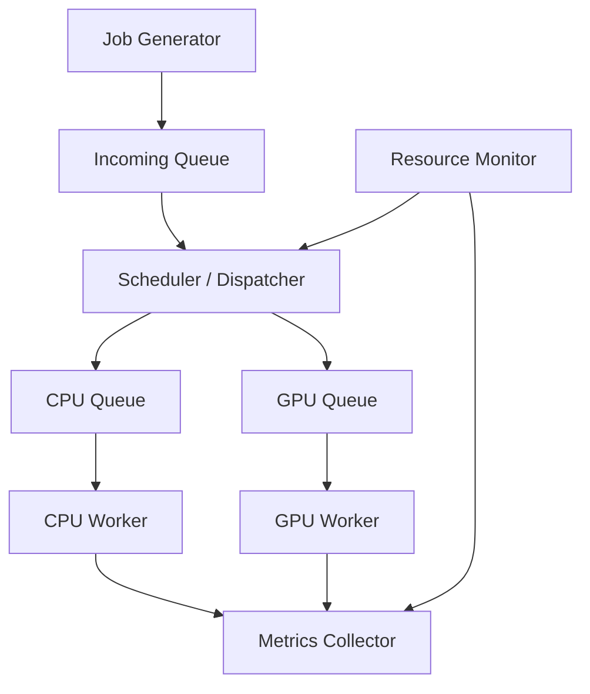

# Thiết kế và xây dựng hệ thống điều phối tác vụ suy luận AI giữa CPU và GPU cho Edge AI

**CPU–GPU AI Inference Scheduling for Edge AI**

## Problem Statement

Hệ thống dự kiến tiếp nhận nhiều AI inference jobs, mỗi job có thể thực thi trên CPU hoặc GPU. Đưa toàn bộ job lên GPU có thể gây nghẽn GPU queue trong khi CPU còn rảnh. Tuy nhiên, phân phối job không hợp lý cũng có thể tăng latency vì thời gian inference và chi phí truyền dữ liệu khác nhau giữa các thiết bị.

Đề tài nghiên cứu cách điều phối job giữa CPU và GPU để sử dụng tài nguyên hiệu quả hơn. Trọng tâm là scheduling và resource management, vận dụng process/thread, IPC, producer–consumer, synchronization và quản lý trạng thái job trong môn Hệ điều hành.

## Objectives

- Xây dựng pipeline: tạo job → tiếp nhận → điều phối → inference → thu kết quả và metrics.
- Chạy ít nhất hai pretrained ONNX models có chi phí xử lý khác nhau trên cả CPU và GPU.
- So sánh CPU-only, GPU-only, Round Robin và Resource-aware.
- Thử nghiệm low, medium, high và burst workload với cùng lịch job.
- Đánh giá latency, throughput, thời gian chờ, tài nguyên và scheduler overhead.
- Phân tích khi nào sử dụng đồng thời CPU/GPU có lợi hoặc không có lợi.

## System Architecture

Kiến trúc dưới đây là thiết kế toàn hệ thống. Đã có contract T04, backend suy
luận CPU/GPU T06, Resource Monitor T08 và queue/controller/scheduler của tuần 2.
Entry point `edge_scheduler.main` ghép controller, backend thật và monitor để
chạy một batch hữu hạn với CPU-only, GPU-only hoặc Round Robin. Collector ghi
sự kiện liên tục, replay workload và benchmark Resource-aware vẫn cần bổ sung.



| Thành phần | Trách nhiệm |
|---|---|
| Job Generator | Tạo hoặc replay job theo manifest workload |
| Incoming Queue | Chứa job chờ điều phối |
| Scheduler / Dispatcher | Chọn thiết bị và chuyển job vào queue tương ứng |
| CPU Queue / GPU Queue | Chứa job chờ trên từng thiết bị |
| CPU Worker / GPU Worker | Thực thi inference, trả kết quả hoặc thông tin lỗi |
| Resource Monitor | Theo dõi tài nguyên và trạng thái worker |
| Metrics Collector | Thu sự kiện, ghi log và tổng hợp metrics |

Chi tiết interface, đồng bộ và vòng đời job nằm trong [PLAN.md](PLAN.md).

## Scheduling Strategies

| Chiến lược | Nguyên tắc |
|---|---|
| CPU-only | Mọi job chạy trên CPU |
| GPU-only | Mọi job chạy trên GPU |
| Round Robin | Luân phiên gán job cho CPU và GPU |
| Resource-aware | Chọn thiết bị đủ tài nguyên, có thời gian hoàn thành dự kiến thấp hơn |

Resource-aware là chiến lược nghiên cứu chính; không giả định nó luôn tốt nhất.

## Metrics

- Queue waiting time: thời gian chờ điều phối và chờ tại thiết bị.
- Execution time và end-to-end latency.
- P50/P95/P99 latency và throughput.
- CPU/GPU job distribution.
- RAM/VRAM và resource usage; GPU utilization ghi nhận khi môi trường hỗ trợ.
- Scheduler overhead và failure rate.

Quy ước đo và công thức được xác định trong [Benchmark Plan](PLAN.md#8-benchmark-plan).

## Technology Stack

T06 đã được kiểm tra trên Ubuntu/WSL2, Python 3.10.12, ONNX Runtime GPU 1.23.2,
NVIDIA GTX 1650 4 GB. Backend dùng `CPUExecutionProvider` và `CUDAExecutionProvider`.
Các dependencies trực tiếp và CUDA/cuDNN được khóa trong `requirements.txt`;
phiên bản toàn bộ môi trường được lưu cùng từng lượt chạy T06.

## Project Scope

### MVP / Required scope

- Terminal interface; hai pretrained ONNX models và hai inference backends.
- Incoming/CPU/GPU queues; tối thiểu một CPU worker và một GPU worker.
- Bốn scheduling strategies, Resource Monitor và Metrics Collector.
- Workload generator/replay cho bốn mức tải.
- Synchronization, xử lý lỗi, graceful shutdown.
- Benchmark, biểu đồ, report và demo.

### Optional / Future extensions

Priority/deadline-aware scheduling, nhiều CPU workers, CPU affinity, dynamic batching, memory/power-aware scheduling, TensorRT, Jetson deployment và CPU/GPU/NPU extension.

Phiên bản đầu không bao gồm train model mới, viết CUDA kernel, GPU driver hoặc GUI.

## Repository Structure

Mã nguồn được chia thành bốn package theo trách nhiệm:

```text
src/edge_scheduler/
├── __init__.py       # Public exports của Job và các contract chung
├── main.py           # CLI chạy pipeline thật và quản lý vòng đời lượt chạy
├── core/            # Models, interfaces, contracts và validation
├── runtime/         # Controller, queues, schedulers và shutdown
├── inference/       # ONNX backends, model registry, preprocessing, verification
└── monitoring/      # System/GPU probes, resource samples, monitor và CSV logger
```

Import implementation qua package tương ứng, ví dụ
`from edge_scheduler.runtime.controller import Controller`.
Các public exports như `from edge_scheduler import Job, Device` vẫn dùng được.

| File | Vai trò |
|---|---|
| `src/edge_scheduler/main.py` | Entry point chạy batch qua controller, backend thật và monitor |
| `src/edge_scheduler/core/models.py`, `interfaces.py`, `contracts.py` | Job và hợp đồng giao tiếp T04 |
| `src/edge_scheduler/runtime/controller.py`, `queues.py`, `schedulers.py`, `shutdown.py` | Queue, WorkerLoop, điều phối và vòng đời thực thi |
| `src/edge_scheduler/runtime/backend_adapter.py`, `run_results.py` | Cập nhật worker registry, xuất job CSV và thống kê cuối lượt |
| `src/edge_scheduler/inference/model_registry.py` | Hai model chuẩn và resolve đường dẫn từ project root |
| `src/edge_scheduler/inference/preprocess.py` | Tiền xử lý dùng chung cho CPU/GPU |
| `src/edge_scheduler/inference/onnx_backend.py` | Quản lý session, warm-up, suy luận, đóng tài nguyên |
| `src/edge_scheduler/inference/cpu_backend.py`, `gpu_backend.py` | Hai backend T06 |
| `src/edge_scheduler/inference/verification.py` | Đọc trace để xác nhận phép tính CUDA |
| `scripts/T06_worker_test.py` | Chạy backend thật và lưu bằng chứng nghiệm thu |
| `tests/test_t06_*.py` | Unit test và integration test CPU/GPU |
| `models/`, `inputs/` | Hai model ONNX và ảnh mẫu |
| `logs/t06/<run_id>/` | Summary, CSV, output NumPy và trace theo từng lượt |
| `T06_report.md` | Kết quả T06 và hướng dẫn bàn giao cho T07 |
| `src/edge_scheduler/monitoring/system_probe.py`, `gpu_probe.py` | Probe psutil và NVML của T08 |
| `src/edge_scheduler/monitoring/monitoring_models.py`, `resource_monitor.py` | ResourceSample bất biến, WorkerRegistry, sampler và snapshot cache |
| `src/edge_scheduler/monitoring/resource_log.py` | Writer CSV bất đồng bộ, queue có giới hạn và bộ đếm dropped samples |
| `scripts/T08_monitor_test.py`, `tests/test_t08_*.py` | Harness kiểm tra độc lập, cùng T06 và unit/integration tests |
| `logs/t08/<run_id>/`, `T08_report.md` | Log, config và kết quả nghiệm thu monitor |
| `PLAN.md` | Requirements, kế hoạch triển khai và đánh giá |

## Setup

Từ thư mục gốc, trên Linux/WSL2 x86-64 có NVIDIA driver hỗ trợ CUDA:

```bash
python3 -m venv .venv
.venv/bin/python -m pip install -r requirements.txt
nvidia-smi
```

Nếu `.venv` đã có và chạy được T02/T03 thì dùng lại. Chỉ cài một distribution
ONNX Runtime trong môi trường; `onnxruntime-gpu` phục vụ cả CPU và CUDA.
GPU backend gọi `onnxruntime.preload_dlls()` để tìm CUDA/cuDNN trong NVIDIA
site packages. Có thể cấu hình `LD_LIBRARY_PATH` theo T02 nếu môi trường riêng yêu cầu.
Không thay NVIDIA driver hoặc các phiên bản CUDA chỉ dựa trên số CUDA hiển thị bởi `nvidia-smi`.

## Running

Chạy pipeline tích hợp, từ project root:

```bash
PYTHONPATH=src .venv/bin/python -m edge_scheduler.main \
  --scheduler round-robin --jobs 20 --models mobilenetv2 resnet50 \
  --input inputs/test.jpg --monitor-interval 0.2 \
  --output-dir logs/pipeline

# Lượt xác nhận CUDA compute và yêu cầu đọc được VRAM thật.
PYTHONPATH=src .venv/bin/python -m edge_scheduler.main \
  --scheduler round-robin --jobs 20 --profile --require-gpu-metrics

PYTHONPATH=src .venv/bin/python -m edge_scheduler.main --help
```

`--jobs` là tổng job trong một batch; model được chọn luân phiên từ `--models`.
Các policy hỗ trợ là `cpu-only`, `gpu-only`, `round-robin`. Controller hiện
prepare **cả CPU và GPU** ở mọi policy, vì vậy CPU-only vẫn yêu cầu GPU khởi
tạo được và vẫn có thể chiếm VRAM. `--no-gpu-telemetry` chỉ tắt NVML, không tắt
GPU inference hoặc cho phép fallback. Nếu có `CUDA_VISIBLE_DEVICES`, cần chỉ
rõ `--gpu-uuid` cho NVML hoặc tắt GPU telemetry.

Mỗi lượt tạo `logs/pipeline/<run_id>/` với:

- `config.json`: tham số, model, thiết bị được prepare, phiên bản môi trường và phạm vi đo.
- `jobs.csv`: thiết bị, trạng thái, timestamps monotonic theo giây, waiting/execution/latency, top-1 và lỗi của mỗi accepted job.
- `resources.csv`: CPU/RAM/process/VRAM, worker/queue state, phase và lỗi từng metric.
- `summary.json`: accepted/completed/failed, job chưa kết thúc, đối soát, phân bố thiết bị, mean/P50/P95/P99 theo ms, throughput và diagnostics sau cleanup.
- `profiles/` nếu bật `--profile`: trace của hai model/device; GPU phải có compute CUDA. Trace gồm warm-up và có overhead, kể cả GPU warm-up ở policy CPU-only.

Job metrics loại thời gian prepare/warm-up, chỉ tổng hợp phân vị trên job thành
công. Throughput lấy số job thành công chia thời gian từ arrival đầu tới terminal
cuối, kể cả terminal failed. Resource summary gồm mọi phase, dùng trung bình
cộng theo mẫu và `observed_max`, không phải peak tuyệt đối. Batch nhỏ chưa đủ
để diễn giải P99 như một kết quả benchmark ổn định.

Exit code: 0 khi toàn bộ job thành công, đối soát và cleanup/log đều đạt; 1 khi
lỗi hoặc có job failed; 2 khi tham số CLI sai; 130 khi Ctrl+C. Ctrl+C ngừng nhận
job và drain các job đã nhận. `--timeout` giới hạn lần chờ workload;
`--shutdown-timeout` giới hạn **mỗi lần thử drain**, không phải hard timeout của
process. Khi drain timeout, main ghi checkpoint job chưa hoàn thành vào
`summary.json` rồi tiếp tục thử đóng; không đóng session đang infer. Native call
bị treo có thể khiến cleanup tiếp tục chờ, do controller dùng worker thread.

Đây là pipeline demo tích hợp và thống kê cuối lượt, chưa phải generator/replay
low/medium/high/burst hoặc benchmark bốn scheduler. Resource-aware chưa được
bật trong CLI. `runtime/run_results.py` chưa thay thế MetricsCollector ghi sự
kiện liên tục và chưa đo scheduler overhead.

Chạy T06 độc lập, không cần queue/controller:

```bash
.venv/bin/python scripts/T06_worker_test.py --device cpu
.venv/bin/python scripts/T06_worker_test.py --device both --require-gpu --profile
```

Mặc định: batch 1, 5 warm-up/model/device, 10 job/model/device, 2 intra-op threads,
inter-op 1, execution mode sequential, tắt intra-op spinning. Hai model được gọi
xen kẽ để kiểm tra tái sử dụng session. Mỗi lượt tạo thư mục riêng trong `logs/t06/`.
`summary.json` có config, package versions, kết quả và lỗi nếu có; `jobs.csv` có thời
gian từng job; `outputs.npz` giữ output đầu tiên mỗi model/device; `profiles/` giữ trace.

GPU yêu cầu mà không chạy được sẽ trả exit code 1, không skip hoặc chuyển sang CPU.
Khi có `--profile`, mỗi model GPU phải có operator Conv/Gemm/MatMul chạy trên CUDA.
`--device both` còn so output CPU/GPU với mặc định `rtol=1e-4`, `atol=1e-4`.
Thời gian gồm đọc ảnh/preprocess, transfer khi cần, ONNX run và kiểm tra output;
load/warm-up được ghi riêng. Bật profiling có overhead, không dùng số liệu này
để kết luận scheduler nào tốt hơn.

Kiểm thử:

```bash
# Không yêu cầu GPU: test CPU thật và unit tests; test GPU được ghi rõ là skipped.
.venv/bin/python -m unittest discover -s tests -v

# Nghiệm thu có GPU: CUDA phải chạy được; không skip nếu khởi tạo GPU lỗi.
T06_TEST_GPU=1 T08_TEST_GPU=1 .venv/bin/python -m unittest discover -s tests -v
```

Sau refactor package ngày 22/10/2026, suite có GPU thật đạt **84/84 tests**, không
skip. Lượt mặc định đạt 82 tests và skip 2 ca GPU thật. Có regression test nạp
cả hai model và ảnh mẫu bằng root mặc định khi current working directory nằm
ngoài project; demo và các CLI T03/T06/T08 cũng đã được chạy từ thư mục ngoài.

Sau khi bổ sung entry point pipeline, suite ngày 22/10/2026 đạt **99/99 tests**
với CUDA/NVML thật, không skip. Lượt mặc định đạt 96 tests và skip 3 ca GPU.
Test tích hợp mới chạy cả ba policy qua controller + backend ONNX thật + monitor,
kiểm tra phân bố job, đối soát, CUDA trace và cleanup. Các ca bổ sung còn kiểm
tra adapter, công thức metrics, lỗi startup/input/log, Ctrl+C và timeout/retry.

Dùng trong T07 với `PYTHONPATH=src`:

```python
from edge_scheduler.inference.cpu_backend import CPUBackend

backend = CPUBackend()
try:
    backend.prepare()
    output = backend.infer("resnet50", "inputs/test.jpg")
finally:
    backend.close()
```

`GPUBackend` có cùng API. Một instance thuộc một worker, gọi tuần tự từ thread
sở hữu; không chạy `close()` đồng thời với `infer()`. `prepare()` khi đã sẵn sàng
là no-op; `close()` gọi lặp được và có thể `prepare()` lại. Backend không sửa Job.
`input_ref` phải là đường dẫn tương đối nằm trong project root, kể cả sau khi resolve symlink.
Root mặc định lấy từ vị trí package; có thể truyền `root=...` khi khởi tạo.

Entry point pipeline là `python -m edge_scheduler.main` với `PYTHONPATH=src`
như trên; không dùng lệnh `python run.py --scheduler ...` trong kế hoạch cũ.

## Resource Monitor T08

Đã cài và khóa `psutil==7.2.2`, `nvidia-ml-py==13.615.71` trong requirements.
NVML binding được import bằng `pynvml`; không cần PyTorch hoặc TensorFlow.

```bash
# Đọc tài nguyên độc lập: mặc định 200 ms/mẫu, 10 giây.
.venv/bin/python scripts/T08_monitor_test.py --duration 10 --interval 0.2

# Chạy cả CPU/GPU backend, yêu cầu đọc được VRAM; utilization vẫn là metric tùy khả năng.
.venv/bin/python scripts/T08_monitor_test.py --workload both --runs 100 --require-gpu-metrics

# Ba cặp bật/tắt monitor, giữ nguyên session, luân phiên thứ tự chạy.
.venv/bin/python scripts/T08_monitor_test.py --workload both --runs 100 \
  --require-gpu-metrics --overhead-repeats 3

# Chỉ kiểm tra T08 có GPU, hoặc dùng T06_TEST_GPU=1 để yêu cầu GPU cho cả T06/T08.
T08_TEST_GPU=1 .venv/bin/python -m unittest discover -s tests -p 'test_t08_*.py' -v
```

`--no-gpu` tắt telemetry GPU, không tắt GPU inference nếu đã yêu cầu workload GPU.
`--gpu-index` là NVML index; `--device-id` là CUDA ordinal. Có thể truyền
`--gpu-uuid` để ánh xạ rõ GPU, bắt buộc với workload GPU nếu đã đặt
`CUDA_VISIBLE_DEVICES` và bật telemetry. UUID/name thực tế được ghi vào metadata.

Mỗi run có `config.json`, `resources.csv`, `monitor_summary.json`, `summary.json`;
đo overhead bổ sung thư mục `overhead/<iteration>/`. Các log lưu CPU%, RAM
available/total/usage%, process RSS/CPU%, VRAM total/used/free và GPU utilization.
Missing metrics dùng ô CSV rỗng và `errors_json`, không giả thành 0. Một metric
NVML không hỗ trợ không làm mất metric khác hoặc đánh dấu GPU backend chết.

CPU/RAM là phạm vi OS/WSL nhìn thấy. RSS là toàn process; VRAM là toàn GPU được
chọn, có thể gồm ứng dụng khác. Trường `ram_free_mb` hiện có chứa RAM available;
tất cả trường `_mb` dùng MiB. Process CPU% có thể lớn hơn 100 khi dùng nhiều core.

T08 không đo từng job: mẫu 200 ms không ghi lại mọi biến động của job 10 ms.
`observed_max` chỉ là đỉnh quan sát trong log. `timestamp_s`/snapshot.timestamp
là lúc bắt đầu đọc mẫu để truy vấn chậm không làm dữ liệu cũ trông như mới;
log có thêm sample duration và thời điểm đọc trạng thái chương trình.

Tích hợp với T07/T13, dùng `PYTHONPATH=src`:

```python
from edge_scheduler.monitoring.monitoring_models import WorkerRegistry
from edge_scheduler.monitoring.resource_log import ResourceCSVLogger
from edge_scheduler.monitoring.resource_monitor import ResourceMonitor

registry = WorkerRegistry()  # T07 gọi set_ready/set_running/set_unavailable.
logger = ResourceCSVLogger("logs/my_run/resources.csv")  # Không ghi đè file cũ.
monitor = ResourceMonitor(worker_state_provider=registry.snapshot, sink=logger)
try:
    monitor.start()
    if not monitor.wait_for_sample(5):
        raise RuntimeError(monitor.diagnostics)
    sample = monitor.read_sample()  # Có stale, tuổi dữ liệu và lỗi từng metric.
    snapshot = monitor.snapshot()  # Giữ nguyên ResourceSnapshot T04 cho Scheduler.
    # Controller truyền snapshot + queued_jobs cho Scheduler.choose_device(...).
finally:
    try:
        monitor.close()
    finally:
        logger.close()  # Drain/flush sau khi sampler ngừng phát mẫu.
```

`snapshot()` không đo phần cứng hoặc ghi file; nó đọc cache và callback trạng
thái. Callback worker/queue/phase phải nhanh, an toàn thread và không làm I/O.
`queue_lengths_provider` tùy chọn nhận mapping tên queue → số job; khi thiếu
nguồn, log ghi `not_configured`, không tạo số 0 giả. Độ dài queue phục vụ log;
Scheduler vẫn nhận danh sách queued_jobs trực tiếp từ T05.

Monitor có `start()`/`close()` idempotent, có thể start lại khi thread đã dừng.
Sink do caller sở hữu; khi restart cần sink còn mở hoặc sink mới. Trước mẫu đầu,
sequence=0, metric=None và stale=True. Mặc định stale sau 1 giây; Scheduler cần
kiểm tra timestamp và Controller vẫn kiểm tra worker trước dispatch. Xem
`diagnostics` để phát hiện sampler/writer lỗi; không suy ra worker health từ utilization.

`WorkerState` bổ sung hai trường mặc định: `running_started_s` và
`estimated_remaining_known`. Busy vẫn có thể available; ước lượng khi đang
chạy mặc định chưa biết, T11/T13 phải xét flag trước khi dùng remaining time.
`memory_free_mb` trong snapshot là bộ nhớ khả dụng của thiết bị, không phải bộ
nhớ được quy riêng cho worker. `ResourceSampleSink.record_resource()` là luồng
log riêng; `MetricsCollector.record(JobEvent)` không đổi.

## Current Status

Đã có T02/T03, hợp đồng T04 và backend T06. MobileNetV2 và ResNet-50 đã chạy
thực tế trên CPU và CUDA, có trace xác nhận compute và so sánh output. Xem
[T06_report.md](T06_report.md) để chạy lại và đọc kết quả. Resource Monitor T08
đã có lấy mẫu nền, snapshot, resource log và kiểm chứng cùng T06; xem
[T08_report.md](T08_report.md). Queue/controller, WorkerLoop và bốn scheduler
đã có mã cùng kiểm thử giả lập tuần 2 trong `src/edge_scheduler/runtime/`; xem
[WEEK2_IMPLEMENTATION_REPORT.md](WEEK2_IMPLEMENTATION_REPORT.md).
`edge_scheduler.main` đã có kiểm thử tích hợp backend thật và monitor cho
CPU-only/GPU-only/Round Robin, kèm output và shutdown. Resource-aware vẫn cần
profile và kiểm tra tài nguyên đầy đủ. Collector ghi sự kiện liên tục,
generator/replay và benchmark so sánh đầy đủ vẫn chưa được triển khai.
Harness T08 không thay cho benchmark T15.

Kế hoạch kỹ thuật nằm trong [PLAN.md](PLAN.md); tiến độ hằng ngày được quản lý theo quy ước trên shared Google Sheets project tracker.

## Limitations

Thử nghiệm ban đầu dự kiến thực hiện trên laptop/PC có CPU và NVIDIA GPU. Kết quả chưa thể đại diện cho toàn bộ nền tảng Edge AI. Hiệu quả phụ thuộc model, workload, chi phí truyền dữ liệu, phần cứng và sai số ước lượng của scheduler. GPU utilization trong WSL được thu thập nếu môi trường hỗ trợ và không phải điều kiện bắt buộc để nghiệm thu.
