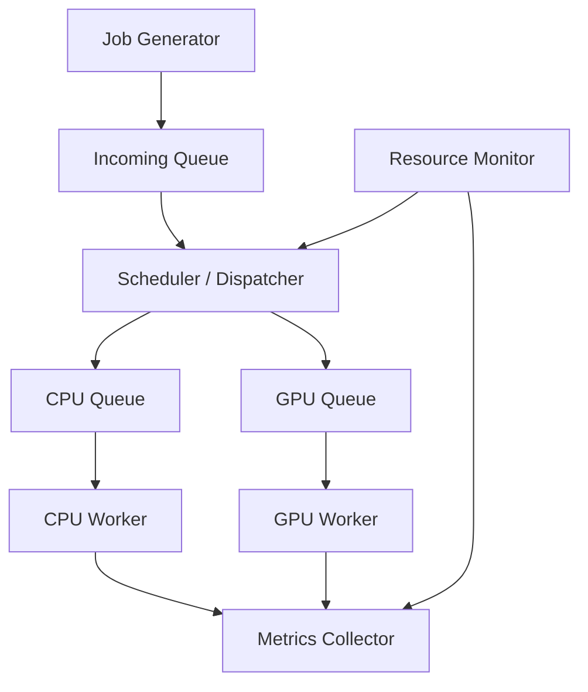

# Thiết kế và xây dựng hệ thống điều phối tác vụ suy luận AI giữa CPU và GPU cho Edge AI

**CPU–GPU AI Inference Scheduling for Edge AI**

## Problem Statement

Hệ thống dự kiến tiếp nhận nhiều AI inference jobs, mỗi job có thể thực thi trên CPU hoặc GPU. Đưa toàn bộ job lên GPU có thể gây nghẽn GPU queue trong khi CPU còn rảnh. Tuy nhiên, phân phối job không hợp lý cũng có thể tăng latency vì thời gian inference và chi phí truyền dữ liệu khác nhau giữa các thiết bị.

Đề tài nghiên cứu cách điều phối job giữa CPU và GPU để sử dụng tài nguyên hiệu quả hơn. Trọng tâm là scheduling và resource management, vận dụng process/thread, IPC, producer–consumer, synchronization và quản lý trạng thái job trong môn Hệ điều hành.

## Objectives

- Xây dựng pipeline: tạo job → tiếp nhận → điều phối → inference → thu kết quả và metrics.
- Chạy ít nhất hai pretrained ONNX models có chi phí xử lý khác nhau trên cả CPU và GPU.
- So sánh CPU-only, GPU-only, Round Robin và Resource-aware.
- Thử nghiệm low, medium, high và burst workload với cùng lịch job.
- Đánh giá latency, throughput, thời gian chờ, tài nguyên và scheduler overhead.
- Phân tích khi nào sử dụng đồng thời CPU/GPU có lợi hoặc không có lợi.

## System Architecture

Kiến trúc dưới đây là thiết kế dự kiến, chưa phải các module đã được triển khai.



| Thành phần | Trách nhiệm |
|---|---|
| Job Generator | Tạo hoặc replay job theo manifest workload |
| Incoming Queue | Chứa job chờ điều phối |
| Scheduler / Dispatcher | Chọn thiết bị và chuyển job vào queue tương ứng |
| CPU Queue / GPU Queue | Chứa job chờ trên từng thiết bị |
| CPU Worker / GPU Worker | Thực thi inference, trả kết quả hoặc thông tin lỗi |
| Resource Monitor | Theo dõi tài nguyên và trạng thái worker |
| Metrics Collector | Thu sự kiện, ghi log và tổng hợp metrics |

Chi tiết interface, đồng bộ và vòng đời job nằm trong [PLAN.md](PLAN.md).

## Scheduling Strategies

| Chiến lược | Nguyên tắc |
|---|---|
| CPU-only | Mọi job chạy trên CPU |
| GPU-only | Mọi job chạy trên GPU |
| Round Robin | Luân phiên gán job cho CPU và GPU |
| Resource-aware | Chọn thiết bị đủ tài nguyên, có thời gian hoàn thành dự kiến thấp hơn |

Resource-aware là chiến lược nghiên cứu chính; không giả định nó luôn tốt nhất.

## Metrics

- Queue waiting time: thời gian chờ điều phối và chờ tại thiết bị.
- Execution time và end-to-end latency.
- P50/P95/P99 latency và throughput.
- CPU/GPU job distribution.
- RAM/VRAM và resource usage; GPU utilization ghi nhận khi môi trường hỗ trợ.
- Scheduler overhead và failure rate.

Quy ước đo và công thức được xác định trong [Benchmark Plan](PLAN.md#8-benchmark-plan).

## Technology Stack

Phiên bản đầu dự kiến sử dụng Windows 11 host, WSL2, Ubuntu, Python, ONNX Runtime với `CPUExecutionProvider` và `CUDAExecutionProvider`, cùng NVIDIA GPU hỗ trợ CUDA. Có thể sử dụng Linux trực tiếp nếu nhóm thống nhất.

Chưa xác định phiên bản phần mềm. CUDA/cuDNN/ONNX Runtime cần được chọn theo compatibility thực tế và ghi lại trong cấu hình môi trường.

## Project Scope

### MVP / Required scope

- Terminal interface; hai pretrained ONNX models và hai inference backends.
- Incoming/CPU/GPU queues; tối thiểu một CPU worker và một GPU worker.
- Bốn scheduling strategies, Resource Monitor và Metrics Collector.
- Workload generator/replay cho bốn mức tải.
- Synchronization, xử lý lỗi, graceful shutdown.
- Benchmark, biểu đồ, report và demo.

### Optional / Future extensions

Priority/deadline-aware scheduling, nhiều CPU workers, CPU affinity, dynamic batching, memory/power-aware scheduling, TensorRT, Jetson deployment và CPU/GPU/NPU extension.

Phiên bản đầu không bao gồm train model mới, viết CUDA kernel, GPU driver hoặc GUI.

## Repository Structure

Bộ tài liệu được cung cấp hiện gồm:

| File | Vai trò |
|---|---|
| `README.md` | Giới thiệu project, môi trường và cách sử dụng dự kiến |
| `PLAN.md` | Requirements, kế hoạch triển khai và đánh giá |
| `Mo_ta_de_tai_va_ke_hoach_CPU_GPU_Edge_AI.md` | Tài liệu nguồn tổng hợp, được giữ nguyên để đối chiếu |

Chưa có cấu trúc implementation trong các file được cung cấp. Các thành phần kiến trúc là dự kiến; chưa xác định đường dẫn module. File diff phục vụ review tài liệu không thuộc cấu trúc implementation.

## Setup

Các bước dưới đây là kế hoạch setup, chưa được kiểm chứng trên máy benchmark:

1. Chốt phần cứng; chuẩn bị WSL2/Ubuntu trên Windows 11 hoặc Linux trực tiếp.
2. Kiểm tra NVIDIA GPU được nhận trong môi trường thực thi.
3. Tạo môi trường Python riêng; chọn ONNX Runtime GPU và CUDA/cuDNN dependencies tương thích. Không coi việc cài đồng thời gói ONNX Runtime CPU và GPU là yêu cầu.
4. Kiểm tra execution providers và chạy smoke-test model trên CPU/CUDA; xác nhận GPU inference thực tế, tránh fallback âm thầm.
5. Chọn hai benchmark models, chuẩn hóa input, warm-up và profiling.
6. Ghi cấu hình phần cứng, phiên bản phần mềm, input shape và CPU thread settings.

## Running

**Planned interface — chưa có `run.py` trong các file được cung cấp, lệnh sau chưa chạy được:**

```bash
python run.py --scheduler resource-aware --jobs 1000 --workload high
```

Đầu ra dự kiến gồm số job theo thiết bị, số job thành công/thất bại, latency, throughput và log theo từng lần chạy. Hướng dẫn chạy thực tế sẽ được bổ sung khi implementation tồn tại.

## Current Status

Đã có tài liệu mô tả và kế hoạch. Workspace được kiểm tra không có Git repository, implementation, model, test hoặc kết quả benchmark của project. Vì vậy chưa xác nhận backend, pipeline hay scheduler nào hoạt động; chưa có bằng chứng để đánh dấu milestone triển khai hoàn thành. Trạng thái này chỉ phản ánh các file được cung cấp, không kết luận về repository bên ngoài.

Kế hoạch kỹ thuật nằm trong [PLAN.md](PLAN.md); tiến độ hằng ngày được quản lý theo quy ước trên shared Google Sheets project tracker.

## Limitations

Thử nghiệm ban đầu dự kiến thực hiện trên laptop/PC có CPU và NVIDIA GPU. Kết quả chưa thể đại diện cho toàn bộ nền tảng Edge AI. Hiệu quả phụ thuộc model, workload, chi phí truyền dữ liệu, phần cứng và sai số ước lượng của scheduler. GPU utilization trong WSL được thu thập nếu môi trường hỗ trợ và không phải điều kiện bắt buộc để nghiệm thu.
