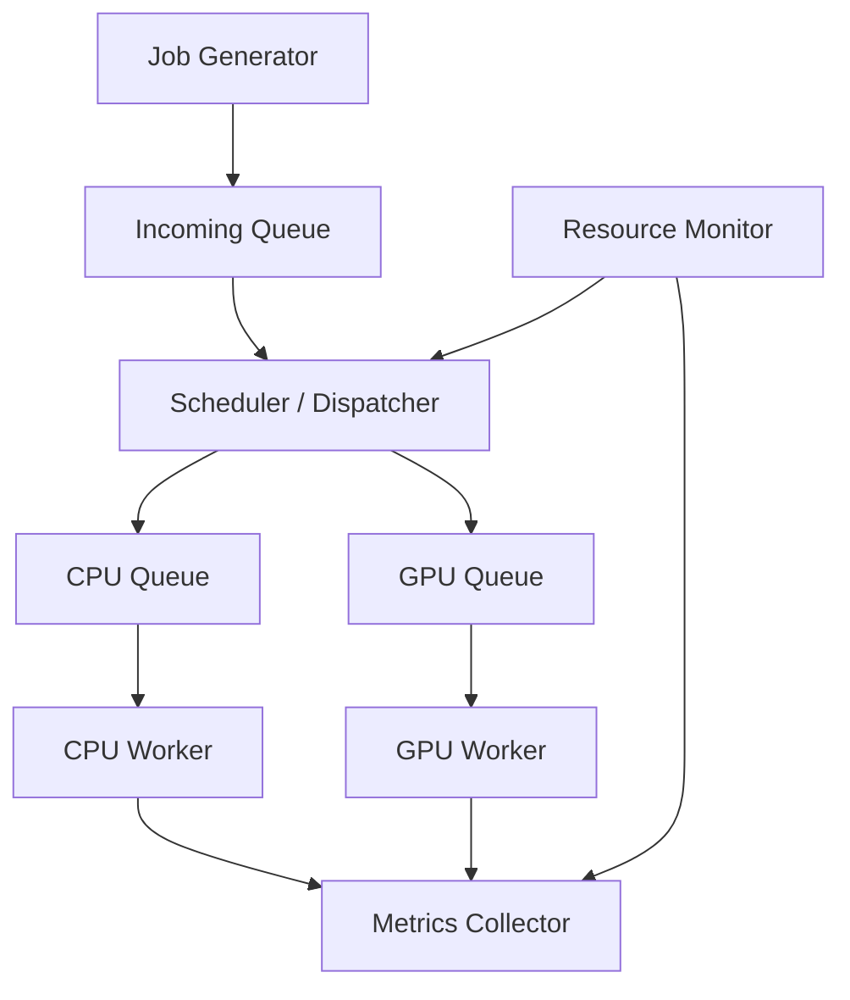

# Thiết kế và xây dựng hệ thống điều phối tác vụ suy luận AI giữa CPU và GPU cho Edge AI

**CPU–GPU AI Inference Scheduling for Edge AI**

## Problem Statement

Hệ thống dự kiến tiếp nhận nhiều AI inference jobs, mỗi job có thể thực thi trên CPU hoặc GPU. Đưa toàn bộ job lên GPU có thể gây nghẽn GPU queue trong khi CPU còn rảnh. Tuy nhiên, phân phối job không hợp lý cũng có thể tăng latency vì thời gian inference và chi phí truyền dữ liệu khác nhau giữa các thiết bị.

Đề tài nghiên cứu cách điều phối job giữa CPU và GPU để sử dụng tài nguyên hiệu quả hơn. Trọng tâm là scheduling và resource management, vận dụng process/thread, IPC, producer–consumer, synchronization và quản lý trạng thái job trong môn Hệ điều hành.

## Objectives

- Xây dựng pipeline: tạo job → tiếp nhận → điều phối → inference → thu kết quả và metrics.
- Chạy ít nhất hai pretrained ONNX models có chi phí xử lý khác nhau trên cả CPU và GPU.
- So sánh CPU-only, GPU-only, Round Robin và Resource-aware.
- Thử nghiệm low, medium, high và burst workload với cùng lịch job.
- Đánh giá latency, throughput, thời gian chờ, tài nguyên và scheduler overhead.
- Phân tích khi nào sử dụng đồng thời CPU/GPU có lợi hoặc không có lợi.

## System Architecture

Kiến trúc dưới đây là thiết kế toàn hệ thống. Hiện đã triển khai contract T04 và
backend suy luận CPU/GPU T06; queue, controller và scheduler chưa có trong checkout này.



| Thành phần | Trách nhiệm |
|---|---|
| Job Generator | Tạo hoặc replay job theo manifest workload |
| Incoming Queue | Chứa job chờ điều phối |
| Scheduler / Dispatcher | Chọn thiết bị và chuyển job vào queue tương ứng |
| CPU Queue / GPU Queue | Chứa job chờ trên từng thiết bị |
| CPU Worker / GPU Worker | Thực thi inference, trả kết quả hoặc thông tin lỗi |
| Resource Monitor | Theo dõi tài nguyên và trạng thái worker |
| Metrics Collector | Thu sự kiện, ghi log và tổng hợp metrics |

Chi tiết interface, đồng bộ và vòng đời job nằm trong [PLAN.md](PLAN.md).

## Scheduling Strategies

| Chiến lược | Nguyên tắc |
|---|---|
| CPU-only | Mọi job chạy trên CPU |
| GPU-only | Mọi job chạy trên GPU |
| Round Robin | Luân phiên gán job cho CPU và GPU |
| Resource-aware | Chọn thiết bị đủ tài nguyên, có thời gian hoàn thành dự kiến thấp hơn |

Resource-aware là chiến lược nghiên cứu chính; không giả định nó luôn tốt nhất.

## Metrics

- Queue waiting time: thời gian chờ điều phối và chờ tại thiết bị.
- Execution time và end-to-end latency.
- P50/P95/P99 latency và throughput.
- CPU/GPU job distribution.
- RAM/VRAM và resource usage; GPU utilization ghi nhận khi môi trường hỗ trợ.
- Scheduler overhead và failure rate.

Quy ước đo và công thức được xác định trong [Benchmark Plan](PLAN.md#8-benchmark-plan).

## Technology Stack

T06 đã được kiểm tra trên Ubuntu/WSL2, Python 3.10.12, ONNX Runtime GPU 1.23.2,
NVIDIA GTX 1650 4 GB. Backend dùng `CPUExecutionProvider` và `CUDAExecutionProvider`.
Các dependencies trực tiếp và CUDA/cuDNN được khóa trong `requirements.txt`;
phiên bản toàn bộ môi trường được lưu cùng từng lượt chạy T06.

## Project Scope

### MVP / Required scope

- Terminal interface; hai pretrained ONNX models và hai inference backends.
- Incoming/CPU/GPU queues; tối thiểu một CPU worker và một GPU worker.
- Bốn scheduling strategies, Resource Monitor và Metrics Collector.
- Workload generator/replay cho bốn mức tải.
- Synchronization, xử lý lỗi, graceful shutdown.
- Benchmark, biểu đồ, report và demo.

### Optional / Future extensions

Priority/deadline-aware scheduling, nhiều CPU workers, CPU affinity, dynamic batching, memory/power-aware scheduling, TensorRT, Jetson deployment và CPU/GPU/NPU extension.

Phiên bản đầu không bao gồm train model mới, viết CUDA kernel, GPU driver hoặc GUI.

## Repository Structure

| File | Vai trò |
|---|---|
| `src/edge_scheduler/models.py`, `interfaces.py`, `contracts.py` | Job và hợp đồng giao tiếp T04 |
| `src/edge_scheduler/model_registry.py` | Hai model chuẩn và resolve đường dẫn từ project root |
| `src/edge_scheduler/preprocess.py` | Tiền xử lý dùng chung cho CPU/GPU |
| `src/edge_scheduler/onnx_backend.py` | Quản lý session, warm-up, suy luận, đóng tài nguyên |
| `src/edge_scheduler/cpu_backend.py`, `gpu_backend.py` | Hai backend T06 |
| `src/edge_scheduler/verification.py` | Đọc trace để xác nhận phép tính CUDA |
| `scripts/T06_worker_test.py` | Chạy backend thật và lưu bằng chứng nghiệm thu |
| `tests/test_t06_*.py` | Unit test và integration test CPU/GPU |
| `models/`, `inputs/` | Hai model ONNX và ảnh mẫu |
| `logs/t06/<run_id>/` | Summary, CSV, output NumPy và trace theo từng lượt |
| `T06_report.md` | Kết quả T06 và hướng dẫn bàn giao cho T07 |
| `PLAN.md` | Requirements, kế hoạch triển khai và đánh giá |

## Setup

Từ thư mục gốc, trên Linux/WSL2 x86-64 có NVIDIA driver hỗ trợ CUDA:

```bash
python3 -m venv .venv
.venv/bin/python -m pip install -r requirements.txt
nvidia-smi
```

Nếu `.venv` đã có và chạy được T02/T03 thì dùng lại. Chỉ cài một distribution
ONNX Runtime trong môi trường; `onnxruntime-gpu` phục vụ cả CPU và CUDA.
GPU backend gọi `onnxruntime.preload_dlls()` để tìm CUDA/cuDNN trong NVIDIA
site packages. Có thể cấu hình `LD_LIBRARY_PATH` theo T02 nếu môi trường riêng yêu cầu.
Không thay NVIDIA driver hoặc các phiên bản CUDA chỉ dựa trên số CUDA hiển thị bởi `nvidia-smi`.

## Running

Chạy T06 độc lập, không cần queue/controller:

```bash
.venv/bin/python scripts/T06_worker_test.py --device cpu
.venv/bin/python scripts/T06_worker_test.py --device both --require-gpu --profile
```

Mặc định: batch 1, 5 warm-up/model/device, 10 job/model/device, 2 intra-op threads,
inter-op 1, execution mode sequential, tắt intra-op spinning. Hai model được gọi
xen kẽ để kiểm tra tái sử dụng session. Mỗi lượt tạo thư mục riêng trong `logs/t06/`.
`summary.json` có config, package versions, kết quả và lỗi nếu có; `jobs.csv` có thời
gian từng job; `outputs.npz` giữ output đầu tiên mỗi model/device; `profiles/` giữ trace.

GPU yêu cầu mà không chạy được sẽ trả exit code 1, không skip hoặc chuyển sang CPU.
Khi có `--profile`, mỗi model GPU phải có operator Conv/Gemm/MatMul chạy trên CUDA.
`--device both` còn so output CPU/GPU với mặc định `rtol=1e-4`, `atol=1e-4`.
Thời gian gồm đọc ảnh/preprocess, transfer khi cần, ONNX run và kiểm tra output;
load/warm-up được ghi riêng. Bật profiling có overhead, không dùng số liệu này
để kết luận scheduler nào tốt hơn.

Kiểm thử:

```bash
# Không yêu cầu GPU: test CPU thật và unit tests; test GPU được ghi rõ là skipped.
.venv/bin/python -m unittest discover -s tests -v

# Nghiệm thu có GPU: CUDA phải chạy được; không skip nếu khởi tạo GPU lỗi.
T06_TEST_GPU=1 .venv/bin/python -m unittest discover -s tests -v
```

Dùng trong T07 với `PYTHONPATH=src`:

```python
from edge_scheduler.cpu_backend import CPUBackend

backend = CPUBackend()
try:
    backend.prepare()
    output = backend.infer("resnet50", "inputs/test.jpg")
finally:
    backend.close()
```

`GPUBackend` có cùng API. Một instance thuộc một worker, gọi tuần tự từ thread
sở hữu; không chạy `close()` đồng thời với `infer()`. `prepare()` khi đã sẵn sàng
là no-op; `close()` gọi lặp được và có thể `prepare()` lại. Backend không sửa Job.
`input_ref` phải là đường dẫn tương đối nằm trong project root, kể cả sau khi resolve symlink.
Root mặc định lấy từ vị trí package; có thể truyền `root=...` khi khởi tạo.

Lệnh `python run.py --scheduler ...` của pipeline vẫn là kế hoạch; chưa có `run.py`.

## Current Status

Đã có T02/T03, hợp đồng T04 và backend T06. MobileNetV2 và ResNet-50 đã chạy
thực tế trên CPU và CUDA, có trace xác nhận compute và so sánh output. Xem
[T06_report.md](T06_report.md) để chạy lại và đọc kết quả. Queue/controller,
WorkerLoop, bốn scheduler, monitor/collector và benchmark toàn hệ thống chưa
được triển khai trong checkout này. T06 không thay cho nghiệm thu T07/T14/T15.

Kế hoạch kỹ thuật nằm trong [PLAN.md](PLAN.md); tiến độ hằng ngày được quản lý theo quy ước trên shared Google Sheets project tracker.

## Limitations

Thử nghiệm ban đầu dự kiến thực hiện trên laptop/PC có CPU và NVIDIA GPU. Kết quả chưa thể đại diện cho toàn bộ nền tảng Edge AI. Hiệu quả phụ thuộc model, workload, chi phí truyền dữ liệu, phần cứng và sai số ước lượng của scheduler. GPU utilization trong WSL được thu thập nếu môi trường hỗ trợ và không phải điều kiện bắt buộc để nghiệm thu.
