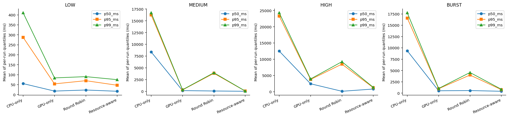
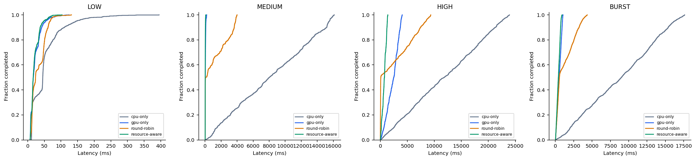
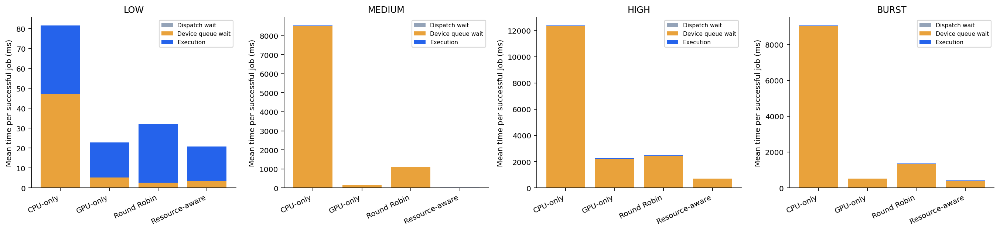
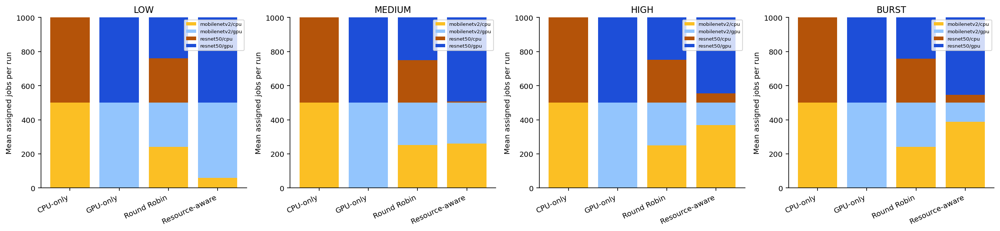
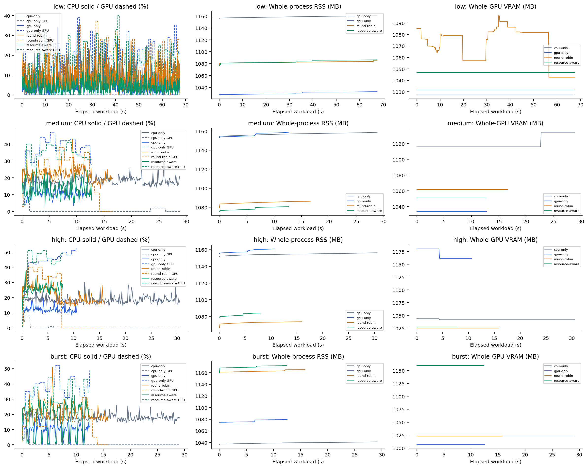
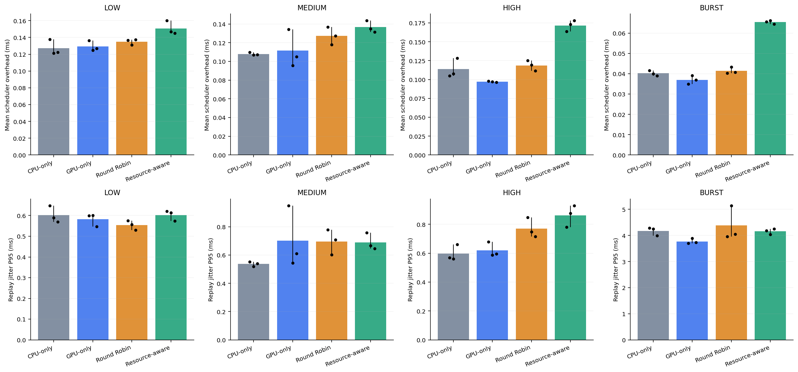

# T15–T16: so sánh điều phối CPU/GPU

Experiment: `20261101T075111Z_e50d39f4`.

Trạng thái: COMPLETE; 48/48 lượt benchmark hợp lệ. Trạng thái runner: passed.

[Bảng từng lượt CSV](../results.csv) · [Bảng tổng hợp CSV](comparison.csv) · [So sánh ghép cặp CSV](paired_comparison.csv) · [Cấu hình và lịch chạy](../experiment.json)

## Cách đọc nhanh

Throughput cao hơn và latency thấp hơn là tốt hơn. Cột là trung bình các lượt; chấm đen là từng lượt; đoạn đen là min–max. Không dùng ba lần lặp để khẳng định ý nghĩa thống kê.

## Điều kiện và phương pháp

Mỗi workload có 1000 job, 3 lần lặp, hai model trộn cân bằng bằng seed cố định. Batch=1; ORT intra-op threads=2; warm-up=5; sampling=0.1 s; cooldown=2.0 s.

Mỗi lượt chạy trong process mới. Cùng workload dùng cùng manifest/hash qua mọi scheduler và lần lặp. Thứ tự workload/scheduler luân chuyển; log nhiệt độ/công suất/xung GPU trước và sau lượt nằm trong experiment.json. Đây không phải kiểm soát nhiệt độ tuyệt đối.

Profiling T11 mới trên máy này dùng process riêng từng model/device/repeat, tắt trace. CUDA trace được kiểm tra riêng trước benchmark; các lượt đo không bật trace hoặc live display.

Latency tính từ arrival thực tế khi Controller tiếp nhận; replay jitter đo độ trễ so với lịch manifest và báo riêng. Throughput = completed / (terminal cuối − arrival đầu), gồm cả thời gian drain.

Tài nguyên chỉ lấy mẫu phase workload/drain nằm giữa arrival đầu và terminal cuối; loại mẫu stale. RSS là toàn process; VRAM là toàn GPU và có thể gồm ứng dụng khác. Max là observed maximum theo sampling, không phải peak tuyệt đối. Missing giữ trống trong CSV; số mẫu thiếu và lý do được lưu ở results.csv.

Máy đo: Linux-6.18.33.2-microsoft-standard-WSL2-x86_64-with-glibc2.35; physical cores=6, logical CPUs=12, RAM=7974 MB.

GPU (name, UUID, driver, memory MiB, nhiệt độ °C, power W lúc bắt đầu): NVIDIA GeForce GTX 1650, GPU-6befd361-4ca0-7d6d-3432-8ea3bbca9130, 621.01, 4096, 45.50, 3.02.

| Workload | Rate mục tiêu job/s | Job | Arrival cuối (s) | Manifest SHA-256 |
| --- | --- | --- | --- | --- |
| low | 15.599 | 1000 | 67.514 | dc804e9ab406a1514af302a965f1e60f19600b3e5b5eb0c0a61120478de77fda |
| medium | 75.529 | 1000 | 12.698 | ff8ecdf26d717b86d96f5e3d1c7ec42ae8f3a479605b7ddae32839e5905bbd5f |
| high | 150.068 | 1000 | 6.605 | 65718338027782f467a0aaffa6d8783240a130876aa63c67a057a3deb594f8f0 |
| burst | burst | 1000 | 11.533 | 6d03ef3b0cd14040e60d3da00e837bf92da88d5b5e5a4fdbcb89ba62bfe24086 |

Năng lực ước lượng từ profile độc lập (job/s): {"cpu": 31.197142022591883, "gpu": 88.85757434780477}. Low=0,5×min capacity; medium=max(1,5×low; 0,85×max capacity); high=max(1,5×medium; 1,25×tổng capacity). Burst rate trung bình mục tiêu=0,65×tổng capacity, theo burst_size/burst_gap đã lưu.

Các capacity này là ước lượng từ inference độc lập; chưa khẳng định bằng năng lực chạy CPU/GPU đồng thời. Mức nghẽn thực tế phải đọc từ queue và waiting time.

## Bảng kết quả

P50/P95/P99 dưới đây là trung bình các phân vị tính riêng từng lượt; không phải phân vị của dữ liệu gộp. Chỉ lượt hợp lệ tham gia số liệu hiệu năng; số failed/missing vẫn hiển thị. P99 của workload hữu hạn là mô tả, chưa chứng minh tail ổn định.

| Workload | Scheduler | PASS / dự kiến | Failed / thiếu | Throughput job/s | P50 ms | P95 ms | P99 ms | Overhead ms |
| --- | --- | --- | --- | --- | --- | --- | --- | --- |
| low | cpu-only | 3/3 | 0/0 | 14.750 | 55.206 | 287.376 | 410.547 | 0.127 |
| low | gpu-only | 3/3 | 0/0 | 14.807 | 17.713 | 53.916 | 83.882 | 0.129 |
| low | round-robin | 3/3 | 0/0 | 14.805 | 23.076 | 69.836 | 90.163 | 0.135 |
| low | resource-aware | 3/3 | 0/0 | 14.806 | 16.731 | 46.969 | 75.010 | 0.151 |
| medium | cpu-only | 3/3 | 0/0 | 33.845 | 8378.564 | 16238.977 | 16699.739 | 0.108 |
| medium | gpu-only | 3/3 | 0/0 | 78.119 | 159.959 | 301.225 | 346.195 | 0.112 |
| medium | round-robin | 3/3 | 0/0 | 60.447 | 76.920 | 3838.688 | 3958.804 | 0.127 |
| medium | resource-aware | 3/3 | 0/0 | 78.578 | 17.544 | 51.823 | 69.690 | 0.137 |
| high | cpu-only | 3/3 | 0/0 | 32.214 | 12508.782 | 23279.888 | 24299.807 | 0.114 |
| high | gpu-only | 3/3 | 0/0 | 94.677 | 2440.639 | 3759.500 | 3921.694 | 0.097 |
| high | round-robin | 3/3 | 0/0 | 62.735 | 129.450 | 8489.987 | 9241.481 | 0.119 |
| high | resource-aware | 3/3 | 0/0 | 125.790 | 820.606 | 1226.303 | 1333.624 | 0.172 |
| burst | cpu-only | 3/3 | 0/0 | 33.863 | 9352.340 | 16585.465 | 17750.670 | 0.040 |
| burst | gpu-only | 3/3 | 0/0 | 79.784 | 520.598 | 969.565 | 1026.430 | 0.037 |
| burst | round-robin | 3/3 | 0/0 | 61.459 | 566.744 | 3995.681 | 4554.676 | 0.041 |
| burst | resource-aware | 3/3 | 0/0 | 80.868 | 408.018 | 762.794 | 849.887 | 0.065 |

## Nhận xét theo workload

LOW: P95 trung bình thấp nhất là resource-aware (46.97 ms); throughput trung bình cao nhất là gpu-only (14.81 job/s).

Resource-aware so với gpu-only, ghép theo lần lặp: giảm P95 +12.65% (min–max +1.16% đến +28.92%); tăng throughput -0.01%. Giá trị âm nghĩa là kém hơn baseline.

Resource-aware so với round-robin, ghép theo lần lặp: giảm P95 +32.17% (min–max +20.78% đến +47.31%); tăng throughput +0.01%. Giá trị âm nghĩa là kém hơn baseline.

MEDIUM: P95 trung bình thấp nhất là resource-aware (51.82 ms); throughput trung bình cao nhất là resource-aware (78.58 job/s).

Resource-aware so với gpu-only, ghép theo lần lặp: giảm P95 +62.28% (min–max +38.38% đến +91.73%); tăng throughput +0.59%. Giá trị âm nghĩa là kém hơn baseline.

Resource-aware so với round-robin, ghép theo lần lặp: giảm P95 +98.56% (min–max +98.10% đến +98.88%); tăng throughput +30.68%. Giá trị âm nghĩa là kém hơn baseline.

HIGH: P95 trung bình thấp nhất là resource-aware (1226.30 ms); throughput trung bình cao nhất là resource-aware (125.79 job/s).

Resource-aware so với gpu-only, ghép theo lần lặp: giảm P95 +67.41% (min–max +65.41% đến +68.60%); tăng throughput +32.91%. Giá trị âm nghĩa là kém hơn baseline.

Resource-aware so với round-robin, ghép theo lần lặp: giảm P95 +85.52% (min–max +84.28% đến +87.94%); tăng throughput +100.56%. Giá trị âm nghĩa là kém hơn baseline.

BURST: P95 trung bình thấp nhất là resource-aware (762.79 ms); throughput trung bình cao nhất là resource-aware (80.87 job/s).

Resource-aware so với gpu-only, ghép theo lần lặp: giảm P95 +21.31% (min–max +18.26% đến +23.71%); tăng throughput +1.36%. Giá trị âm nghĩa là kém hơn baseline.

Resource-aware so với round-robin, ghép theo lần lặp: giảm P95 +80.48% (min–max +78.51% đến +84.13%); tăng throughput +31.88%. Giá trị âm nghĩa là kém hơn baseline.

## Phân bố latency và nguyên nhân chờ

## Queue, phân công job và tài nguyên

ECDF và timeline dùng lượt có P95 gần median nhất trong từng cặp workload–scheduler, hòa chọn repeat nhỏ hơn; lựa chọn cụ thể ở representative_runs.json. Không gộp các lượt thành một timeline. Queue lấy mẫu có thể bỏ lỡ đỉnh ngắn.

## Chi phí điều phối và độ trễ phát job

Overhead đo snapshot + chọn thiết bị + enqueue; khác thời gian job chờ dispatch. Replay cùng lịch dự kiến không đảm bảo arrival thực tế giống hệt, nên phải đọc jitter cùng latency.

## Giới hạn và phạm vi kết luận

Resource-aware hiện tối thiểu hóa ETA từ profile, queued work và running work khi snapshot đủ mới. Chưa có admission theo RAM/VRAM hoặc điều chỉnh trực tiếp theo CPU load. Snapshot cũ làm scheduler dùng queue/profile, nên remaining-time có thể thiếu. Benchmark này không nghiệm thu đầy đủ chính sách bộ nhớ T13.

Mọi policy đều prepare cả CPU và GPU, cùng hai model. CPU-only mô tả thiết bị chạy job; VRAM của nó vẫn gồm session GPU đã nạp. Số liệu bộ nhớ không đại diện cho triển khai chỉ nạp backend đang dùng.

Một máy, một ảnh mẫu, tỷ lệ model 50/50, một manifest/seed cho mỗi workload, ba lần lặp mặc định; kết quả chưa đại diện mọi Edge AI, accuracy dataset hoặc mọi cách trộn model. Seed ở đây kiểm soát tái lập, chưa là nghiên cứu độ nhạy nhiều seed. Low-load throughput thường bị giới hạn bởi arrival rate.

## Đối soát và lỗi

| Lượt | Workload | Scheduler | Repeat | Trạng thái | Completed / accepted | Lỗi validation |
| --- | --- | --- | --- | --- | --- | --- |
| 1 | low | cpu-only | 1 | passed | 1000/1000 | — |
| 2 | low | gpu-only | 1 | passed | 1000/1000 | — |
| 3 | low | round-robin | 1 | passed | 1000/1000 | — |
| 4 | low | resource-aware | 1 | passed | 1000/1000 | — |
| 5 | medium | gpu-only | 1 | passed | 1000/1000 | — |
| 6 | medium | round-robin | 1 | passed | 1000/1000 | — |
| 7 | medium | resource-aware | 1 | passed | 1000/1000 | — |
| 8 | medium | cpu-only | 1 | passed | 1000/1000 | — |
| 9 | high | round-robin | 1 | passed | 1000/1000 | — |
| 10 | high | resource-aware | 1 | passed | 1000/1000 | — |
| 11 | high | cpu-only | 1 | passed | 1000/1000 | — |
| 12 | high | gpu-only | 1 | passed | 1000/1000 | — |
| 13 | burst | resource-aware | 1 | passed | 1000/1000 | — |
| 14 | burst | cpu-only | 1 | passed | 1000/1000 | — |
| 15 | burst | gpu-only | 1 | passed | 1000/1000 | — |
| 16 | burst | round-robin | 1 | passed | 1000/1000 | — |
| 17 | medium | round-robin | 2 | passed | 1000/1000 | — |
| 18 | medium | resource-aware | 2 | passed | 1000/1000 | — |
| 19 | medium | cpu-only | 2 | passed | 1000/1000 | — |
| 20 | medium | gpu-only | 2 | passed | 1000/1000 | — |
| 21 | high | resource-aware | 2 | passed | 1000/1000 | — |
| 22 | high | cpu-only | 2 | passed | 1000/1000 | — |
| 23 | high | gpu-only | 2 | passed | 1000/1000 | — |
| 24 | high | round-robin | 2 | passed | 1000/1000 | — |
| 25 | burst | cpu-only | 2 | passed | 1000/1000 | — |
| 26 | burst | gpu-only | 2 | passed | 1000/1000 | — |
| 27 | burst | round-robin | 2 | passed | 1000/1000 | — |
| 28 | burst | resource-aware | 2 | passed | 1000/1000 | — |
| 29 | low | gpu-only | 2 | passed | 1000/1000 | — |
| 30 | low | round-robin | 2 | passed | 1000/1000 | — |
| 31 | low | resource-aware | 2 | passed | 1000/1000 | — |
| 32 | low | cpu-only | 2 | passed | 1000/1000 | — |
| 33 | high | cpu-only | 3 | passed | 1000/1000 | — |
| 34 | high | gpu-only | 3 | passed | 1000/1000 | — |
| 35 | high | round-robin | 3 | passed | 1000/1000 | — |
| 36 | high | resource-aware | 3 | passed | 1000/1000 | — |
| 37 | burst | gpu-only | 3 | passed | 1000/1000 | — |
| 38 | burst | round-robin | 3 | passed | 1000/1000 | — |
| 39 | burst | resource-aware | 3 | passed | 1000/1000 | — |
| 40 | burst | cpu-only | 3 | passed | 1000/1000 | — |
| 41 | low | round-robin | 3 | passed | 1000/1000 | — |
| 42 | low | resource-aware | 3 | passed | 1000/1000 | — |
| 43 | low | cpu-only | 3 | passed | 1000/1000 | — |
| 44 | low | gpu-only | 3 | passed | 1000/1000 | — |
| 45 | medium | resource-aware | 3 | passed | 1000/1000 | — |
| 46 | medium | cpu-only | 3 | passed | 1000/1000 | — |
| 47 | medium | gpu-only | 3 | passed | 1000/1000 | — |
| 48 | medium | round-robin | 3 | passed | 1000/1000 | — |

Báo cáo được tái tạo từ artifact đã lưu; tạo lại report không chạy inference.
