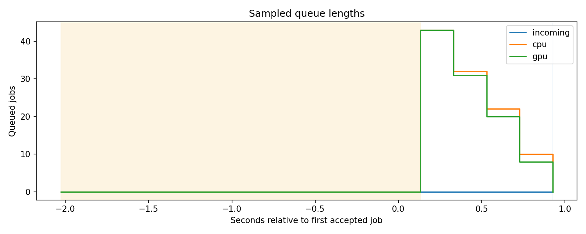
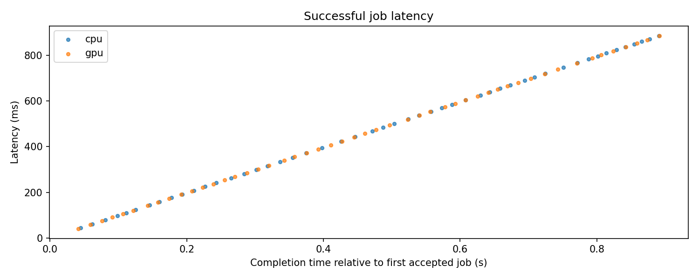
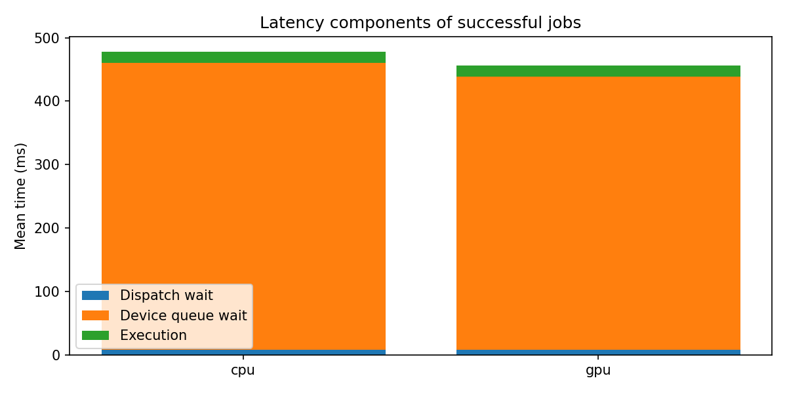
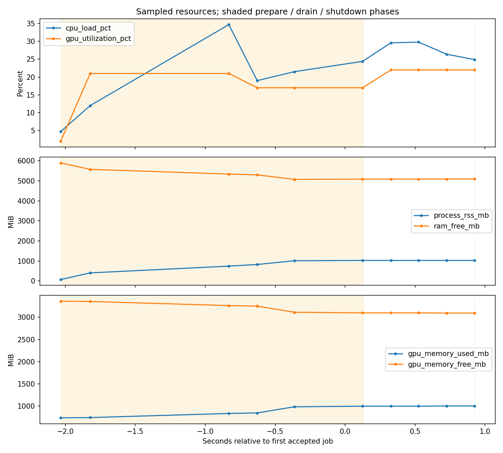

# Pipeline run report

Run: `20261029T034929Z_6660920a`

Source: `/home/yoo/HDH/logs/pipeline/20261029T034929Z_6660920a`

Status: **passed**

This report reads saved artifacts; inference is not rerun.

## Pipeline results

Policy: `round-robin`. Successful jobs supply latency percentiles; failed jobs are reported separately.

| Accepted | Completed | Failed | Unfinished | Reconciled | Throughput jobs/s |
| --- | --- | --- | --- | --- | --- |
| 100 | 100 | 0 | 0 | True | 112.150 |

| Metric (ms) | Samples | Mean | P50 | P95 | P99 |
| --- | --- | --- | --- | --- | --- |
| dispatch_wait_ms | 100 | 8.128 | 7.280 | 10.044 | 10.161 |
| device_wait_ms | 100 | 441.156 | 442.067 | 826.797 | 857.332 |
| total_wait_ms | 100 | 449.284 | 450.151 | 836.752 | 867.541 |
| execution_ms | 100 | 17.555 | 16.744 | 26.018 | 30.412 |
| latency_ms | 100 | 466.839 | 470.823 | 852.997 | 884.463 |

Scheduler overhead measures snapshot + selection + enqueue; it differs from dispatch waiting time.

| Attempts | Mean ms | P95 ms | Total ms |
| --- | --- | --- | --- |
| 100 | 0.057 | 0.088 | 5.731 |

| Device | Assigned | Completed | Failed |
| --- | --- | --- | --- |
| cpu | 50 | 50 | 0 |
| gpu | 50 | 50 | 0 |

## Measurement limits

Prepare/warm-up is excluded from job timing. Resource plots include all phases, including negative time before the first accepted job. Queue curves use state timestamps; resource curves use hardware-sample timestamps.

Missing metrics are gaps, not zero. Resource maxima are sampled observations, not absolute peaks. Sparse sampling can miss short queues or memory spikes. Small job counts do not support stable tail-percentile conclusions.

Both CPU/GPU backends are prepared even for single-device policies. A finite alternating batch is not a replay benchmark of four workload levels.

| Component | Diagnostics |
| --- | --- |
| controller | {"started": true, "closed": true, "accepting_jobs": false, "running_workers": [], "collector_errors": []} |
| collector | {"written_events": 400, "dropped_events": 0, "error": null, "closed": true, "running": false} |
| monitor | {"running": false, "sampler_error": null, "sink_error": null, "sequence": 10} |
| logger | {"written_samples": 10, "dropped_samples": 0, "error": null, "closed": true, "running": false} |

