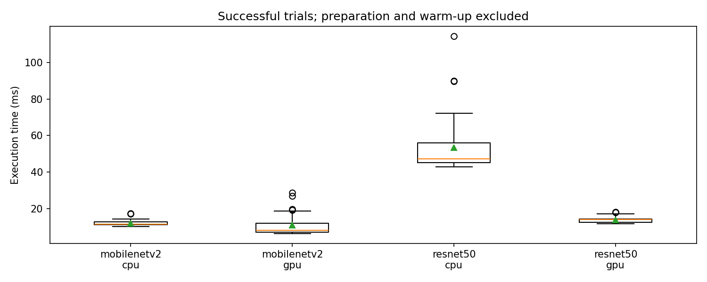
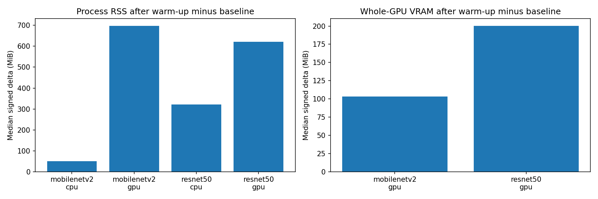

# Profiling run report

Run: `20261029T035002Z_5305ba8b`

Source: `/home/yoo/HDH/logs/profiling/20261029T035002Z_5305ba8b`

Status: **passed**

This report reads saved artifacts; inference is not rerun.

## Model/device profiling

Runs per pair per repeat: 20; repeats: 2; warm-up: 1; ORT threads: 2.

| Model | Device | Status | Samples | Repeats | Mean ms | P50 ms | P95 ms | P99 ms | Repeat mean std ms |
| --- | --- | --- | --- | --- | --- | --- | --- | --- | --- |
| mobilenetv2 | cpu | passed | 40 | 2 | 11.945 | 11.322 | 14.405 | 17.242 | 0.304 |
| mobilenetv2 | gpu | passed | 40 | 2 | 10.714 | 8.046 | 20.092 | 27.832 | 3.281 |
| resnet50 | cpu | passed | 40 | 2 | 53.341 | 47.152 | 89.816 | 105.044 | 8.130 |
| resnet50 | gpu | passed | 40 | 2 | 13.728 | 13.856 | 17.192 | 17.917 | 0.404 |

| Model | Device | RSS baseline MiB | RSS ready MiB | RSS delta MiB | RSS observed max MiB | VRAM delta MiB | VRAM observed max MiB |
| --- | --- | --- | --- | --- | --- | --- | --- |
| mobilenetv2 | cpu | 47.078 | 97.287 | 50.209 | 104.270 | — | — |
| mobilenetv2 | gpu | 73.025 | 770.553 | 697.527 | 776.113 | 103.336 | 884.145 |
| resnet50 | cpu | 47.096 | 368.904 | 321.809 | 383.430 | — | — |
| resnet50 | gpu | 72.986 | 694.516 | 621.529 | 704.094 | 200.281 | 1062.637 |

## Measurement limits

image load + preprocessing + synchronous ONNX run + validation; excludes prepare/warmup, sampling waits and file I/O

one model/device per fresh process; RSS whole process; VRAM whole GPU; baseline deltas are signed estimates; maxima are sampled observations, not absolute peaks

Each model/device/repeat uses a fresh process. Memory baseline/ready/deltas in the table are medians across successful repeats; observed maxima cover sampled inference-phase values. Short inference spikes can be missed. Whole-GPU VRAM may include other applications; a signed delta is not an exact model allocation.

Failed trials are excluded from calibration. Missing memory remains unavailable. CPU-only profiles do not measure GPU inference. These measurements do not compare scheduler policies.

| Model | Device | Repeat | Status | Errors / unavailable metrics |
| --- | --- | --- | --- | --- |
| mobilenetv2 | cpu | 1 | passed | {"errors": [], "resource_metrics": {"cpu_load_pct": {"valid_samples": 5, "unavailable_samples": 0, "mean": 7.459999999999999, "observed_max": 17.8, "errors": {}}, "ram_total_mb": {"valid_samples": 5, "unavailable_samples": 0, "mean": 7604.64453125, "observed_max": 7604.64453125, "errors": {}}, "ram_free_mb": {"valid_samples": 5, "unavailable_samples": 0, "mean": 5876.43046875, "observed_max": 5901.3671875, "errors": {}}, "ram_used_pct": {"valid_samples": 5, "unavailable_samples": 0, "mean": 22.74, "observed_max": 23.0, "errors": {}}, "process_rss_mb": {"valid_samples": 5, "unavailable_samples": 0, "mean": 79.553125, "observed_max": 103.34765625, "errors": {}}, "process_cpu_pct": {"valid_samples": 5, "unavailable_samples": 0, "mean": 50.980000000000004, "observed_max": 159.9, "errors": {}}, "gpu_memory_total_mb": {"valid_samples": 0, "unavailable_samples": 5, "mean": null, "observed_max": null, "errors": {"disabled": 5}}, "gpu_memory_used_mb": {"valid_samples": 0, "unavailable_samples": 5, "mean": null, "observed_max": null, "errors": {"disabled": 5}}, "gpu_memory_free_mb": {"valid_samples": 0, "unavailable_samples": 5, "mean": null, "observed_max": null, "errors": {"disabled": 5}}, "gpu_utilization_pct": {"valid_samples": 0, "unavailable_samples": 5, "mean": null, "observed_max": null, "errors": {"disabled": 5}}}} |
| mobilenetv2 | cpu | 2 | passed | {"errors": [], "resource_metrics": {"cpu_load_pct": {"valid_samples": 5, "unavailable_samples": 0, "mean": 7.5, "observed_max": 14.3, "errors": {}}, "ram_total_mb": {"valid_samples": 5, "unavailable_samples": 0, "mean": 7604.64453125, "observed_max": 7604.64453125, "errors": {}}, "ram_free_mb": {"valid_samples": 5, "unavailable_samples": 0, "mean": 5848.81328125, "observed_max": 5888.13671875, "errors": {}}, "ram_used_pct": {"valid_samples": 5, "unavailable_samples": 0, "mean": 23.1, "observed_max": 23.5, "errors": {}}, "process_rss_mb": {"valid_samples": 5, "unavailable_samples": 0, "mean": 80.0578125, "observed_max": 104.26953125, "errors": {}}, "process_cpu_pct": {"valid_samples": 5, "unavailable_samples": 0, "mean": 48.96, "observed_max": 154.8, "errors": {}}, "gpu_memory_total_mb": {"valid_samples": 0, "unavailable_samples": 5, "mean": null, "observed_max": null, "errors": {"disabled": 5}}, "gpu_memory_used_mb": {"valid_samples": 0, "unavailable_samples": 5, "mean": null, "observed_max": null, "errors": {"disabled": 5}}, "gpu_memory_free_mb": {"valid_samples": 0, "unavailable_samples": 5, "mean": null, "observed_max": null, "errors": {"disabled": 5}}, "gpu_utilization_pct": {"valid_samples": 0, "unavailable_samples": 5, "mean": null, "observed_max": null, "errors": {"disabled": 5}}}} |
| mobilenetv2 | gpu | 1 | passed | {"errors": [], "resource_metrics": {"cpu_load_pct": {"valid_samples": 7, "unavailable_samples": 0, "mean": 6.7, "observed_max": 14.6, "errors": {}}, "ram_total_mb": {"valid_samples": 7, "unavailable_samples": 0, "mean": 7604.64453125, "observed_max": 7604.64453125, "errors": {}}, "ram_free_mb": {"valid_samples": 7, "unavailable_samples": 0, "mean": 5562.2578125, "observed_max": 5852.38671875, "errors": {}}, "ram_used_pct": {"valid_samples": 7, "unavailable_samples": 0, "mean": 26.82857142857143, "observed_max": 29.5, "errors": {}}, "process_rss_mb": {"valid_samples": 7, "unavailable_samples": 0, "mean": 501.68470982142856, "observed_max": 776.11328125, "errors": {}}, "process_cpu_pct": {"valid_samples": 7, "unavailable_samples": 0, "mean": 58.18571428571429, "observed_max": 109.9, "errors": {}}, "gpu_memory_total_mb": {"valid_samples": 7, "unavailable_samples": 0, "mean": 4096.0, "observed_max": 4096.0, "errors": {}}, "gpu_memory_used_mb": {"valid_samples": 7, "unavailable_samples": 0, "mean": 817.9737723214286, "observed_max": 878.95703125, "errors": {}}, "gpu_memory_free_mb": {"valid_samples": 7, "unavailable_samples": 0, "mean": 3278.0262276785716, "observed_max": 3353.484375, "errors": {}}, "gpu_utilization_pct": {"valid_samples": 7, "unavailable_samples": 0, "mean": 18.857142857142858, "observed_max": 21.0, "errors": {}}}} |
| mobilenetv2 | gpu | 2 | passed | {"errors": [], "resource_metrics": {"cpu_load_pct": {"valid_samples": 8, "unavailable_samples": 0, "mean": 22.575, "observed_max": 39.5, "errors": {}}, "ram_total_mb": {"valid_samples": 8, "unavailable_samples": 0, "mean": 7604.64453125, "observed_max": 7604.64453125, "errors": {}}, "ram_free_mb": {"valid_samples": 8, "unavailable_samples": 0, "mean": 5487.44189453125, "observed_max": 5806.546875, "errors": {}}, "ram_used_pct": {"valid_samples": 8, "unavailable_samples": 0, "mean": 27.8375, "observed_max": 30.2, "errors": {}}, "process_rss_mb": {"valid_samples": 8, "unavailable_samples": 0, "mean": 531.21533203125, "observed_max": 775.01171875, "errors": {}}, "process_cpu_pct": {"valid_samples": 8, "unavailable_samples": 0, "mean": 63.85, "observed_max": 113.4, "errors": {}}, "gpu_memory_total_mb": {"valid_samples": 8, "unavailable_samples": 0, "mean": 4096.0, "observed_max": 4096.0, "errors": {}}, "gpu_memory_used_mb": {"valid_samples": 8, "unavailable_samples": 0, "mean": 833.8369140625, "observed_max": 884.14453125, "errors": {}}, "gpu_memory_free_mb": {"valid_samples": 8, "unavailable_samples": 0, "mean": 3262.1630859375, "observed_max": 3346.0859375, "errors": {}}, "gpu_utilization_pct": {"valid_samples": 8, "unavailable_samples": 0, "mean": 16.375, "observed_max": 18.0, "errors": {}}}} |
| resnet50 | cpu | 1 | passed | {"errors": [], "resource_metrics": {"cpu_load_pct": {"valid_samples": 9, "unavailable_samples": 0, "mean": 12.244444444444445, "observed_max": 20.7, "errors": {}}, "ram_total_mb": {"valid_samples": 9, "unavailable_samples": 0, "mean": 7604.64453125, "observed_max": 7604.64453125, "errors": {}}, "ram_free_mb": {"valid_samples": 9, "unavailable_samples": 0, "mean": 5595.383246527777, "observed_max": 5846.67578125, "errors": {}}, "ram_used_pct": {"valid_samples": 9, "unavailable_samples": 0, "mean": 26.422222222222224, "observed_max": 27.4, "errors": {}}, "process_rss_mb": {"valid_samples": 9, "unavailable_samples": 0, "mean": 307.62803819444446, "observed_max": 383.4296875, "errors": {}}, "process_cpu_pct": {"valid_samples": 9, "unavailable_samples": 0, "mean": 121.45555555555555, "observed_max": 205.1, "errors": {}}, "gpu_memory_total_mb": {"valid_samples": 0, "unavailable_samples": 9, "mean": null, "observed_max": null, "errors": {"disabled": 9}}, "gpu_memory_used_mb": {"valid_samples": 0, "unavailable_samples": 9, "mean": null, "observed_max": null, "errors": {"disabled": 9}}, "gpu_memory_free_mb": {"valid_samples": 0, "unavailable_samples": 9, "mean": null, "observed_max": null, "errors": {"disabled": 9}}, "gpu_utilization_pct": {"valid_samples": 0, "unavailable_samples": 9, "mean": null, "observed_max": null, "errors": {"disabled": 9}}}} |
| resnet50 | cpu | 2 | passed | {"errors": [], "resource_metrics": {"cpu_load_pct": {"valid_samples": 11, "unavailable_samples": 0, "mean": 13.045454545454545, "observed_max": 21.1, "errors": {}}, "ram_total_mb": {"valid_samples": 11, "unavailable_samples": 0, "mean": 7604.64453125, "observed_max": 7604.64453125, "errors": {}}, "ram_free_mb": {"valid_samples": 11, "unavailable_samples": 0, "mean": 5624.220525568182, "observed_max": 5870.09375, "errors": {}}, "ram_used_pct": {"valid_samples": 11, "unavailable_samples": 0, "mean": 26.045454545454547, "observed_max": 26.8, "errors": {}}, "process_rss_mb": {"valid_samples": 11, "unavailable_samples": 0, "mean": 299.69460227272725, "observed_max": 356.8828125, "errors": {}}, "process_cpu_pct": {"valid_samples": 11, "unavailable_samples": 0, "mean": 124.03636363636365, "observed_max": 199.9, "errors": {}}, "gpu_memory_total_mb": {"valid_samples": 0, "unavailable_samples": 11, "mean": null, "observed_max": null, "errors": {"disabled": 11}}, "gpu_memory_used_mb": {"valid_samples": 0, "unavailable_samples": 11, "mean": null, "observed_max": null, "errors": {"disabled": 11}}, "gpu_memory_free_mb": {"valid_samples": 0, "unavailable_samples": 11, "mean": null, "observed_max": null, "errors": {"disabled": 11}}, "gpu_utilization_pct": {"valid_samples": 0, "unavailable_samples": 11, "mean": null, "observed_max": null, "errors": {"disabled": 11}}}} |
| resnet50 | gpu | 1 | passed | {"errors": [], "resource_metrics": {"cpu_load_pct": {"valid_samples": 6, "unavailable_samples": 0, "mean": 6.566666666666666, "observed_max": 9.8, "errors": {}}, "ram_total_mb": {"valid_samples": 6, "unavailable_samples": 0, "mean": 7604.64453125, "observed_max": 7604.64453125, "errors": {}}, "ram_free_mb": {"valid_samples": 6, "unavailable_samples": 0, "mean": 5586.840494791667, "observed_max": 5840.46484375, "errors": {}}, "ram_used_pct": {"valid_samples": 6, "unavailable_samples": 0, "mean": 26.516666666666666, "observed_max": 28.4, "errors": {}}, "process_rss_mb": {"valid_samples": 6, "unavailable_samples": 0, "mean": 467.83203125, "observed_max": 704.09375, "errors": {}}, "process_cpu_pct": {"valid_samples": 6, "unavailable_samples": 0, "mean": 58.4, "observed_max": 105.0, "errors": {}}, "gpu_memory_total_mb": {"valid_samples": 6, "unavailable_samples": 0, "mean": 4096.0, "observed_max": 4096.0, "errors": {}}, "gpu_memory_used_mb": {"valid_samples": 6, "unavailable_samples": 0, "mean": 911.5963541666666, "observed_max": 1062.63671875, "errors": {}}, "gpu_memory_free_mb": {"valid_samples": 6, "unavailable_samples": 0, "mean": 3184.4036458333335, "observed_max": 3353.484375, "errors": {}}, "gpu_utilization_pct": {"valid_samples": 6, "unavailable_samples": 0, "mean": 18.0, "observed_max": 25.0, "errors": {}}}} |
| resnet50 | gpu | 2 | passed | {"errors": [], "resource_metrics": {"cpu_load_pct": {"valid_samples": 6, "unavailable_samples": 0, "mean": 7.916666666666667, "observed_max": 13.1, "errors": {}}, "ram_total_mb": {"valid_samples": 6, "unavailable_samples": 0, "mean": 7604.64453125, "observed_max": 7604.64453125, "errors": {}}, "ram_free_mb": {"valid_samples": 6, "unavailable_samples": 0, "mean": 5583.827473958333, "observed_max": 5854.421875, "errors": {}}, "ram_used_pct": {"valid_samples": 6, "unavailable_samples": 0, "mean": 26.583333333333332, "observed_max": 28.5, "errors": {}}, "process_rss_mb": {"valid_samples": 6, "unavailable_samples": 0, "mean": 464.1510416666667, "observed_max": 696.734375, "errors": {}}, "process_cpu_pct": {"valid_samples": 6, "unavailable_samples": 0, "mean": 60.36666666666667, "observed_max": 104.9, "errors": {}}, "gpu_memory_total_mb": {"valid_samples": 6, "unavailable_samples": 0, "mean": 4096.0, "observed_max": 4096.0, "errors": {}}, "gpu_memory_used_mb": {"valid_samples": 6, "unavailable_samples": 0, "mean": 873.4895833333334, "observed_max": 944.63671875, "errors": {}}, "gpu_memory_free_mb": {"valid_samples": 6, "unavailable_samples": 0, "mean": 3222.5104166666665, "observed_max": 3359.8046875, "errors": {}}, "gpu_utilization_pct": {"valid_samples": 6, "unavailable_samples": 0, "mean": 7.0, "observed_max": 11.0, "errors": {}}}} |

