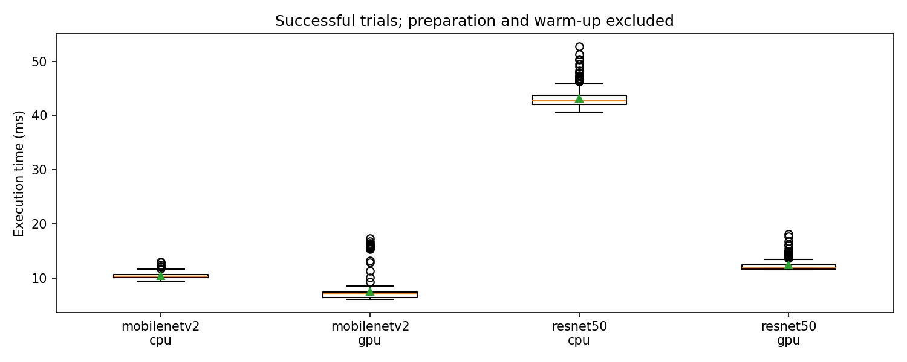
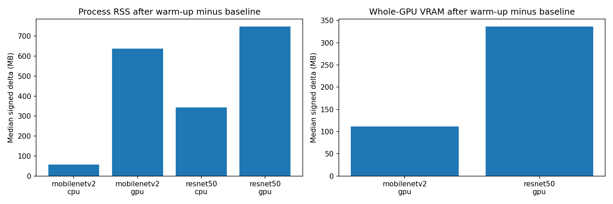

# Profiling run report

Run: `20261029T065843Z_5e300e44`

Source: `/home/yoo/HDH/logs/profiling/20261029T065843Z_5e300e44`

Status: **passed**

Memory unit: **MB** (1 MB = 1,000,000 bytes). Values retain the saved run's original unit.

This report reads saved artifacts; inference is not rerun.

## Model/device profiling

Runs per pair per repeat: 100; repeats: 3; warm-up: 5; ORT threads: 2.

| Model | Device | Status | Samples | Repeats | Mean ms | P50 ms | P95 ms | P99 ms | Repeat mean std ms |
| --- | --- | --- | --- | --- | --- | --- | --- | --- | --- |
| mobilenetv2 | cpu | passed | 300 | 3 | 10.395 | 10.324 | 11.325 | 12.428 | 0.057 |
| mobilenetv2 | gpu | passed | 300 | 3 | 7.508 | 7.016 | 15.376 | 16.172 | 0.559 |
| resnet50 | cpu | passed | 300 | 3 | 43.116 | 42.736 | 46.583 | 50.310 | 0.294 |
| resnet50 | gpu | passed | 300 | 3 | 12.359 | 11.823 | 14.718 | 16.242 | 0.095 |

| Model | Device | RSS baseline MB | RSS ready MB | RSS delta MB | RSS observed max MB | VRAM delta MB | VRAM observed max MB |
| --- | --- | --- | --- | --- | --- | --- | --- |
| mobilenetv2 | cpu | 49.385 | 107.397 | 57.983 | 108.880 | — | — |
| mobilenetv2 | gpu | 76.599 | 714.715 | 638.095 | 812.491 | 111.612 | 959.525 |
| resnet50 | cpu | 49.455 | 391.946 | 342.573 | 396.034 | — | — |
| resnet50 | gpu | 76.554 | 824.656 | 748.159 | 832.152 | 336.531 | 1160.720 |

## Measurement limits

image load + preprocessing + synchronous ONNX run + validation; excludes prepare/warmup, sampling waits and file I/O

one model/device per fresh process; RSS whole process; VRAM whole GPU; baseline deltas are signed estimates; maxima are sampled observations, not absolute peaks

Each model/device/repeat uses a fresh process. Memory baseline/ready/deltas in the table are medians across successful repeats; observed maxima cover sampled inference-phase values. Short inference spikes can be missed. Whole-GPU VRAM may include other applications; a signed delta is not an exact model allocation.

Failed trials are excluded from calibration. Missing memory remains unavailable. CPU-only profiles do not measure GPU inference. These measurements do not compare scheduler policies.

| Model | Device | Repeat | Status | Errors / unavailable metrics |
| --- | --- | --- | --- | --- |
| mobilenetv2 | cpu | 1 | passed | {"errors": [], "resource_metrics": {"cpu_load_pct": {"valid_samples": 9, "unavailable_samples": 0, "mean": 9.455555555555556, "observed_max": 14.5, "errors": {}}, "ram_total_mb": {"valid_samples": 9, "unavailable_samples": 0, "mean": 7974.047744, "observed_max": 7974.047744, "errors": {}}, "ram_free_mb": {"valid_samples": 9, "unavailable_samples": 0, "mean": 6200.618097777778, "observed_max": 6241.308672, "errors": {}}, "ram_used_pct": {"valid_samples": 9, "unavailable_samples": 0, "mean": 22.244444444444444, "observed_max": 22.4, "errors": {}}, "process_rss_mb": {"valid_samples": 9, "unavailable_samples": 0, "mean": 95.33485511111111, "observed_max": 108.6464, "errors": {}}, "process_cpu_pct": {"valid_samples": 9, "unavailable_samples": 0, "mean": 105.51111111111112, "observed_max": 169.6, "errors": {}}, "gpu_memory_total_mb": {"valid_samples": 0, "unavailable_samples": 9, "mean": null, "observed_max": null, "errors": {"disabled": 9}}, "gpu_memory_used_mb": {"valid_samples": 0, "unavailable_samples": 9, "mean": null, "observed_max": null, "errors": {"disabled": 9}}, "gpu_memory_free_mb": {"valid_samples": 0, "unavailable_samples": 9, "mean": null, "observed_max": null, "errors": {"disabled": 9}}, "gpu_utilization_pct": {"valid_samples": 0, "unavailable_samples": 9, "mean": null, "observed_max": null, "errors": {"disabled": 9}}}} |
| mobilenetv2 | cpu | 2 | passed | {"errors": [], "resource_metrics": {"cpu_load_pct": {"valid_samples": 9, "unavailable_samples": 0, "mean": 9.644444444444444, "observed_max": 19.2, "errors": {}}, "ram_total_mb": {"valid_samples": 9, "unavailable_samples": 0, "mean": 7974.047744, "observed_max": 7974.047744, "errors": {}}, "ram_free_mb": {"valid_samples": 9, "unavailable_samples": 0, "mean": 6153.3620906666665, "observed_max": 6193.790976, "errors": {}}, "ram_used_pct": {"valid_samples": 9, "unavailable_samples": 0, "mean": 22.844444444444445, "observed_max": 23.0, "errors": {}}, "process_rss_mb": {"valid_samples": 9, "unavailable_samples": 0, "mean": 95.23063466666666, "observed_max": 108.527616, "errors": {}}, "process_cpu_pct": {"valid_samples": 9, "unavailable_samples": 0, "mean": 101.65555555555555, "observed_max": 165.1, "errors": {}}, "gpu_memory_total_mb": {"valid_samples": 0, "unavailable_samples": 9, "mean": null, "observed_max": null, "errors": {"disabled": 9}}, "gpu_memory_used_mb": {"valid_samples": 0, "unavailable_samples": 9, "mean": null, "observed_max": null, "errors": {"disabled": 9}}, "gpu_memory_free_mb": {"valid_samples": 0, "unavailable_samples": 9, "mean": null, "observed_max": null, "errors": {"disabled": 9}}, "gpu_utilization_pct": {"valid_samples": 0, "unavailable_samples": 9, "mean": null, "observed_max": null, "errors": {"disabled": 9}}}} |
| mobilenetv2 | cpu | 3 | passed | {"errors": [], "resource_metrics": {"cpu_load_pct": {"valid_samples": 9, "unavailable_samples": 0, "mean": 8.722222222222221, "observed_max": 16.5, "errors": {}}, "ram_total_mb": {"valid_samples": 9, "unavailable_samples": 0, "mean": 7974.047744, "observed_max": 7974.047744, "errors": {}}, "ram_free_mb": {"valid_samples": 9, "unavailable_samples": 0, "mean": 6154.433422222222, "observed_max": 6196.191232, "errors": {}}, "ram_used_pct": {"valid_samples": 9, "unavailable_samples": 0, "mean": 22.844444444444445, "observed_max": 23.0, "errors": {}}, "process_rss_mb": {"valid_samples": 9, "unavailable_samples": 0, "mean": 95.5109831111111, "observed_max": 108.879872, "errors": {}}, "process_cpu_pct": {"valid_samples": 9, "unavailable_samples": 0, "mean": 101.66666666666667, "observed_max": 165.2, "errors": {}}, "gpu_memory_total_mb": {"valid_samples": 0, "unavailable_samples": 9, "mean": null, "observed_max": null, "errors": {"disabled": 9}}, "gpu_memory_used_mb": {"valid_samples": 0, "unavailable_samples": 9, "mean": null, "observed_max": null, "errors": {"disabled": 9}}, "gpu_memory_free_mb": {"valid_samples": 0, "unavailable_samples": 9, "mean": null, "observed_max": null, "errors": {"disabled": 9}}, "gpu_utilization_pct": {"valid_samples": 0, "unavailable_samples": 9, "mean": null, "observed_max": null, "errors": {"disabled": 9}}}} |
| mobilenetv2 | gpu | 1 | passed | {"errors": [], "resource_metrics": {"cpu_load_pct": {"valid_samples": 9, "unavailable_samples": 0, "mean": 6.411111111111111, "observed_max": 8.7, "errors": {}}, "ram_total_mb": {"valid_samples": 9, "unavailable_samples": 0, "mean": 7974.047744, "observed_max": 7974.047744, "errors": {}}, "ram_free_mb": {"valid_samples": 9, "unavailable_samples": 0, "mean": 5898.652330666667, "observed_max": 6199.627776, "errors": {}}, "ram_used_pct": {"valid_samples": 9, "unavailable_samples": 0, "mean": 26.044444444444444, "observed_max": 27.6, "errors": {}}, "process_rss_mb": {"valid_samples": 9, "unavailable_samples": 0, "mean": 538.3950791111112, "observed_max": 717.594624, "errors": {}}, "process_cpu_pct": {"valid_samples": 9, "unavailable_samples": 0, "mean": 74.92222222222222, "observed_max": 110.4, "errors": {}}, "gpu_memory_total_mb": {"valid_samples": 9, "unavailable_samples": 0, "mean": 4294.967296, "observed_max": 4294.967296, "errors": {}}, "gpu_memory_used_mb": {"valid_samples": 9, "unavailable_samples": 0, "mean": 911.843783111111, "observed_max": 939.937792, "errors": {}}, "gpu_memory_free_mb": {"valid_samples": 9, "unavailable_samples": 0, "mean": 3383.1235128888893, "observed_max": 3466.641408, "errors": {}}, "gpu_utilization_pct": {"valid_samples": 9, "unavailable_samples": 0, "mean": 6.111111111111111, "observed_max": 17.0, "errors": {}}}} |
| mobilenetv2 | gpu | 2 | passed | {"errors": [], "resource_metrics": {"cpu_load_pct": {"valid_samples": 10, "unavailable_samples": 0, "mean": 7.7, "observed_max": 18.7, "errors": {}}, "ram_total_mb": {"valid_samples": 10, "unavailable_samples": 0, "mean": 7974.047744, "observed_max": 7974.047744, "errors": {}}, "ram_free_mb": {"valid_samples": 10, "unavailable_samples": 0, "mean": 5843.7095424, "observed_max": 6193.516544, "errors": {}}, "ram_used_pct": {"valid_samples": 10, "unavailable_samples": 0, "mean": 26.71, "observed_max": 28.8, "errors": {}}, "process_rss_mb": {"valid_samples": 10, "unavailable_samples": 0, "mean": 590.6948096, "observed_max": 812.490752, "errors": {}}, "process_cpu_pct": {"valid_samples": 10, "unavailable_samples": 0, "mean": 74.28, "observed_max": 110.2, "errors": {}}, "gpu_memory_total_mb": {"valid_samples": 10, "unavailable_samples": 0, "mean": 4294.967296, "observed_max": 4294.967296, "errors": {}}, "gpu_memory_used_mb": {"valid_samples": 10, "unavailable_samples": 0, "mean": 920.1762304, "observed_max": 959.524864, "errors": {}}, "gpu_memory_free_mb": {"valid_samples": 10, "unavailable_samples": 0, "mean": 3374.7910656, "observed_max": 3476.414464, "errors": {}}, "gpu_utilization_pct": {"valid_samples": 10, "unavailable_samples": 0, "mean": 6.2, "observed_max": 21.0, "errors": {}}}} |
| mobilenetv2 | gpu | 3 | passed | {"errors": [], "resource_metrics": {"cpu_load_pct": {"valid_samples": 10, "unavailable_samples": 0, "mean": 7.340000000000001, "observed_max": 13.3, "errors": {}}, "ram_total_mb": {"valid_samples": 10, "unavailable_samples": 0, "mean": 7974.047744, "observed_max": 7974.047744, "errors": {}}, "ram_free_mb": {"valid_samples": 10, "unavailable_samples": 0, "mean": 5867.4958336, "observed_max": 6181.810176, "errors": {}}, "ram_used_pct": {"valid_samples": 10, "unavailable_samples": 0, "mean": 26.419999999999998, "observed_max": 27.9, "errors": {}}, "process_rss_mb": {"valid_samples": 10, "unavailable_samples": 0, "mean": 555.845632, "observed_max": 718.757888, "errors": {}}, "process_cpu_pct": {"valid_samples": 10, "unavailable_samples": 0, "mean": 75.33, "observed_max": 113.8, "errors": {}}, "gpu_memory_total_mb": {"valid_samples": 10, "unavailable_samples": 0, "mean": 4294.967296, "observed_max": 4294.967296, "errors": {}}, "gpu_memory_used_mb": {"valid_samples": 10, "unavailable_samples": 0, "mean": 905.8238464, "observed_max": 930.033664, "errors": {}}, "gpu_memory_free_mb": {"valid_samples": 10, "unavailable_samples": 0, "mean": 3389.1434496, "observed_max": 3476.545536, "errors": {}}, "gpu_utilization_pct": {"valid_samples": 10, "unavailable_samples": 0, "mean": 4.3, "observed_max": 8.0, "errors": {}}}} |
| resnet50 | cpu | 1 | passed | {"errors": [], "resource_metrics": {"cpu_load_pct": {"valid_samples": 27, "unavailable_samples": 0, "mean": 14.71111111111111, "observed_max": 23.7, "errors": {}}, "ram_total_mb": {"valid_samples": 27, "unavailable_samples": 0, "mean": 7974.047744, "observed_max": 7974.047744, "errors": {}}, "ram_free_mb": {"valid_samples": 27, "unavailable_samples": 0, "mean": 5909.960628148147, "observed_max": 6216.470528, "errors": {}}, "ram_used_pct": {"valid_samples": 27, "unavailable_samples": 0, "mean": 25.885185185185183, "observed_max": 26.2, "errors": {}}, "process_rss_mb": {"valid_samples": 27, "unavailable_samples": 0, "mean": 354.3319134814815, "observed_max": 379.404288, "errors": {}}, "process_cpu_pct": {"valid_samples": 27, "unavailable_samples": 0, "mean": 175.05185185185184, "observed_max": 209.2, "errors": {}}, "gpu_memory_total_mb": {"valid_samples": 0, "unavailable_samples": 27, "mean": null, "observed_max": null, "errors": {"disabled": 27}}, "gpu_memory_used_mb": {"valid_samples": 0, "unavailable_samples": 27, "mean": null, "observed_max": null, "errors": {"disabled": 27}}, "gpu_memory_free_mb": {"valid_samples": 0, "unavailable_samples": 27, "mean": null, "observed_max": null, "errors": {"disabled": 27}}, "gpu_utilization_pct": {"valid_samples": 0, "unavailable_samples": 27, "mean": null, "observed_max": null, "errors": {"disabled": 27}}}} |
| resnet50 | cpu | 2 | passed | {"errors": [], "resource_metrics": {"cpu_load_pct": {"valid_samples": 26, "unavailable_samples": 0, "mean": 15.149999999999999, "observed_max": 20.5, "errors": {}}, "ram_total_mb": {"valid_samples": 26, "unavailable_samples": 0, "mean": 7974.047744, "observed_max": 7974.047744, "errors": {}}, "ram_free_mb": {"valid_samples": 26, "unavailable_samples": 0, "mean": 5900.352118153846, "observed_max": 6204.731392, "errors": {}}, "ram_used_pct": {"valid_samples": 26, "unavailable_samples": 0, "mean": 25.98846153846154, "observed_max": 26.4, "errors": {}}, "process_rss_mb": {"valid_samples": 26, "unavailable_samples": 0, "mean": 368.8010043076923, "observed_max": 396.034048, "errors": {}}, "process_cpu_pct": {"valid_samples": 26, "unavailable_samples": 0, "mean": 178.98076923076923, "observed_max": 214.2, "errors": {}}, "gpu_memory_total_mb": {"valid_samples": 0, "unavailable_samples": 26, "mean": null, "observed_max": null, "errors": {"disabled": 26}}, "gpu_memory_used_mb": {"valid_samples": 0, "unavailable_samples": 26, "mean": null, "observed_max": null, "errors": {"disabled": 26}}, "gpu_memory_free_mb": {"valid_samples": 0, "unavailable_samples": 26, "mean": null, "observed_max": null, "errors": {"disabled": 26}}, "gpu_utilization_pct": {"valid_samples": 0, "unavailable_samples": 26, "mean": null, "observed_max": null, "errors": {"disabled": 26}}}} |
| resnet50 | cpu | 3 | passed | {"errors": [], "resource_metrics": {"cpu_load_pct": {"valid_samples": 26, "unavailable_samples": 0, "mean": 15.399999999999999, "observed_max": 28.0, "errors": {}}, "ram_total_mb": {"valid_samples": 26, "unavailable_samples": 0, "mean": 7974.047744, "observed_max": 7974.047744, "errors": {}}, "ram_free_mb": {"valid_samples": 26, "unavailable_samples": 0, "mean": 5894.192679384616, "observed_max": 6199.5008, "errors": {}}, "ram_used_pct": {"valid_samples": 26, "unavailable_samples": 0, "mean": 26.088461538461537, "observed_max": 26.5, "errors": {}}, "process_rss_mb": {"valid_samples": 26, "unavailable_samples": 0, "mean": 366.55797169230766, "observed_max": 393.592832, "errors": {}}, "process_cpu_pct": {"valid_samples": 26, "unavailable_samples": 0, "mean": 182.53846153846155, "observed_max": 209.7, "errors": {}}, "gpu_memory_total_mb": {"valid_samples": 0, "unavailable_samples": 26, "mean": null, "observed_max": null, "errors": {"disabled": 26}}, "gpu_memory_used_mb": {"valid_samples": 0, "unavailable_samples": 26, "mean": null, "observed_max": null, "errors": {"disabled": 26}}, "gpu_memory_free_mb": {"valid_samples": 0, "unavailable_samples": 26, "mean": null, "observed_max": null, "errors": {"disabled": 26}}, "gpu_utilization_pct": {"valid_samples": 0, "unavailable_samples": 26, "mean": null, "observed_max": null, "errors": {"disabled": 26}}}} |
| resnet50 | gpu | 1 | passed | {"errors": [], "resource_metrics": {"cpu_load_pct": {"valid_samples": 12, "unavailable_samples": 0, "mean": 7.516666666666667, "observed_max": 13.2, "errors": {}}, "ram_total_mb": {"valid_samples": 12, "unavailable_samples": 0, "mean": 7974.047744, "observed_max": 7974.047744, "errors": {}}, "ram_free_mb": {"valid_samples": 12, "unavailable_samples": 0, "mean": 5763.904853333333, "observed_max": 6181.511168, "errors": {}}, "ram_used_pct": {"valid_samples": 12, "unavailable_samples": 0, "mean": 27.708333333333332, "observed_max": 29.1, "errors": {}}, "process_rss_mb": {"valid_samples": 12, "unavailable_samples": 0, "mean": 674.7634346666667, "observed_max": 828.70272, "errors": {}}, "process_cpu_pct": {"valid_samples": 12, "unavailable_samples": 0, "mean": 81.33333333333333, "observed_max": 110.7, "errors": {}}, "gpu_memory_total_mb": {"valid_samples": 12, "unavailable_samples": 0, "mean": 4294.967296, "observed_max": 4294.967296, "errors": {}}, "gpu_memory_used_mb": {"valid_samples": 12, "unavailable_samples": 0, "mean": 1081.8689706666667, "observed_max": 1160.720384, "errors": {}}, "gpu_memory_free_mb": {"valid_samples": 12, "unavailable_samples": 0, "mean": 3213.098325333333, "observed_max": 3470.778368, "errors": {}}, "gpu_utilization_pct": {"valid_samples": 12, "unavailable_samples": 0, "mean": 21.833333333333332, "observed_max": 60.0, "errors": {}}}} |
| resnet50 | gpu | 2 | passed | {"errors": [], "resource_metrics": {"cpu_load_pct": {"valid_samples": 12, "unavailable_samples": 0, "mean": 7.116666666666667, "observed_max": 10.0, "errors": {}}, "ram_total_mb": {"valid_samples": 12, "unavailable_samples": 0, "mean": 7974.047744, "observed_max": 7974.047744, "errors": {}}, "ram_free_mb": {"valid_samples": 12, "unavailable_samples": 0, "mean": 5834.776576, "observed_max": 6192.467968, "errors": {}}, "ram_used_pct": {"valid_samples": 12, "unavailable_samples": 0, "mean": 26.816666666666666, "observed_max": 27.8, "errors": {}}, "process_rss_mb": {"valid_samples": 12, "unavailable_samples": 0, "mean": 608.3072000000001, "observed_max": 730.615808, "errors": {}}, "process_cpu_pct": {"valid_samples": 12, "unavailable_samples": 0, "mean": 78.05, "observed_max": 110.3, "errors": {}}, "gpu_memory_total_mb": {"valid_samples": 12, "unavailable_samples": 0, "mean": 4294.967296, "observed_max": 4294.967296, "errors": {}}, "gpu_memory_used_mb": {"valid_samples": 12, "unavailable_samples": 0, "mean": 992.69632, "observed_max": 1028.599808, "errors": {}}, "gpu_memory_free_mb": {"valid_samples": 12, "unavailable_samples": 0, "mean": 3302.270976, "observed_max": 3476.545536, "errors": {}}, "gpu_utilization_pct": {"valid_samples": 12, "unavailable_samples": 0, "mean": 22.833333333333332, "observed_max": 64.0, "errors": {}}}} |
| resnet50 | gpu | 3 | passed | {"errors": [], "resource_metrics": {"cpu_load_pct": {"valid_samples": 12, "unavailable_samples": 0, "mean": 7.133333333333333, "observed_max": 10.7, "errors": {}}, "ram_total_mb": {"valid_samples": 12, "unavailable_samples": 0, "mean": 7974.047744, "observed_max": 7974.047744, "errors": {}}, "ram_free_mb": {"valid_samples": 12, "unavailable_samples": 0, "mean": 5742.143829333333, "observed_max": 6179.459072, "errors": {}}, "ram_used_pct": {"valid_samples": 12, "unavailable_samples": 0, "mean": 27.991666666666664, "observed_max": 29.4, "errors": {}}, "process_rss_mb": {"valid_samples": 12, "unavailable_samples": 0, "mean": 679.4584746666667, "observed_max": 832.151552, "errors": {}}, "process_cpu_pct": {"valid_samples": 12, "unavailable_samples": 0, "mean": 81.5, "observed_max": 115.0, "errors": {}}, "gpu_memory_total_mb": {"valid_samples": 12, "unavailable_samples": 0, "mean": 4294.967296, "observed_max": 4294.967296, "errors": {}}, "gpu_memory_used_mb": {"valid_samples": 12, "unavailable_samples": 0, "mean": 1080.3944106666665, "observed_max": 1160.654848, "errors": {}}, "gpu_memory_free_mb": {"valid_samples": 12, "unavailable_samples": 0, "mean": 3214.5728853333335, "observed_max": 3476.48, "errors": {}}, "gpu_utilization_pct": {"valid_samples": 12, "unavailable_samples": 0, "mean": 20.833333333333332, "observed_max": 46.0, "errors": {}}}} |

