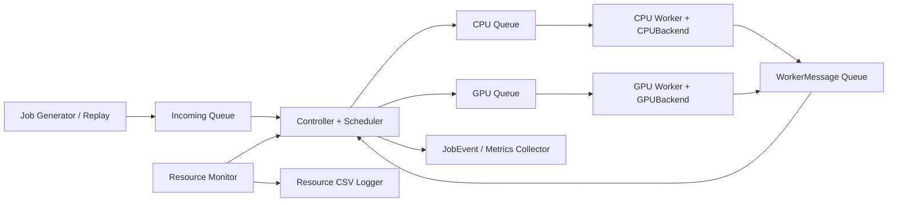

# Báo cáo phân tích dự án điều phối tác vụ suy luận AI giữa CPU và GPU cho Edge AI

**Ngày lập:** 21/10/2026  
**Mã nguồn tham chiếu:** commit `3d67759`, cùng các tài liệu có trong thư mục project tại thời điểm phân tích.  
**Phạm vi:** mục tiêu đề tài, lý do lựa chọn, kiến thức Hệ điều hành, hiện trạng triển khai và phương pháp kiểm chứng.

## 1. Tổng quan và mục tiêu dự án

Đề tài **“Thiết kế và xây dựng hệ thống điều phối tác vụ suy luận AI giữa CPU và GPU cho Edge AI”** nghiên cứu cách phân phối nhiều yêu cầu suy luận giữa hai loại thiết bị tính toán. Mỗi yêu cầu được biểu diễn bằng một `Job`, chứa ID, model, ảnh đầu vào, thiết bị được gán, trạng thái, các mốc thời gian và kết quả hoặc lỗi.

Mục tiêu chính là xây dựng một pipeline nhận job, xếp hàng, chọn thiết bị, thực thi suy luận và thu số liệu; từ đó đánh giá cách điều phối nào phù hợp với từng mức tải. Hai model pretrained được dùng là MobileNetV2 và ResNet-50, nhằm tạo ra các tác vụ có chi phí xử lý khác nhau. Dự án tập trung vào **scheduling và quản lý tài nguyên**, không huấn luyện model mới, viết GPU driver hay tự viết CUDA kernel.

Các kết quả mà dự án hướng tới gồm:

1. Chạy được cả hai model trên CPU và GPU với cùng quy trình tiền xử lý.
2. Có Incoming Queue, CPU Queue, GPU Queue và một worker cho mỗi thiết bị.
3. So sánh CPU-only, GPU-only, Round Robin và Resource-aware trên cùng lịch job.
4. Theo dõi đầy đủ vòng đời job, xử lý lỗi, chống tiếp nhận trùng và dừng chương trình có kiểm soát.
5. Đo latency, throughput, thời gian chờ, tài nguyên, tỷ lệ lỗi và chi phí điều phối.
6. Xác định điều kiện mà phối hợp CPU/GPU mang lại lợi ích, kể cả trường hợp phối hợp làm kết quả kém hơn.

Nguồn xác định phạm vi: [README.md](../README.md), [PLAN.md](../PLAN.md).

## 2. Tại sao thực hiện đề tài này?

### 2.1. Thiết bị nhanh với một job chưa chắc tốt cho cả hệ thống

Nếu dồn mọi job lên GPU, thời gian xử lý riêng lẻ có thể thấp nhưng hàng đợi GPU có thể dài, trong khi CPU còn khả năng thực thi. Người dùng phải chờ cả thời gian xếp hàng và thời gian chạy; vì vậy tối ưu thời gian suy luận đơn lẻ chưa đủ để tối ưu thời gian phản hồi toàn hệ thống.

Ngược lại, phân việc đều theo số lượng cũng chưa chắc hợp lý: một job MobileNetV2 và một job ResNet-50 có chi phí khác nhau; CPU và GPU cũng có tốc độ khác nhau với từng model. GPU còn có chi phí chuẩn bị dữ liệu và truyền dữ liệu. Điều phối cần xét lượng công việc đang chờ thay vì chỉ đếm số job hoặc nhìn utilization tại một thời điểm.

Số liệu backend đã lưu trong project minh họa điều này: MobileNetV2 có thời gian trung bình CPU/GPU khoảng **12,654/14,484 ms**, còn ResNet-50 là **51,274/16,578 ms**. Đây là một lượt kiểm tra có profiling và tiền xử lý, chưa đủ để kết luận về hiệu quả scheduler, nhưng cho thấy không nên mặc định mọi model đều có lợi như nhau khi chuyển lên GPU.

### 2.2. Bài toán phù hợp với môn Hệ điều hành

Ứng dụng phải giải quyết các vấn đề quen thuộc của Hệ điều hành: nhiều luồng chạy đồng thời, chia sẻ dữ liệu, producer–consumer, đồng bộ, lập lịch, quản lý bộ nhớ và thu hồi tài nguyên. Tác vụ AI đóng vai trò workload thực tế để quan sát ảnh hưởng của các quyết định quản lý tài nguyên.

Edge AI là bối cảnh mục tiêu vì tài nguyên tính toán và bộ nhớ có giới hạn. Tuy nhiên, bằng chứng hiện có được thu trên PC/laptop dùng WSL2 và NVIDIA GTX 1650; project chưa chứng minh khả năng triển khai hoặc mức hiệu quả tương tự trên mọi thiết bị edge như Jetson.

## 3. Phân tích cấu trúc và hiện trạng project

### 3.1. Các nhóm thành phần

| Nhóm | File/thư mục tiêu biểu | Vai trò |
|---|---|---|
| Tài liệu | `README.md`, `PLAN.md`, các báo cáo T02/T03/T04/T06/T08, `WEEK2_IMPLEMENTATION_REPORT.md` | Phạm vi, hợp đồng, kế hoạch và bằng chứng từng phần |
| Dữ liệu, model | `models/`, `inputs/test.jpg` | Hai model ONNX và ảnh đầu vào mẫu |
| Hợp đồng dữ liệu | `src/edge_scheduler/models.py`, `interfaces.py`, `contracts.py`, `contract_validation.py` | Job, trạng thái, snapshot, sự kiện và API giữa các thành phần |
| Điều phối | `queues.py`, `controller.py`, `schedulers.py`, `shutdown.py` | Hàng đợi, WorkerLoop, chuyển trạng thái, chọn thiết bị và hỗ trợ dừng |
| Suy luận | `model_registry.py`, `preprocess.py`, `onnx_backend.py`, `cpu_backend.py`, `gpu_backend.py` | Nạp model, warm-up, chuẩn hóa ảnh, chạy CPU/CUDA, kiểm tra output |
| Giám sát | `monitoring_models.py`, `system_probe.py`, `gpu_probe.py`, `resource_monitor.py`, `resource_log.py` | Đọc CPU/RAM/VRAM, cache snapshot và ghi CSV nền |
| Chạy thử | `scripts/T02_smoke_test.py`, `T03_model_test.py`, `T06_worker_test.py`, `T08_monitor_test.py`, `demo_week2.py` | Smoke test, nghiệm thu backend/monitor và demo điều phối giả lập |
| Kiểm thử, bằng chứng | `tests/`, `test_cases/`, `logs/t06/`, `logs/t08/` | Unit/integration tests, mô tả testcase, summary, CSV, output và trace |

### 3.2. Kiến trúc xử lý



Sơ đồ mô tả kiến trúc hướng tới sau tích hợp. Trong mã hiện tại, `Controller` chạy một worker thread cho mỗi thiết bị; `dispatch_pending()` và `drain_events()` được caller hoặc vòng `wait_all()` gọi để điều phối và xử lý thông điệp. Chưa có CLI replay/benchmark hoàn chỉnh tự vận hành toàn bộ sơ đồ.

### 3.3. Phân biệt phần đã có với phần còn thiếu

| Hạng mục | Trạng thái có thể xác nhận |
|---|---|
| Môi trường, hai model, tiền xử lý | Có tài liệu T02/T03, model và mã dùng chung |
| CPUBackend/GPUBackend thật | Có mã T06, log chạy thật và trace compute CUDA ngày 18/10/2026 |
| Resource Monitor và CSV logger | Có mã T08, test và log theo dõi hai backend chạy đồng thời |
| Queue/Controller/WorkerLoop | Đã có mã và bộ test tuần 2 bằng backend giả |
| Bốn scheduler | Đã có lớp triển khai; Resource-aware được test bằng service-time profile giả |
| Collector thống kê toàn pipeline | Có protocol và collector giả trong test; chưa thấy implementation tổng hợp benchmark dùng chung |
| Generator/replay low, medium, high, burst | Là yêu cầu trong kế hoạch; chưa thấy bộ replay/benchmark hoàn chỉnh |
| Tích hợp Controller + backend thật + monitor + profile đo thật | Chưa có bằng chứng nghiệm thu đầy đủ trong repository |
| So sánh hiệu năng bốn scheduler | Chưa có kết quả benchmark toàn hệ thống đủ điều kiện kết luận |

**Lưu ý về độ mới của tài liệu:** README, PLAN và một số báo cáo T04/T06/T08 còn ghi queue/controller/scheduler chưa triển khai. Checkout hiện tại đã có mã và báo cáo tuần 2 cho các phần này. Báo cáo này dùng mã nguồn và kiểm thử hiện tại để xác nhận sự tồn tại; kết quả lịch sử của từng module vẫn giữ nguyên phạm vi, không được xem là nghiệm thu tích hợp thật.

## 4. Những kiến thức Hệ điều hành được vận dụng

### 4.1. Process, thread và thực thi đồng thời

Phiên bản hiện tại dùng **nhiều thread trong một process Python**, gồm worker CPU, worker GPU, sampler tài nguyên và writer CSV. Hai worker dùng backend riêng, mỗi backend giữ các inference session được tái sử dụng. Việc nạp model/warm-up diễn ra trước workload đo, giúp tách chi phí khởi tạo khỏi thời gian xử lý thông thường.

Cần phân biệt concurrency với việc chắc chắn chạy song song mọi đoạn Python: mức song song thực tế còn phụ thuộc runtime, thư viện native và phần cứng. ONNX Runtime còn có thread nội bộ; backend hiện đặt intra-op là 2, inter-op là 1, execution mode sequential và tắt intra-op spinning. Cố định các thông số này giúp kiểm soát tranh chấp CPU khi đo.

Project hiện sử dụng **giao tiếp liên luồng bằng queue**, chưa triển khai IPC giữa nhiều process bằng pipe, socket hay shared memory. IPC là kiến thức liên quan và hướng mở rộng, không phải một tính năng đã có trong checkout.

### 4.2. Producer–consumer và hàng đợi

Luồng nhận job đóng vai trò producer; scheduler/controller lấy job từ Incoming Queue và đưa vào CPU/GPU Queue; worker là consumer của queue tương ứng. Worker lại là producer của `WorkerMessage`, còn controller là consumer cập nhật trạng thái.

`queue.Queue` hỗ trợ trao đổi an toàn giữa các thread. `task_done()` và các bộ đếm công việc chưa hoàn tất hỗ trợ xác định lúc drain xong. Queue cho phép tiếp nhận và thực thi hoạt động độc lập, đồng thời làm lộ ra tình trạng quá tải thông qua số job và thời gian chờ.

Job queues hiện chưa đặt giới hạn dung lượng. Vì vậy dự án đã có mô hình producer–consumer, nhưng chưa có backpressure hoàn chỉnh để hạn chế nhận job khi tải cao kéo dài. Riêng queue của resource logger có giới hạn, mặc định 1024 mẫu.

### 4.3. Critical section, lock và quyền sở hữu trạng thái

`Controller` dùng `RLock` để bảo vệ tiếp nhận job, dispatch và xử lý thông điệp; `JobQueues` dùng `Lock` bảo vệ các tập ID accepted/scheduled/terminal. Worker chỉ phát `STARTED`, `COMPLETED`, `FAILED`; controller là nơi xử lý thay đổi trạng thái sau dispatch.

Quy tắc một đầu mối cập nhật trạng thái giúp tránh hai luồng cùng ghi kết quả hoặc chuyển một job đã kết thúc trở lại trạng thái chạy. Vòng đời bình thường là:

```text
CREATED → WAITING → SCHEDULED → RUNNING → COMPLETED
                     lỗi ở bước phù hợp → FAILED
```

Chặn ID trùng và chặn terminal message lặp là kiểm tra tính đúng đắn, không chỉ là thống kê. Khi chạy bình thường và drain xong phải thỏa:

```text
accepted_jobs = completed_jobs + failed_jobs
mỗi accepted job_id có đúng một terminal outcome
```

Cam kết này áp dụng cho các kịch bản in-process đã kiểm tra. Chưa có cơ chế lưu bền để bảo đảm kết quả sau mất điện hoặc kill toàn bộ process.

### 4.4. Scheduling trên tài nguyên không đồng nhất

CPU-only và GPU-only tạo hai mốc so sánh; Round Robin luân phiên thiết bị; Resource-aware ước lượng thời gian hoàn thành cho từng lựa chọn:

```text
F(d, j) = R(d) + Σ S(model(q), d) + S(model(j), d)
                  q thuộc queue d
```

Trong đó `R(d)` là thời gian còn lại ước lượng của job đang chạy và `S(m,d)` là service time của model `m` trên thiết bị `d`. Chọn thiết bị có `F` nhỏ hơn; job đang chạy không được tính lại trong queue. Đây là lập lịch ở tầng ứng dụng để chọn thiết bị, không thay thế bộ lập lịch CPU của kernel.

Resource-aware hiện đã tính theo công thức trên, nhưng chưa hoàn thiện mọi điều kiện tài nguyên trong thiết kế: chưa dùng trực tiếp CPU load/VRAM làm ràng buộc, chưa xét cờ `estimated_remaining_known`, tuổi snapshot hoặc thiếu năng lực cả hai phía một cách đầy đủ. Trường `priority` cũng mới được lưu, chưa được dùng để lập lịch ưu tiên. Cần hoàn tất và kiểm thử các điểm này trước khi mô tả scheduler là thích nghi đầy đủ theo tài nguyên.

### 4.5. Quản lý bộ nhớ và tài nguyên thiết bị

Model/session được nạp một lần rồi tái sử dụng, thay vì nạp lại cho từng job. `close()` kết thúc profiling và giải phóng tham chiếu session; chuẩn bị thất bại phải dọn phần tài nguyên đã tạo. Cách quản lý vòng đời này liên hệ trực tiếp với cấp phát và thu hồi tài nguyên.

Monitor đo RAM available, RSS process và VRAM. RSS là của toàn process, không phải bộ nhớ riêng của CPU/GPU worker; VRAM là của GPU được chọn, có thể gồm ứng dụng khác. Các trường tên `_mb` thực tế dùng MiB. CPU/RAM trên WSL phản ánh phạm vi OS guest quan sát được.

### 4.6. I/O bất đồng bộ, snapshot và giới hạn quan sát

Sampler đọc phần cứng theo chu kỳ mặc định 200 ms rồi cập nhật cache. Scheduler đọc snapshot từ cache thay vì chờ mỗi truy vấn NVML/psutil; writer CSV chạy bằng thread riêng. Lock cache không được giữ trong lúc gọi probe chậm.

Timestamp được lấy ở đầu lần đọc mẫu để phản ánh tuổi dữ liệu một cách bảo thủ; dữ liệu thiếu dùng `None` kèm nguyên nhân. Khi queue logger đầy, tăng `dropped_samples` thay vì chặn sampler. Đây là sự đánh đổi giữa độ đầy đủ của log và việc tránh làm chậm hệ thống đang được đo.

### 4.7. Graceful shutdown và kiểm soát vòng đời

`request_shutdown()` ngừng nhận job mới. `close()` tiếp tục dispatch/drain các job đã nhận, đối soát terminal, dừng và join worker rồi đóng backend và collector. Nếu timeout khi còn việc, controller báo lỗi và cho phép gọi `close()` lại; không tuyên bố đã đóng thành công khi worker vẫn chạy.

Các test backlog, shutdown giữa lúc chạy, nhiều producer cùng submit và lỗi collector giúp kiểm tra race condition, mất job và treo trong những kịch bản cụ thể. Bộ test hữu hạn chưa chứng minh không thể có deadlock trong mọi lịch thực thi.

## 5. Bằng chứng đã có về hoạt động của code

### 5.1. Kiểm tra lại tại thời điểm lập báo cáo

Tại project root, đã thực hiện:

```bash
.venv/bin/python -m unittest discover -s tests -v
PYTHONPATH=src .venv/bin/python scripts/demo_week2.py
```

Kết quả suite: **83 test được phát hiện, 81 PASS, 2 SKIP, không FAIL/ERROR**; unittest in `Ran 83 tests in 3.150s` và `OK (skipped=2)`. Hai ca bị bỏ qua là integration CUDA T06 và telemetry GPU thật T08 vì chưa bật biến môi trường yêu cầu GPU. Lượt này có chạy CPU inference thật; không xác nhận lại GPU thật ngày 21/10.

Demo backend giả cho kết quả 4 accepted = 4 terminal, gồm 3 completed và 1 failed do lỗi đầu vào được tạo cố ý; in `RECONCILE (4, 4) finished True`. Test stress tuần 2 cũng đạt đối soát **300 accepted = 282 completed + 18 failed cố ý**, đồng thời xác nhận các worker đã dừng. Những số này kiểm chứng luồng điều phối, không phải tốc độ ONNX.

Các số 33 hoặc 62 test trong báo cáo T06/T08 và 30 test trong báo cáo tuần 2 là quy mô những bộ kiểm thử ở từng thời điểm/phạm vi trước đó. Bộ hiện tại gồm 62 test T04/T06/T08 cộng 21 test controller/hardening.

### 5.2. Backend CPU/CUDA thật: bằng chứng ngày 18/10/2026

Nguồn: [T06_report.md](../T06_report.md), [summary T06](../logs/t06/20261018T033611Z_865ab910/summary.json), [jobs.csv](../logs/t06/20261018T033611Z_865ab910/jobs.csv) và [trace](../logs/t06/20261018T033611Z_865ab910/profiles/).

Lượt này dùng batch 1, 5 warm-up/model/device và 10 job/model/device, tổng 40 job. Thời gian đo gồm đọc ảnh, preprocessing, transfer khi cần, ONNX run đồng bộ và kiểm tra output; không gồm prepare. Profiling được bật.

| Model | CPU mean (ms) | GPU mean (ms) | Sai khác tuyệt đối lớn nhất CPU/GPU |
|---|---:|---:|---:|
| MobileNetV2 | 12,654 | 14,484 | 8,1062 × 10⁻⁶ |
| ResNet-50 | 51,274 | 16,578 | 1,3351 × 10⁻⁵ |

Cả hai phép so sánh đạt `assert_allclose(rtol=1e-4, atol=1e-4)`; output có shape `(1, 1000)`, dtype float32 và hữu hạn. Trace GPU ghi nhận MobileNetV2 có 780 CUDA Conv và 15 Gemm events; ResNet-50 có 795 Conv và 15 Gemm events, bao gồm warm-up.

Trace operator tính toán là bằng chứng mạnh hơn việc chỉ thấy `CUDAExecutionProvider` trong danh sách. Một số node phụ được gán CPU là graph partitioning của runtime; không đồng nghĩa toàn bộ job đã fallback sang CPU. Backend có kiểm tra và từ chối fallback toàn bộ khi yêu cầu GPU.

Các phép kiểm tra trên xác nhận suy luận thực thi và output CPU/GPU tương đồng trong tolerance; chưa đánh giá độ chính xác phân loại trên tập dữ liệu có nhãn và chưa chứng minh scheduler nào tốt hơn.

### 5.3. Monitor thật và chi phí giám sát

Nguồn: [T08_report.md](../T08_report.md), [summary T08](../logs/t08/20261018T084314Z_0c742da6/summary.json), [resources.csv](../logs/t08/20261018T084314Z_0c742da6/resources.csv).

Lượt lưu ngày 18/10 chạy hai backend đồng thời, hoàn tất **400 job**, thu và ghi **39/39 mẫu**, không mất mẫu, không lỗi sampler/writer; cả 10 metric hợp lệ ở 39/39 mẫu. Đỉnh quan sát RSS là 1073,25 MiB, VRAM used 1022,95 MiB, GPU utilization 47%. Đây là đỉnh qua lấy mẫu, không phải peak tuyệt đối của từng job.

Lượt [đo overhead theo cặp](../logs/t08/20261018T082334Z_ad189e2f/summary.json) có thay đổi thời gian -6,20%, -2,35%, +3,78%, median -2,35%. Dao động này chưa đủ để kết luận monitor tăng tốc hoặc có overhead bằng 0. Cần nhiều lần lặp và kiểm soát tải nền để có ước lượng chặt hơn.

## 6. Đo đạc thế nào để chứng minh dự án hoạt động ổn?

Cần kiểm chứng riêng ba vấn đề: **kết quả suy luận hợp lệ**, **pipeline xử lý job đúng và dừng sạch**, **chính sách điều phối có hiệu quả trong điều kiện nào**. Một lần chạy không crash hoặc một giá trị utilization cao chưa đủ trả lời cả ba.

### 6.1. Ghi sự kiện và kiểm tra tính đúng đắn

Mỗi job cần có bản ghi ID, model, input, thiết bị, trạng thái, lỗi và các timestamp. Collector đối chiếu `ACCEPTED`, `DISPATCHED`, `STARTED`, `COMPLETED/FAILED` theo ID, kể cả job lỗi trước khi bắt đầu chạy.

Sau mỗi lượt chạy phải kiểm tra:

- Không tiếp nhận trùng ID, không dispatch cùng job hai lần và không có hai terminal outcomes cho một ID.
- `accepted = completed + failed`; số job chưa terminal bằng 0 sau shutdown bình thường.
- Với job thành công: `arrival ≤ dispatch ≤ start ≤ finish`, output đúng shape/dtype và không chứa NaN/Inf.
- Job lỗi có nguyên nhân; không đếm job failed như job completed. Lỗi collector/writer cũng phải xuất hiện trong kết quả nghiệm thu.
- Sau close thành công: worker/sampler/writer đã dừng, session đã được đóng và log đã flush.

Đây là các điều kiện nghiệm thu về tính đúng đắn. Latency thấp không bù được việc mất job, tính sai output hoặc che giấu lỗi GPU.

### 6.2. Định nghĩa thời gian và chỉ số

Ký hiệu `a`, `d`, `s`, `f` lần lượt là thời điểm tiếp nhận, dispatch, bắt đầu worker xử lý và kết quả/lỗi đã sẵn sàng. Dùng đồng hồ monotonic trên cùng máy.

| Chỉ số | Công thức/cách đo | Ý nghĩa |
|---|---|---|
| Chờ dispatch | `d − a` | Độ trễ trước khi vào queue thiết bị |
| Chờ queue thiết bị | `s − d` | Mức ùn tắc ở CPU/GPU queue |
| Tổng thời gian chờ | `s − a` | Phần latency do xếp hàng |
| Execution/service time | `f − s` | Tiền xử lý, transfer khi cần, suy luận đồng bộ và kiểm tra output theo phạm vi backend |
| End-to-end latency | `f − a` | Thời gian job ở trong hệ thống sau khi được tiếp nhận |
| P50/P95/P99 latency | Phân vị trên job thành công | Mức điển hình và độ trễ ở phần đuôi phân phối |
| Throughput | `N_completed / (max(f_terminal) − min(a_accepted))` | Job thành công/giây, tính cả thời gian drain tới terminal cuối |
| Failure rate | `N_failed / N_accepted` | Tỷ lệ job thất bại |
| Phân bố CPU/GPU | Số assigned/completed/failed mỗi thiết bị | Kiểm tra chính sách và mức phân phối thực tế |
| Scheduler overhead | Đo quanh snapshot + chọn thiết bị + enqueue | Chi phí ra quyết định; báo cáo mean/P95 và tổng thời gian |

Với job thành công, kiểm tra đẳng thức `latency = chờ dispatch + chờ thiết bị + execution`, cho phép sai số số học nhỏ. Job failed trước `STARTED` không có execution time hợp lệ; để thiếu có nguyên nhân thay vì gán 0 rồi gộp vào thống kê.

Thời điểm `s`/`f` cần là timestamp phát từ worker, không phải lúc controller đọc thông điệp muộn hơn. GPU `f` phải là lúc output đã sẵn sàng ở phía caller; backend hiện dùng `session.run()` trả NumPy đồng bộ. Khi tạo manifest, lưu arrival offset dự kiến; `a` được ghi lúc tiếp nhận thực tế. Nên đo thêm độ trễ replay so với lịch dự kiến để phát hiện chính bộ phát tải không theo kịp.

### 6.3. Đo tài nguyên và độ tin cậy của log

Ghi CPU load, process CPU%, RAM available, RSS, VRAM total/used/free, GPU utilization nếu hỗ trợ; đồng thời ghi độ dài queue, worker state, tuổi mẫu, sample duration và lỗi từng metric. Đánh dấu các phase prepare, warm-up, inference, drain để tránh gộp nhầm chi phí khởi tạo vào giai đoạn benchmark.

Chu kỳ 200 ms không ghi lại mọi biến động của job khoảng 10 ms. Báo cáo cần ghi rõ interval, tỷ lệ mẫu hợp lệ, số stale, số written/dropped và phạm vi tài nguyên. Giá trị không đo được giữ `None`; GPU utilization unavailable không tự động có nghĩa GPU inference hỏng. Đối với lượt dùng log để nghiệm thu monitor, yêu cầu không mất mẫu và không lỗi writer; nếu không đạt phải ghi lượt chạy chưa đạt tiêu chí đó.

Để kiểm tra bộ nhớ dài hạn, chạy lặp sau warm-up và theo dõi RSS/VRAM theo thời gian, kết hợp kiểm tra số session không tăng theo số job. Cần tính đến `Controller.jobs` và `events` hiện giữ lịch sử/kết quả trong RAM: tăng bộ nhớ do giữ output có chủ đích phải được phân biệt với rò rỉ session. Muốn chạy lâu cần chính sách lưu/giải phóng lịch sử và giới hạn nhận tải.

### 6.4. Thiết kế benchmark so sánh công bằng

Quy trình sau là **đề xuất để hoàn thành nghiệm thu**, chưa phải kết quả đã thực hiện cho toàn pipeline:

1. **Đo profile thật trước:** với từng cặp model–device, load/warm-up rồi đo lặp service time; thống nhất phạm vi có preprocessing/transfer hay không. Lưu profile và độ biến động. Không lấy profile giả trong test làm số liệu thực nghiệm.
2. **Sinh manifest cố định:** lưu ID, model, input và arrival offset, tỷ lệ trộn model, seed. Replay cùng manifest cho mọi scheduler, với lịch đến độc lập với tốc độ hoàn thành.
3. **Chọn bốn mức tải:** low thấp hơn năng lực xử lý; medium gần vùng bắt đầu tích queue; high làm xuất hiện backlog rõ trong thời gian hữu hạn; burst có số job/đợt và khoảng nghỉ xác định. Tốc độ phải dựa trên profile đo được, không đặt một mức jobs/s tùy ý cho mọi máy.
4. **Giữ điều kiện nhất quán:** cùng hardware, phần mềm, input, model, batch 1, CPU thread settings, monitor interval và chính sách nạp session. Tách prepare/warm-up khỏi thời gian đo thông thường; ghi riêng thời gian khởi động.
5. **Chạy bốn scheduler:** CPU-only, GPU-only, Round Robin, Resource-aware; tối thiểu ba lần/mỗi mức tải, luân phiên thứ tự để giảm ảnh hưởng tải nền và nhiệt độ. Ma trận tối thiểu là `4 scheduler × 4 workload × 3 lần = 48 lượt` cho một cấu hình trộn model.
6. **Lưu và đối soát từng lượt:** config, manifest/profile, job log, resource log, summary; không ghi đè. Tổng hợp median và độ biến động giữa các lượt. P99 cần đủ số job; nếu dữ liệu ít phải nêu hạn chế thay vì diễn giải như ước lượng ổn định.

Controller hiện yêu cầu và prepare cả hai backend ngay cả với policy CPU-only/GPU-only. Do đó, baseline hiện tại chỉ có nghĩa **job chạy trên một thiết bị**, chưa có nghĩa chỉ thiết bị đó được nạp model hoặc chiếm bộ nhớ. Khi so sánh RAM/VRAM cần giữ cùng chính sách prepare và công khai điều kiện này, hoặc xây dựng baseline khởi tạo riêng có mô tả rõ.

Kết quả nên có bảng P50/P95/P99, throughput, failure rate, queue wait, resource usage và overhead cho từng policy/mức tải; kèm biểu đồ latency theo policy, queue length theo thời gian và CPU/GPU utilization theo thời gian. Chỉ khẳng định Resource-aware cải thiện nếu mức thay đổi nhất quán qua các lần lặp, không đánh đổi bằng mất job hay tăng lỗi; mức cải thiện nhỏ hơn dao động đo được cần ghi là chưa đủ bằng chứng.

### 6.5. Kiểm thử lỗi và dừng hệ thống

| Kịch bản | Điều kiện cần kiểm tra |
|---|---|
| Input thiếu/hỏng, model ID sai | Báo lỗi đúng, không làm hỏng job hợp lệ tiếp theo |
| Job ID trùng, message sai thiết bị/lặp | Từ chối, không ghi thêm terminal hoặc chạy lại job |
| GPU không khởi tạo được hoặc inference lỗi | Lỗi có ngữ cảnh; không âm thầm chuyển toàn bộ job về CPU |
| Worker unavailable, cả hai phía không có năng lực | Chính sách thất bại hoặc chờ phải rõ; không tuyên bố dispatch thành công vào worker không chạy được |
| Snapshot cũ hoặc remaining time chưa biết | Không xem dữ liệu thiếu như ước lượng 0 đã được xác nhận |
| Nhiều producer submit đồng thời với shutdown | Mỗi job được tiếp nhận hoặc bị từ chối rõ ràng; job đã nhận vẫn được đối soát |
| Shutdown khi còn backlog/in-flight | Drain đủ, terminal duy nhất, không thread còn sống sau close thành công |
| Timeout và gọi close lại | Báo timeout đúng; lần gọi sau có thể hoàn tất cleanup |
| Logger đầy/hỏng, collector lỗi | Không giấu mất mẫu/lỗi ghi; job vẫn được đối soát và lỗi log được công khai |

Nhiều kịch bản đã có test tuần 2 hoặc T06/T08; các trường hợp profile, snapshot và worker state cần được kiểm tra lại khi nối các module thật.

## 7. Lệnh tái kiểm chứng và artifact cần đọc

Chạy từ project root với `.venv` đã có dependencies trong [requirements.txt](../requirements.txt). Các lệnh GPU cần môi trường truy cập được NVIDIA GPU.

```bash
# Suite hiện tại; mặc định bỏ qua hai integration test GPU thật.
.venv/bin/python -m unittest discover -s tests -v

# Yêu cầu rõ ràng cả inference CUDA lẫn telemetry GPU thật.
T06_TEST_GPU=1 T08_TEST_GPU=1 .venv/bin/python -m unittest discover -s tests -v

# Demo điều phối bằng backend giả.
PYTHONPATH=src .venv/bin/python scripts/demo_week2.py

# Backend thật: so output CPU/GPU và xác nhận compute CUDA bằng trace.
.venv/bin/python scripts/T06_worker_test.py --device both --require-gpu --profile

# Monitor theo dõi hai backend thật.
.venv/bin/python scripts/T08_monitor_test.py --workload both --runs 100 --require-gpu-metrics

# Overhead monitor theo ba cặp bật/tắt.
.venv/bin/python scripts/T08_monitor_test.py --workload both --runs 100 \
  --require-gpu-metrics --overhead-repeats 3
```

T06/T08 tạo artifact riêng theo run: đọc exit code và `status` trong summary trước, sau đó kiểm tra CSV, output, trace, số mẫu mất và diagnostics. Các lệnh trên nghiệm thu những phần đã có, chưa phải lệnh benchmark bốn scheduler với replay toàn pipeline. Project hiện chưa có `run.py`; không sử dụng lệnh dự kiến trong tài liệu như một CLI đã triển khai.

## 8. Đánh giá và công việc cần hoàn tất

Dự án đã có nền tảng thực nghiệm: hai model chạy được CPU/CUDA, output được đối chiếu, compute CUDA có trace, monitor có log tài nguyên thật, còn vòng đời job/queue/controller đã vượt qua các test đồng thời và shutdown bằng backend giả. Kiểm tra lại ngày lập báo cáo đạt 81 test và bỏ qua 2 ca GPU thật, không có lỗi kiểm thử.

Để chứng minh mục tiêu toàn đề tài, cần ưu tiên nối controller với backend thật và monitor, cập nhật worker state/remaining time, xử lý snapshot cũ và không đủ năng lực, xây collector/replay cùng profile đo thật, rồi thực hiện ma trận benchmark có đối soát job. **Chưa có cơ sở kết luận Resource-aware tốt hơn các baseline** từ bằng chứng hiện tại.

Giá trị học thuật của đề tài nằm ở việc dùng kiến thức Hệ điều hành để giải quyết một bài toán thực thi đồng thời có tài nguyên không đồng nhất, rồi chứng minh bằng dữ liệu: job đúng và không mất/trùng trong các kịch bản đã kiểm tra, thiết bị thực thi đúng, dừng sạch, số liệu đo có phạm vi rõ và so sánh hiệu năng có thể lặp lại.

## 9. Tài liệu nội bộ tham chiếu

- [README.md](../README.md) và [PLAN.md](../PLAN.md): bài toán, yêu cầu, kiến trúc và tiêu chí benchmark.
- [T02_report.md](../T02_report.md), [T03_report.md](../T03_report.md): môi trường, model và tiền xử lý.
- [T04_INTEGRATION_CONTRACT_v1.md](../T04_INTEGRATION_CONTRACT_v1.md), [T04_IMPLEMENTATION_HANDOFF.md](../T04_IMPLEMENTATION_HANDOFF.md): API, sự kiện và quyền sở hữu trạng thái; một số mô tả tiến độ đã cũ.
- [T06_report.md](../T06_report.md), [T08_report.md](../T08_report.md): nghiệm thu backend và monitor ngày 18/10/2026.
- [WEEK2_IMPLEMENTATION_REPORT.md](../WEEK2_IMPLEMENTATION_REPORT.md): queue/controller/scheduler và giới hạn kiểm thử backend giả.
- [TEST_CASES_T02_T03_T06_T08.md](../test_cases/TEST_CASES_T02_T03_T06_T08.md): testcase, artifact và giới hạn bằng chứng từng module.
- [Mã nguồn](../src/edge_scheduler/), [bộ kiểm thử](../tests/), [scripts](../scripts/): đối chiếu implementation và kết quả chạy lại ngày 21/10/2026.
