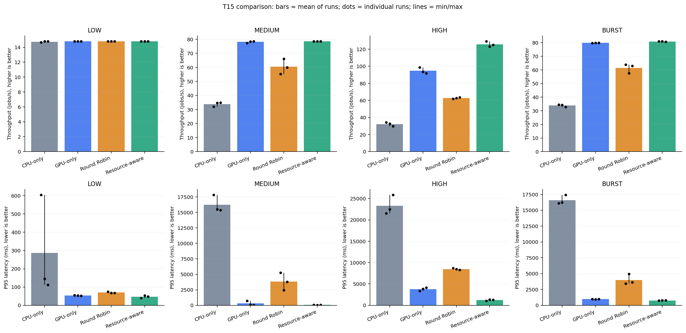

# T15–T16: triển khai và kết quả benchmark ngày 01/11/2026

Experiment: `20261101T075111Z_e50d39f4`.
Thời gian: 14:51:11–15:23:39 UTC+7, khoảng 32 phút 29 giây, gồm regression,
calibration, preflight, cooldown và 48 lượt đo. Thời gian này không phải latency job.

- [Mở báo cáo HTML tự chứa biểu đồ](../logs/benchmark/20261101T075111Z_e50d39f4/report/index.html)
- [Báo cáo Markdown](../logs/benchmark/20261101T075111Z_e50d39f4/report/report.md)
- [CSV từng lượt](../logs/benchmark/20261101T075111Z_e50d39f4/results.csv)
- [CSV trung bình, min–max, độ lệch chuẩn](../logs/benchmark/20261101T075111Z_e50d39f4/report/comparison.csv)
- [So sánh ghép cặp Resource-aware với baseline](../logs/benchmark/20261101T075111Z_e50d39f4/report/paired_comparison.csv)
- [Execution theo model/device, dữ liệu mô tả gộp các lượt](../logs/benchmark/20261101T075111Z_e50d39f4/report/model_device_execution.csv)
- [Cấu hình, hash, thứ tự chạy và trạng thái](../logs/benchmark/20261101T075111Z_e50d39f4/experiment.json)

## Nghiệm thu T15 và kiểm tra dữ liệu T16

48/48 lượt PASS: bốn scheduler × bốn workload × ba lần lặp, 1.000 job/lượt.
48.000 accepted = 48.000 completed, failed=0, unfinished=0. Không loại lượt,
không chạy lại để thay lượt kém. Mỗi workload dùng lại cùng manifest/hash qua
mọi policy và lần lặp. Model mix 500 MobileNetV2 + 500 ResNet-50, xáo trộn bằng seed.

Toàn suite trước calibration: 141/141 PASS với CUDA/NVML thật, không skip;
trong đó có chín test mới cho benchmark/report. Log ở `tests.log` của experiment.
Calibration mới có 300 mẫu mỗi cặp model/device qua ba process trial riêng biệt.
Preflight xác nhận compute CUDA cho cả hai model bằng trace riêng và kiểm tra
bốn scheduler với cùng pilot. Các lượt đo chính không bật trace/live display.

Runner kiểm tra hash, job ID/nội dung/order, replay offsets, outcome và decision log.
T16 đọc lại jobs.csv, tính lại metrics và đối chiếu summary; kiểm tra cấu hình,
manifest/profile và số lần lặp. `report/analysis.json` có `status=complete`,
không có validation error. Source/model/input/profile hashes ổn định trong đợt đo.

## Điều kiện thử nghiệm

WSL2/Linux, 6 physical cores/12 logical CPUs nhìn từ OS, khoảng 7.974 MB RAM;
GTX 1650 4 GB. Batch=1, hai worker threads CPU/GPU, ORT intra-op threads=2,
warm-up=5, sampling=100 ms, cooldown=2 s. Mỗi lượt là process mới;
mọi policy vẫn nạp cả CPU/GPU và cả hai model.

Service time trung bình từ calibration (bao gồm đọc ảnh, preprocessing, transfer
khi cần, synchronous ONNX run, validation; loại prepare/warm-up):

| Model | CPU ms | GPU ms |
| --- | ---: | ---: |
| MobileNetV2 | 12,084 | 8,665 |
| ResNet-50 | 52,025 | 13,843 |

Rate mục tiêu low/medium/high lần lượt 15,599 / 75,529 / 150,068 job/s.
Burst 100 job/đợt, gap khoảng 1,281 s. Arrival span lần lượt
67,514 / 12,698 / 6,605 / 11,533 s. Rate hữu hạn thực tế có thể khác mục tiêu
vì lịch Poisson và số job; manifest là nguồn lịch phát chính xác.

## Kết quả chính

Mỗi ô là trung bình ba lượt. P95 là trung bình P95 riêng từng lượt,
không phải P95 của dữ liệu gộp. Dùng dấu chấm thập phân trong hai bảng này.

| Workload | CPU-only P95 ms | GPU-only P95 ms | Round Robin P95 ms | Resource-aware P95 ms |
| --- | ---: | ---: | ---: | ---: |
| Low | 287.38 | 53.92 | 69.84 | 46.97 |
| Medium | 16238.98 | 301.22 | 3838.69 | 51.82 |
| High | 23279.89 | 3759.50 | 8489.99 | 1226.30 |
| Burst | 16585.46 | 969.56 | 3995.68 | 762.79 |

| Workload | CPU-only job/s | GPU-only job/s | Round Robin job/s | Resource-aware job/s |
| --- | ---: | ---: | ---: | ---: |
| Low | 14.75 | 14.81 | 14.80 | 14.81 |
| Medium | 33.85 | 78.12 | 60.45 | 78.58 |
| High | 32.21 | 94.68 | 62.73 | 125.79 |
| Burst | 33.86 | 79.78 | 61.46 | 80.87 |



## Giải thích từ dữ liệu

**High-load là trường hợp thể hiện lợi ích phối hợp CPU/GPU rõ nhất trong đợt này.**
Resource-aware đạt 125,79 job/s so với GPU-only 94,68 job/s. So sánh ghép theo
lần lặp cho throughput tăng trung bình 32,91%, P95 giảm 67,41%; ba lần đều có
P95 thấp hơn GPU-only, mức giảm 65,41–68,60%.

Lợi ích chủ yếu nằm ở giảm queue waiting. Ở high-load, device queue wait trung bình
giảm từ 2.243,67 ms (GPU-only) xuống 707,59 ms (Resource-aware), trong khi execution
trung bình tăng từ 10,54 lên 15,76 ms. Điều này cho thấy chọn thiết bị chạy từng job
nhanh nhất không đồng nghĩa với toàn workload hoàn thành sớm nhất.

Resource-aware high-load gán 1.268/3.000 job cho CPU (42,27%). Trong 1.500 MobileNetV2,
1.106 job chạy CPU (73,73%); trong 1.500 ResNet-50, 1.338 job chạy GPU (89,20%).
Đây là phân công quan sát được phù hợp với chênh lệch service time model/device;
không phải quy tắc gán model cố định trong scheduler.

**Round Robin chia đều số lượng nhưng queue CPU có thể thành nút thắt.**
Ở high-load, throughput trung bình 62,73 job/s, P95 8.489,99 ms. Timeline mẫu cho
thấy CPU queue còn backlog trong khi GPU queue nhỏ. Resource-aware dùng ETA để
giảm sự mất cân đối về lượng công việc; không chỉ cân bằng số job.

**Low-load không mang lại lợi ích throughput đáng kể so với GPU-only.**
Cả hai khoảng 14,81 job/s vì tốc độ hoàn thành bị giới hạn bởi lịch arrival.
Resource-aware giảm P95 ghép cặp trung bình 12,65%, nhưng overhead điều phối trung
bình 0,151 ms/job, cao hơn GPU-only 0,129 ms/job. Vì vậy, nếu chỉ cần throughput
ở mức tải này, dữ liệu chưa tạo lý do hiệu năng mạnh để tăng độ phức tạp scheduler.

**Medium/burst cải thiện latency nhiều hơn throughput.**
Medium: Resource-aware P95 51,82 ms, GPU-only 301,22 ms; throughput gần nhau.
GPU-only medium biến động đáng kể: P95 ba lượt trong khoảng 80,78–715,24 ms,
trong khi Resource-aware 46,58–59,12 ms. Cần xem các chấm đo và độ biến động,
không diễn giải riêng một giá trị trung bình.

Burst: Resource-aware P95 762,79 ms so với GPU-only 969,56 ms; giảm P95 ghép cặp
21,31%, nhưng throughput chỉ tăng 1,36%. Queue được chia cho cả hai worker,
giảm thời gian chờ trong từng đợt.

**Chi phí của Resource-aware tăng khi backlog lớn.**
High-load: overhead trung bình 0,172 ms/job so với GPU-only 0,097 ms/job,
chênh khoảng 0,075 ms/job. Thuật toán cộng service time của các queued job nên
chi phí tăng theo queue; đây là giải thích từ implementation, không phải bằng
chứng độ phức tạp tiệm cận chỉ từ bốn workload.

Phần trăm trong paired_comparison.csv là trung bình phần trăm ghép theo từng
repeat, khác phép lấy phần trăm từ hai giá trị trung bình. Ví dụ medium giảm
P95 ghép cặp 62,28%; không dùng con số này như tỷ lệ trực tiếp của 51,82/301,22.

## Giới hạn khi đánh giá

- Resource-aware giữ nguyên implementation ETA hiện có: chưa có admission theo
  RAM/VRAM hoặc điều chỉnh trực tiếp theo CPU load; snapshot cũ bỏ running-state
  khỏi ETA. Kết quả không nghiệm thu đầy đủ chính sách bộ nhớ T13.
- CPU-only vẫn nạp GPU sessions, nên bảng VRAM chưa đại diện triển khai chỉ có CPU.
  VRAM toàn GPU có thể gồm ứng dụng khác; không kết luận tiết kiệm bộ nhớ từ chênh
  lệch nhỏ giữa các policy. Max tài nguyên là observed maximum theo sampling.
- Nhiệt độ GPU ghi trước/sau các lượt là 55,5–71,1 °C; có đổi thứ tự/cooldown,
  chưa khóa nhiệt độ/xung hoặc cô lập tuyệt đối tác vụ nền Windows/WSL.
- Max replay jitter lớn nhất 85,23 ms, thuộc low CPU-only lần 1. Giữ lượt này
  trong báo cáo; chưa đủ bằng chứng quy nguyên nhân cho một thành phần cụ thể.
  Jitter P95 trung bình các nhóm dưới 1 ms cho low/medium/high, khoảng 3,77–4,39 ms
  cho burst. Latency bắt đầu tại arrival thực tế, jitter được báo riêng.
- Một máy, một ảnh mẫu, một tỷ lệ model, một manifest/seed mỗi workload, ba lần
  lặp; không khẳng định ý nghĩa thống kê, độ ổn định tail dài hạn hoặc tính khái quát
  cho mọi Edge AI. Queue/timeline/ECDF dùng lượt đại diện theo median P95 đã công khai.

## Phần triển khai mới và cách tái chạy

- `src/edge_scheduler/benchmark.py`: runner, calibration, manifest, preflight,
  lịch chạy, process timeout, validation và audit metadata.
- `src/edge_scheduler/benchmark_report.py`: đọc lại raw artifact, tổng hợp,
  paired comparison, tám PNG, Markdown và HTML nhúng ảnh.
- Makefile có `benchmark`, `benchmark-report`; `make report RUN=...` nhận benchmark.
- `tests/test_benchmark.py`: chín kiểm thử, gồm tampered CSV/summary, missing repeats,
  unavailable metrics và dừng child khi hard timeout.
- Hướng dẫn tại [BENCHMARK.md](../BENCHMARK.md).

```bash
make benchmark ARGS="--require-gpu-metrics --verify-tests"
make benchmark-report RUN=logs/benchmark/20261101T075111Z_e50d39f4
```

T15 và T16 đã có deliverable cho ma trận/thử nghiệm này. Bước tiếp theo phù hợp là
hoàn thiện T13 về tài nguyên và freshness, sau đó kiểm tra thêm seed/tỷ lệ model
hoặc workload dài hơn. T17 có thể dùng bộ hình và số liệu này để viết báo cáo/demo.
